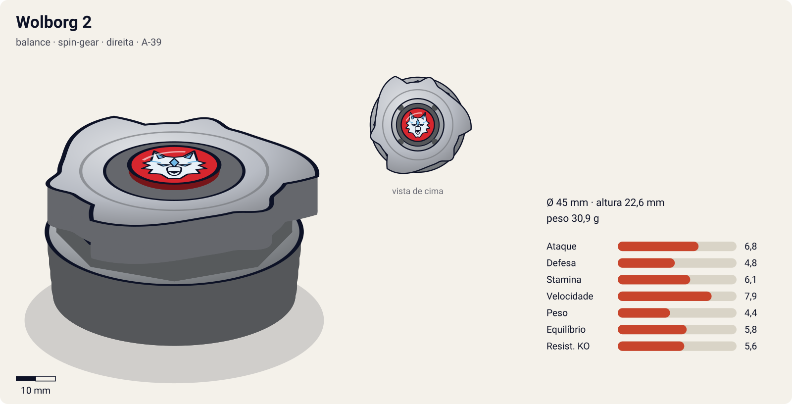
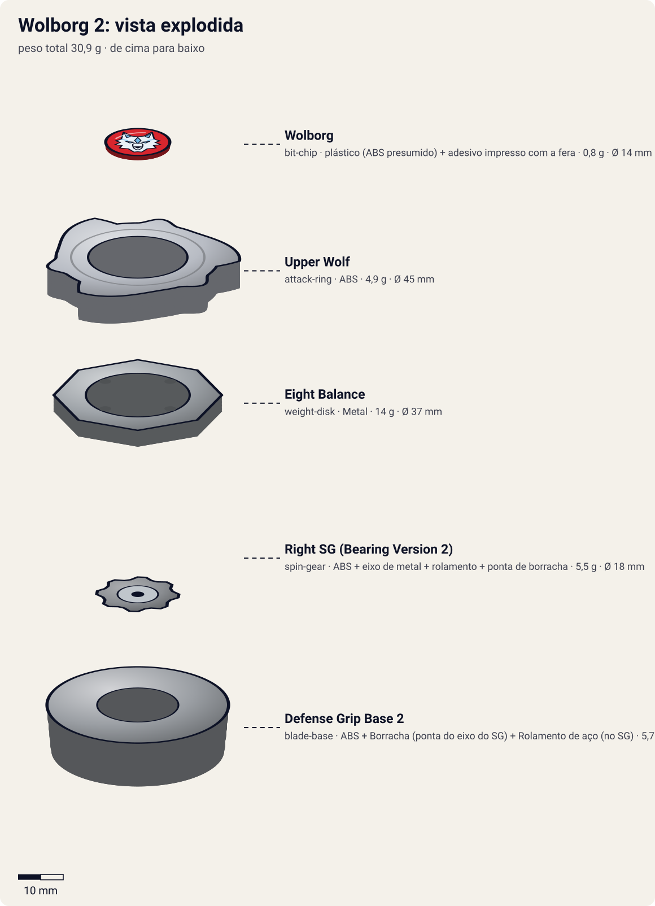

# Wolborg 2 (ウルボーグ2 / Urubōgu 2)

<!-- auto:inicio (gerado por npm run build:research; não edite este bloco) -->

| Ficha | |
|---|---|
| Dono | [Tala (Yuriy Ivanov / ユーリ・イヴァノーフ)](../../README.md) |
| Tipo · sistema · rotação | balance · spin-gear · direita |
| Código do produto | A-39 |
| Montada | Ø 45 mm · altura 22,6 mm · **30,9 g** (soma das peças) |
| Fera bit | [Wolborg](../../../../feras-bit/wolborg/) |
| Lançador | [EZ Shooter (Easy Shooter, rotação direita)](../../../../lancadores/ez-shooter/) |
| Ripcord | [winder-padrao](../../../../lancadores/ripcords/winder-padrao/) |

### Peças

| Camada | Peça | Material | Ø mm | Altura mm | Peso g | Estrelas Takara (A / D / S) | Desenho |
|---|---|---|---|---|---|---|---|
| Bit Chip | [Wolborg](../../../../pecas/bit-chip/wolborg/) | plástico (ABS presumido) + adesivo impresso com a fera | 14 estimado | 8 estimado | 0,8 comunidade | — | [ver](pecas/bit-chip.svg) |
| Attack Ring | [Upper Wolf](../../../../pecas/attack-ring/upper-wolf/) | ABS | 45 estimado | 6 estimado | 4,9 wiki | 3 / 1 / 1 | [ver](pecas/attack-ring.svg) |
| Weight Disk | [Eight Balance](../../../../pecas/weight-disk/eight-balance/) | Metal | 37 estimado | 3,6 estimado | 14 wiki | 0,5 / 2 / 2,5 | [ver](pecas/weight-disk.svg) |
| Spin Gear / Core | [Right SG (Bearing Version 2)](../../../../pecas/spin-gear/right-sg-bearing-version-2/) | ABS + eixo de metal + rolamento + ponta de borracha | 18 estimado | 16 estimado | 5,5 wiki | — | [ver](pecas/spin-gear.svg) |
| Blade Base | [Defense Grip Base 2](../../../../pecas/blade-base/defense-grip-base-2/) | ABS + Borracha (ponta do eixo do SG) + Rolamento de aço (no SG) | 42 estimado | 13 estimado | 5,7 wiki | 3 / 2 / 1 | [ver](pecas/blade-base.svg) |

Fonte de cada medida em subscrito (wiki, comunidade, estimado). Detalhes em cada ficha de peça.

### Atributos

| Atributo | Brinquedo (calculado) | Ajuste anime | Jogo |
|---|---|---|---|
| Ataque | 5,8 | +1 | **6,8** |
| Defesa | 3,8 | +1 | **4,8** |
| Stamina | 4,1 | +2 | **6,1** |
| Velocidade | 7,9 | — | **7,9** |
| Peso | 4,4 | — | **4,4** |
| Equilíbrio | 5,8 | — | **5,8** |
| Resistência a KO | 5,6 | — | **5,6** |

Calculado por `src/beyblade/stats.js` a partir de: ponta grip (atrito 0,9), contato smash (recoil 0,6), peso do WD na equilibrado. Modelo em [docs/BEYBLADES.md](../../../../../docs/BEYBLADES.md).

### Fera bit em cima da bey

 

Sons: [invocacao](../../../../feras-bit/wolborg/sons/invocacao.wav) · [rugido](../../../../feras-bit/wolborg/sons/rugido.wav) · [ataque](../../../../feras-bit/wolborg/sons/ataque.wav). Animações: [invocação](../../../../feras-bit/wolborg/invocacao.svg) · [ataque](../../../../feras-bit/wolborg/ataque.svg).

Fotos de referência (terceiros, só para estudo)

[anime.jpg](referencia/anime.jpg) · [imagem-frente.jpg](referencia/imagem-frente.jpg) · [imagem.jpg](referencia/imagem.jpg) · [pecas-bit-chip.png](referencia/pecas-bit-chip.png) · [pecas-blade-base.jpg](referencia/pecas-blade-base.jpg) · [pecas-pecas-separadas.jpg](referencia/pecas-pecas-separadas.jpg) · [pecas-spin-gear-aberto.jpg](referencia/pecas-spin-gear-aberto.jpg) · [pecas-spin-gear.jpg](referencia/pecas-spin-gear.jpg)

<!-- auto:fim -->

Outras imagens: [imagem-frente.jpg](referencia/imagem-frente.jpg) (foto real do brinquedo), [anime.jpg](referencia/anime.jpg) (fera bit Wolborg no anime).

| Campo | Valor |
|---|---|
| Dono | Tala (Yuriy Ivanov) |
| Código do produto | A-39 (Takara, 780¥); lançada também pela Hasbro |
| Tipo | Balance (classificação oficial Takara). No anime age como Stamina/Endurance |
| Sistema | Spin Gear System (SG com rolamento) |
| Fera Bit (Bit-Beast) | Wolborg, lobo prateado de gelo (銀狼), fera bit artificial da Abadia Balkov |
| Série / temporada | Bakuten Shoot (2001); reaparece em G-Revolution (2003) ep. 7 |
| Primeira aparição (anime) | S1 ep. 42 "Drawn to the Darkness" (flashback); 1ª batalha ep. 43 "Live and Let Kai!" vs. Eddy |
| Antecessora → Sucessora | Wolborg (A-11, só mangá/brinquedo) → [Wolborg 4](../wolborg-4/) (anime/mangá). No brinquedo a sucessora é Wolborg 03 |

## Formato e geometria
- Silhueta de cima: 3 lâminas curvas (cabeças de lobo) em simetria trilateral, com "asas" inclinadas atrás de cada cabeça; aparência de cata-vento.
- Peso: AR leve + WD de 8 lados médio + base com massa na periferia → inércia razoável e boa estabilidade no fim do giro.
- Perfil lateral **alto** por causa do eixo com rolamento: fácil de ser atingida por baixo (upper attack).
- Raio: médio (AR de diâmetro padrão da era plástica).

Análise das peças:
- [Upper Wolf](../../../../pecas/attack-ring/upper-wolf/): 3 cabeças de lobo com projeções inclinadas (slopes), espaçamento parecido com o Triple Wing (Trygle); 4,9 g (molde 1) / 5,2 g (molde 2, Hasbro reforçado). Apesar do nome, os slopes são curtos demais para upper útil: faz smash fraco e gera muito **recoil** (contatos apontados para fora). Ineficaz em rotação esquerda.
- [Eight Balance](../../../../pecas/weight-disk/eight-balance/) (14 g): octogonal, peso entre Wide e Heavy; serve a defesa e stamina sem destaque.
- [Right SG (Bearing Version 2)](../../../../pecas/spin-gear/right-sg-bearing-version-2/) (5,5 g): eixo apoiado em **rolamento** com **ponta de borracha**, eixo alto. A bey gira em volta do eixo enquanto o eixo quase não gira: a borracha "ancora" a bey (defesa enorme) sem destruir a stamina. Desvantagens: a altura expõe a upper e a borracha gasta com o uso.
- [Defense Grip Base 2](../../../../pecas/blade-base/defense-grip-base-2/) (5,7 g): redonda, peso na periferia, seção do eixo curta. Excelente **Life After Death** (só perde para a Spiral Change Base).

Fotos das peças (terceiros): [peças separadas](referencia/pecas-pecas-separadas.jpg), [SG](referencia/pecas-spin-gear.jpg), [SG aberto](referencia/pecas-spin-gear-aberto.jpg) (interior com rolamento), [base](referencia/pecas-blade-base.jpg), [bit chip](referencia/pecas-bit-chip.png).

## Comportamento na arena
- **Movimento**: fica quase parada no centro (a ponta de borracha sobre rolamento ancora a bey), com pequenas derivas; não faz flower agressivo.
- **Ataque**: fraco; os contatos geram recoil que afasta as duas beys mais do que causa dano.
- **Defesa**: boa contra empurrões frontais (a borracha agarra o piso), ruim contra upper por baixo.
- **Stamina**: muito alta para a era plástica graças ao rolamento + LAD da base.
- **Pontos fortes**: sobreviver; resistir a empurrões; virar o jogo no fim quando o adversário perde rotação.
- **Pontos fracos**: upper attackers (Driger V2, Dragoon F), stamina de rotação esquerda; desgaste da borracha.
- **Matchups**: vence atacantes de smash leves que se cansam; perde para upper attack e para stamina customs de rotação contrária bem montados.
- **Gimmick**: eixo com rolamento + ponta de borracha (combinação rara e muito valorizada na geração plástica).

## No anime
- **Especiais**:
  - **Blizzalog** (EN; JP: ブリザローグ / Blizzarōgu é o especial da Wolborg 1 no mangá): na final do Mundial (eps. 50–51) cria uma nevasca gigante que prende Tala, Tyson, as beys e o estádio numa cúpula de gelo/iceberg; o frio reduz a concentração e a resistência do adversário até Tala finalizar.
  - Na Wikipedia JP (tabela do mangá) o especial de Wolborg 2 é **闘神氷弾 (Vainarōgu / "Vaina Rog")**. Nome exato usado no anime JP: **não confirmado**.
  - Na final, Tala usa as feras bit roubadas (Dranzer, Draciel, All Starz, White Tigers) através de Wolborg 2, e congela Dragoon/青龍.
- **Batalhas**: ep. 43 vence Eddy (Trypio) num golpe; eps. 50–51 contra Tyson (Dragoon F → Dragoon V): perde a 1ª rodada, vence a 2ª dentro do iceberg, perde a 3ª quando Dragoon quebra o iceberg; G-Rev ep. 7 vence Spencer (Seaborg 2) na seletiva russa.
- **Substituição**: a partir de G-Rev ep. 13 Tala usa Wolborg 4 (Engine Gear).

## Mecânica no jogo
- **Movimento (IA)**: "centro fixo": busca o centro e fica com deriva lenta (raio ≤ 10% do estádio). Não persegue; só reage quando o adversário se aproxima.
- **Gimmick (rolamento + borracha)**: a ponta tem atrito alto com o piso (resiste a empurrão: −25% de knockback frontal), mas a perda de RPM por atrito é a de uma ponta de rolamento (−40% em relação a uma grip comum). Golpes vindos de baixo (upper) ignoram esse bônus. Abaixo de 15% de RPM, LAD: a bey continua girando inclinada por mais 3 s.
- **Especial**: *Blizzalog*. Campo de gelo de 6 s no estádio todo: o adversário perde 25% de atrito/controle e 2% de RPM/s a mais; custo 100 de energia, recarga 25 s. Visual: pilar de gelo da [invocação de Wolborg](../../../../feras-bit/wolborg/invocacao.svg) e névoa gelada do [ataque](../../../../feras-bit/wolborg/ataque.svg) cobrindo a arena como uma cúpula.
- **Modo chefe (final do Mundial, opcional)**: Tala pode usar uma vez por luta uma fera roubada (efeito visual de outra fera, +20% no próximo especial).
- **Física**: massa relativa 0,95; raio 1,0; atrito da ponta 0,75 (borracha), com perda de rotação baixa (rolamento); restituição 0,65 (recoil alto do AR).

## Ajuste do anime

| Atributo | Delta | Justificativa (episódio/batalha) |
|---|---|---|
| Stamina | +2 | Vence por desgaste dentro do iceberg do Blizzalog (2ª rodada da final, S1 ep. 51) e derruba Eddy num golpe (ep. 43). |
| Defesa | +1 | A ponta de borracha ancorada segura Dragoon até ele quebrar o iceberg (eps. 50–51). |
| Ataque | +1 | Na final, Tala lança o poder das feras roubadas através de Wolborg 2 e congela Dragoon; vence Spencer (G-Rev ep. 7). |

Resultado esperado: chefe da S1, forte em stamina e controle; perde 1–2 para Dragoon V na final do Mundial, que quebra o gelo no ataque.

Nota para o coordenador: o brinquedo calculado tem Velocidade 7,9 porque a ponta conta como `grip` (atrito 0,75). Na prática o rolamento deixa a bey quase parada no centro; o modelo não parece separar "borracha sobre rolamento" de grip comum (o eixo livre também não entra na stamina, 6,5).

## Fontes
- https://beyblade.fandom.com/wiki/Wolborg_2
- https://beyblade.fandom.com/wiki/Attack_Ring_-_Upper_Wolf
- https://beyblade.fandom.com/wiki/Weight_Disk_-_Eight_Balance
- https://beyblade.fandom.com/wiki/Spin_Gear_-_Right_SG_(Bearing_Version_2)
- https://beyblade.fandom.com/wiki/Blade_Base_-_Defense_Grip_2
- https://beyblade.fandom.com/wiki/Bit_Chip_-_Wolborg
- https://beyblade.fandom.com/wiki/Blizzalog
- https://beyblade.fandom.com/wiki/Beyblade_-_Episode_43 , _50, _51; https://beyblade.fandom.com/wiki/Beyblade:_G-Revolution_-_Episode_07
- https://ja.wikipedia.org/wiki/爆転シュート_ベイブレード_(漫画) (tabela de especiais)
