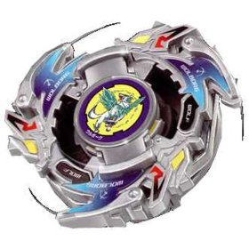

# Wolborg 2 (ウルボーグ2 / Urubōgu 2)

Outras imagens: [imagem-frente.jpg](imagem-frente.jpg) (foto real do brinquedo), [anime.jpg](anime.jpg) (fera bit Wolborg no anime).

| Campo | Valor |
|---|---|
| Dono | Tala (Yuriy Ivanov) |
| Código do produto | A-39 (Takara, 780¥); lançada também pela Hasbro |
| Tipo | Balance (classificação oficial Takara). No anime age como Stamina/Endurance |
| Sistema | Spin Gear System (SG com rolamento) |
| Rotação | Direita |
| Fera Bit (Bit-Beast) | Wolborg — lobo prateado de gelo (銀狼), fera bit artificial da Abadia Balkov |
| Série / temporada | Bakuten Shoot (2001); reaparece em G-Revolution (2003) ep. 7 |
| Primeira aparição (anime) | S1 ep. 42 "Drawn to the Darkness" (flashback); 1ª batalha ep. 43 "Live and Let Kai!" vs. Eddy |
| Antecessora → Sucessora | Wolborg (A-11, só mangá/brinquedo) → Wolborg 4 (anime/mangá). No brinquedo a sucessora é Wolborg 03 |

## 1. Peças (de cima para baixo)

| Camada | Peça | Descrição física | Função em batalha |
|---|---|---|---|
| Bit Chip | Wolborg | Chip com o lobo Wolborg (elemento gelo) | identidade / fera bit |
| Attack Ring (AR) | Upper Wolf | 3 cabeças de lobo com projeções inclinadas (slopes), espaçamento parecido com Triple Wing (Trygle). 4,9 g (molde 1) / 5,2 g (molde 2, Hasbro reforçado) | Apesar do nome, os slopes são curtos demais para Upper Attack útil; faz Smash fraco e gera muito **recoil** (pontos de contato apontados para fora). Ineficaz em rotação esquerda |
| Weight Disk (WD) | Eight Balance | Octogonal, 14 g, peso intermediário entre Wide e Heavy | Distribuição equilibrada; serve a defesa e stamina, sem destaque |
| Spin Gear (SG) | Right SG (Bearing Version 2) | SG de rotação direita com **eixo apoiado em rolamento** e **ponta de borracha**; 5,5 g. Eixo alto | A bey gira em volta do eixo enquanto o eixo quase não gira: a borracha "ancora" a bey (defesa enorme) sem destruir a stamina. Desvantagem: altura → vulnerável a Upper Attack; a borracha gasta com o uso |
| Support Part / Sub Ring | — | não tem | — |
| Blade Base (BB) | Defense Grip Base 2 | Base redonda, peso distribuído na periferia; 5,7 g; seção do eixo curta | Excelente **Life After Death** (só perde para Spiral Change Base); ótima sobrevivência quando a rotação está no fim |

Fotos das peças: [pecas/pecas-separadas.jpg](pecas/pecas-separadas.jpg) (BB+SG, WD, AR+chip), [pecas/spin-gear.jpg](pecas/spin-gear.jpg), [pecas/spin-gear-aberto.jpg](pecas/spin-gear-aberto.jpg) (interior com rolamento), [pecas/blade-base.jpg](pecas/blade-base.jpg) (vista de baixo), [pecas/bit-chip.png](pecas/bit-chip.png).

## 2. Formato e geometria
- Silhueta de cima: 3 lâminas curvas (cabeças de lobo) em simetria trilateral, com "asas" inclinadas atrás de cada cabeça; aparência de cata-vento.
- Peso: AR leve + WD de 8 lados médio + base com massa na periferia → inércia razoável e boa estabilidade no final do giro.
- Perfil lateral **alto** por causa do eixo com rolamento: fácil de ser atingida por baixo (upper attack).
- Raio: médio (AR de diâmetro padrão da era plástica).

## 3. Comportamento na arena
- **Movimento**: tende a ficar quase parada no centro (ponta de borracha sobre rolamento ancora a bey), com pequenas derivas; não é um flower pattern agressivo.
- **Ataque**: fraco; contatos geram recoil que afastam as duas beys mais do que causam dano.
- **Defesa**: boa contra empurrões frontais (a borracha agarra o piso), ruim contra upper attack por baixo.
- **Stamina**: muito alta para a era plástica graças ao rolamento + Life After Death da base (a âncora "Stamina 10" do brief).
- **Pontos fortes**: sobreviver; resistir a empurrões; virar o jogo no final quando o adversário perde rotação.
- **Pontos fracos**: upper attackers (Driger V2, Dragoon F), adversários de stamina em rotação esquerda; desgaste da borracha.
- **Matchups**: vence attackers de smash leves que se cansam; perde para upper attack e para stamina-customs de rotação contrária bem montados.
- **Gimmick**: eixo com rolamento + ponta de borracha (combinação rara e muito valorizada na geração plástica).

## 4. No anime
- **Especiais**:
  - **Blizzalog** (EN; JP: ブリザローグ / Blizzarōgu é o especial da Wolborg 1 no mangá) — na final do Mundial (eps. 50–51) cria uma nevasca gigante que prende Tala, Tyson, as beys e o estádio numa cúpula de gelo/iceberg; o frio reduz a concentração e a resistência do adversário até Tala finalizar.
  - Na Wikipedia JP (tabela do mangá) o especial de Wolborg 2 é **闘神氷弾 (Vainarōgu / "Vaina Rog")**. Nome exato usado no anime JP: **não confirmado**.
  - Na final, Tala usa as feras bit roubadas (Dranzer, Draciel, All Starz, White Tigers) através de Wolborg 2, e congela Dragoon/青龍.
- **Batalhas**: ep. 43 vence Eddy (Trypio) num golpe; eps. 50–51 contra Tyson (Dragoon F → Dragoon V) — perde a 1ª rodada, vence a 2ª dentro do iceberg, perde a 3ª quando Dragoon quebra o iceberg; G-Rev ep. 7 vence Spencer (Seaborg 2) na seletiva russa.
- **Substituição**: a partir de G-Rev ep. 13 Tala passa a usar Wolborg 4 (Engine Gear).

## 5. Tradução para o jogo
Valores 1–10 (ver `pesquisa-bakuten/_template/BRIEF-AGENTES.md` → "Escala de atributos").

| Atributo | Valor | Justificativa |
|---|---|---|
| Ataque | 4 | Upper Wolf é fraco (recoil alto, slopes curtos); no anime o dano vem do especial, não do contato |
| Defesa | 6 | Ponta de borracha ancorada dá ótima resistência a empurrões, mas o perfil alto expõe a upper attack |
| Stamina | 10 | Âncora do brief; rolamento + Defense Grip Base 2 (Life After Death excelente); no anime ganha por desgaste |
| Velocidade | 3 | Fica parada no centro; quase não se desloca |
| Peso | 5 | Combo plástico padrão (AR ~5 g + WD 14 g + SG 5,5 g + BB 5,7 g + chip) — estimativa |
| Equilíbrio | 8 | Massa periférica e rolamento estabilizam; pouco wobble até o fim |
| Burst/Knockout-resist | 7 | Borracha agarra o piso; perde pontos contra golpes por baixo |

- **Movimento em IA**: "centro fixo" — busca o centro e fica com deriva lenta (raio ≤ 10% do estádio). Não persegue o adversário; reage apenas quando ele se aproxima.
- **Especiais (no jogo)**:
  - *Blizzalog* — cria campo de gelo por 6 s: adversário perde 25% de atrito/controle e 2%/s de rotação extra; custo 100, cooldown 25 s.
- **Física sugerida**: massa relativa 0,95; raio relativo 1,0; atrito da ponta 0,75 (borracha) mas com perda de rotação baixa (rolamento); restituição 0,65 (recoil alto do AR).

Os mesmos dados ficam em `dados.json`.

## 6. Fontes
- https://beyblade.fandom.com/wiki/Wolborg_2
- https://beyblade.fandom.com/wiki/Attack_Ring_-_Upper_Wolf
- https://beyblade.fandom.com/wiki/Weight_Disk_-_Eight_Balance
- https://beyblade.fandom.com/wiki/Spin_Gear_-_Right_SG_(Bearing_Version_2)
- https://beyblade.fandom.com/wiki/Blade_Base_-_Defense_Grip_2
- https://beyblade.fandom.com/wiki/Bit_Chip_-_Wolborg
- https://beyblade.fandom.com/wiki/Blizzalog
- https://beyblade.fandom.com/wiki/Beyblade_-_Episode_43 , _50, _51; https://beyblade.fandom.com/wiki/Beyblade:_G-Revolution_-_Episode_07
- https://ja.wikipedia.org/wiki/爆転シュート_ベイブレード_(漫画) (tabela de especiais)
