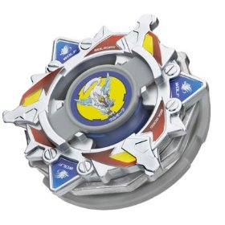

# Wolborg 4 (ウルボーグ4 / Urubōgu 4)

Outras imagens: [imagem-topo.jpg](imagem-topo.jpg) (foto real, vista de cima), [anime.jpg](anime.jpg) (Wolborg 4 no anime, G-Rev ep. 14), [anime-novae-rog.png](anime-novae-rog.png) (Novae Rog).

| Campo | Valor |
|---|---|
| Dono | Tala (Yuriy Ivanov) |
| Código do produto | A-100 (Takara, julho de 2003); Hasbro 2004. Nome de desenvolvimento Takara: "Wolborg 3" |
| Tipo | Stamina (Endurance) |
| Sistema | Engine Gear System |
| Rotação | Direita (o Engine Gear Circle Survivor só gira para a direita) |
| Fera Bit (Bit-Beast) | Wolborg — lobo prateado de gelo; nos especiais às vezes aparece como *Yuki-onna* (mulher das neves) |
| Série / temporada | G-Revolution (2003) |
| Primeira aparição (anime) | G-Rev ep. 13 "Kenny's Big Battle" |
| Antecessora → Sucessora | Wolborg 2 → nenhuma no anime (destruída por Garland no ep. 36). No mangá: Wolborg MS; no brinquedo: Wolborg MS (Metal Survive) |

## 1. Peças (de cima para baixo)

| Camada | Peça | Descrição física | Função em batalha |
|---|---|---|---|
| Bit Chip | Wolborg | Chip com o lobo (elemento gelo) | identidade / fera bit |
| Attack Ring (AR) | Star Wolf | Estrela de 6 pontas: 3 cabeças de lobo (com "focinho" entalhado) + 3 triângulos menores com parafusos decorativos; 5 g | Smash moderado nas duas rotações, mas com **recoil** sério (pontos de contato mal definidos). Ruim para defesa/stamina pura |
| Weight Disk (WD) | Ten Wide | Disco Wide de 10 lados, 14 g, o mais largo da série Wide | Massa na periferia → mais inércia, melhor stamina |
| Spin Gear / Core | Right EG (Circle Survivor) | Engine Gear (7 g) + CEW de **plástico em forma de tigela** (5 g; total 12 g). A tigela gira livre e cobre quase toda a base; ponta parecida com as pontas "D" (Defense, larga/arredondada) | Golpes de beys mais baixas batem na tigela livre: ela absorve o choque (como sub-ring livre) contra rotação esquerda e **carrega o Engine Gear** contra rotação direita. Excelente defesa/sobrevivência, ótimo Life After Death, forte contra zombies |
| Support Part / Sub Ring | — | não tem | — |
| Blade Base (BB) | Normal Base (Wolborg 4 Version) | Base quase lisa e circular, 5 g, sem gimmick de mola; dois clipes seguram o EG e um furo central deixa passar os pinos do CEW | Estrutural; mais baixa e leve que a Normal Base do Rock Bison |

Fotos das peças: [pecas/attack-ring.jpg](pecas/attack-ring.jpg), [pecas/weight-disk.jpg](pecas/weight-disk.jpg), [pecas/engine-gear.jpg](pecas/engine-gear.jpg) (EG azul + CEW Circle Survivor), [pecas/blade-base.jpg](pecas/blade-base.jpg), [pecas/blade-base-2.jpg](pecas/blade-base-2.jpg), [pecas/bit-chip.png](pecas/bit-chip.png).

## 2. Formato e geometria
- Silhueta de cima: estrela de 6 pontas com simetria trilateral (3 lobos grandes + 3 pontas pequenas). Contorno serrilhado → muitos pontos de contato, porém irregulares.
- Peso concentrado na periferia (Ten Wide) + massa central do Engine Gear → bastante inércia.
- Perfil **alto** (típico do Engine Gear); a tigela do CEW fica embaixo e protege a base: attackers baixos e upper attack batem na tigela, não no AR.

## 3. Comportamento na arena
- **Movimento**: fica no centro com pouca deriva (ponta larga tipo "D"); estável.
- **Ataque**: moderado com recoil; o dano real vem do especial.
- **Defesa**: alta contra beys baixas e upper attack (tigela livre absorve o impacto).
- **Stamina**: muito alta; LAD excelente; o EG pode ser "recarregado" pelos golpes de beys de rotação direita.
- **Pontos fortes**: vencer por resistência (como contra Lee, G-Rev ep. 22); neutralizar ataques baixos.
- **Pontos fracos**: beys de stamina em **rotação direita** (mesma rotação); no anime, **fica vulnerável logo após o Novae Rog** — Wolborg salta para atacar e, se errar, fica no ar sem defesa (Kenny descobre isso e Daichi explora no ep. 14).
- **Matchups**: vence Hopper (Kenny), Galeon 2 (Lee), Rushing Boar (Aaron); perde para Strata Dragoon (Daichi) quando ele foge e contra-ataca, e para Rock Bison (Rick).
- **Gimmick**: Engine Gear (motor de corda que libera rotação extra) + CEW de plástico livre.

## 4. No anime
- **Especial**: **Novae Rog** (JP: 真闘神氷撃 / ノーヴァエ・ローグ, "Nōvae Rōgu") — Wolborg solta ar gelado e vapor da base, envolve a bey adversária, **congela-a** num bloco de gelo e então salta e a esmaga. Às vezes a fera aparece como Yuki-onna. Estreia em G-Rev ep. 14.
- **Batalhas marcantes**:
  - ep. 13–14 vs. Kenny (Hopper) — Novae Rog estilhaça Hopper; vitória.
  - ep. 14 vs. Daichi (Strata Dragoon V) — Daichi recua (plano de Kenny), Novae Rog erra, Wolborg fica no ar e perde.
  - ep. 16 vs. Rick (Rock Bison) — derrota.
  - ep. 18 vs. Aaron (Rushing Boar) — vitória.
  - eps. 22–23 vs. Lee (Galeon 2) — vitória por desgaste.
  - ep. 28 vs. Daichi (Strata Dragoon G) — choque Novae Rog x Great Cutter, explosão, **empate**; última vez da forma Yuki-onna.
  - ep. 35 vs. BEGA Training Squad (com Bryan e Spencer) — vitória.
  - ep. 36 vs. Garland (Apollon) — estádio com barras que impedem knockout ("deathmatch"); Tala derruba Garland com Novae Rog e consegue empate, mas Wolborg 4 é destruída e Tala vai em coma.
- **Substituição**: não há sucessora no anime.

## 5. Tradução para o jogo
Valores 1–10 (ver `pesquisa-bakuten/_template/BRIEF-AGENTES.md` → "Escala de atributos").

| Atributo | Valor | Justificativa |
|---|---|---|
| Ataque | 5 | Star Wolf faz smash moderado com recoil; o Novae Rog dá o golpe forte (no jogo, via especial) |
| Defesa | 7 | CEW em tigela livre absorve ataques baixos/upper; perfil alto ainda expõe o AR a attackers altos |
| Stamina | 9 | Tipo Stamina, Ten Wide + Circle Survivor com LAD excelente; ganha por desgaste no anime |
| Velocidade | 4 | Fica no centro; ponta larga tipo "D" |
| Peso | 7 | Engine Gear + CEW (12 g) + Ten Wide (14 g) — mais pesado que combos Spin Gear (estimativa) |
| Equilíbrio | 7 | Bem estável, mas a altura do EG gera algum wobble no fim |
| Burst/Knockout-resist | 7 | Ponta larga e massa alta; no anime foi derrotada mais por especiais/estratégia que por knockout |

- **Movimento em IA**: "centro" — mantém posição central, órbita mínima; espera o adversário vir. Quando o adversário estiver lento ou encostado na parede, ativa o especial (salto + esmagamento).
- **Especiais (no jogo)**:
  - *Novae Rog* — projeta névoa de gelo num cone; se acertar, o adversário fica **congelado 1,5 s** (sem controle, atrito máximo) e recebe um golpe de smash forte (dano 2× ataque). Custo 100, cooldown 22 s. **Penalidade**: após o uso, Wolborg 4 fica 1,5 s "no ar" (defesa −50%, não pode bloquear). Se errar, a penalidade dobra.
  - *Recarga do Engine Gear* (passivo) — ao receber golpe de bey de rotação direita, ganha +3% de rotação (máx. 1×/3 s).
- **Física sugerida**: massa relativa 1,15; raio relativo 1,0; atrito da ponta 0,35 (ponta larga de plástico); restituição 0,55; altura alta (vulnerável a ARs altos, imune a upper de beys baixas pela tigela).

Os mesmos dados ficam em `dados.json`.

## 6. Fontes
- https://beyblade.fandom.com/wiki/Wolborg_4
- https://beyblade.fandom.com/wiki/Attack_Ring_-_Star_Wolf
- https://beyblade.fandom.com/wiki/Weight_Disk_-_Ten_Wide
- https://beyblade.fandom.com/wiki/Engine_Gear_-_Right_EG_(Circle_Survivor)
- https://beyblade.fandom.com/wiki/Blade_Base_-_Normal_Base_(Wolborg_4_Version)
- https://beyblade.fandom.com/wiki/Novae_Rog
- https://beyblade.fandom.com/wiki/Beyblade:_G-Revolution_-_Episode_13 , _14, _16; https://beyblade.fandom.com/wiki/Beyblade_G-Revolution_-_Episode_18 , _22, _28, _35, _36
- https://ja.wikipedia.org/wiki/爆転シュート_ベイブレード_(アニメ) e (漫画) (nome JP do especial)
