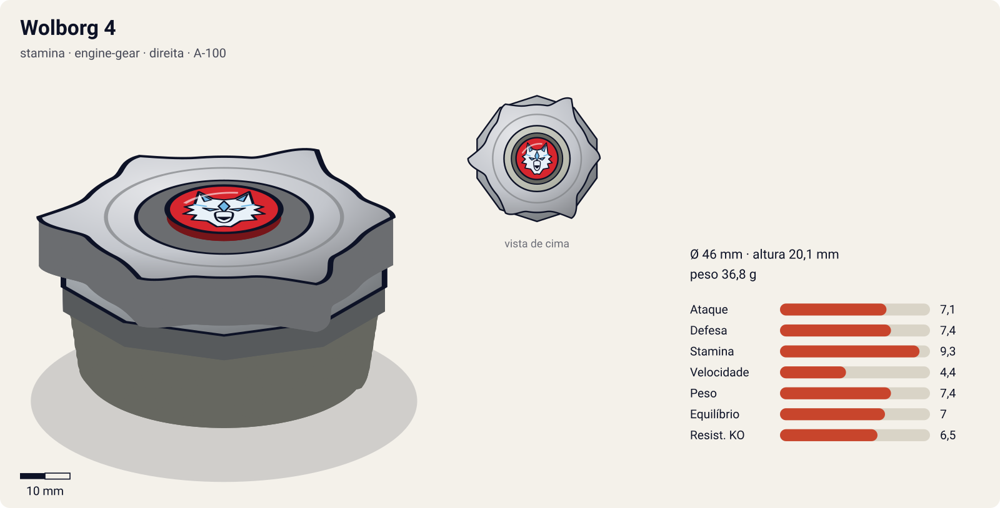
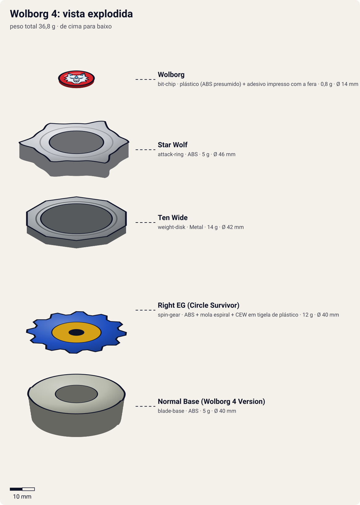

# Wolborg 4 (ウルボーグ4 / Urubōgu 4)

<!-- auto:inicio (gerado por npm run build:research; não edite este bloco) -->

| Ficha | |
|---|---|
| Dono | [Tala (Yuriy Ivanov / ユーリ・イヴァノーフ)](../../README.md) |
| Tipo · sistema · rotação | stamina · engine-gear · direita |
| Código do produto | A-100 |
| Montada | Ø 46 mm · altura 20,1 mm · **36,8 g** (soma das peças) |
| Fera bit | [Wolborg](../../../../feras-bit/wolborg/) |
| Lançador | [EZ Shooter (Easy Shooter, rotação direita)](../../../../lancadores/ez-shooter/) |
| Ripcord | [winder-padrao](../../../../lancadores/ripcords/winder-padrao/) |

### Peças

| Camada | Peça | Material | Ø mm | Altura mm | Peso g | Estrelas Takara (A / D / S) | Desenho |
|---|---|---|---|---|---|---|---|
| Bit Chip | [Wolborg](../../../../pecas/bit-chip/wolborg/) | plástico (ABS presumido) + adesivo impresso com a fera | 14 estimado | 8 estimado | 0,8 comunidade | — | [ver](pecas/bit-chip.svg) |
| Attack Ring | [Star Wolf](../../../../pecas/attack-ring/star-wolf/) | ABS | 46 estimado | 6 estimado | 5 wiki | 2 / 1 / 1 | [ver](pecas/attack-ring.svg) |
| Weight Disk | [Ten Wide](../../../../pecas/weight-disk/ten-wide/) | Metal | 42 estimado | 3,1 estimado | 14 wiki | 1 / 1,5 / 4 | [ver](pecas/weight-disk.svg) |
| Spin Gear / Core | [Right EG (Circle Survivor)](../../../../pecas/spin-gear/right-eg-circle-survivor/) | ABS + mola espiral + CEW em tigela de plástico | 40 estimado | 18 estimado | 12 wiki | 1 / 2 / 3 | [ver](pecas/spin-gear.svg) |
| Blade Base | [Normal Base (Wolborg 4 Version)](../../../../pecas/blade-base/normal-base-wolborg-4/) | ABS | 40 estimado | 11 estimado | 5 wiki | 1 / 1 / 1 | [ver](pecas/blade-base.svg) |

Fonte de cada medida em subscrito (wiki, comunidade, estimado). Detalhes em cada ficha de peça.

### Atributos

| Atributo | Brinquedo (calculado) | Ajuste anime | Jogo |
|---|---|---|---|
| Ataque | 5,1 | +2 | **7,1** |
| Defesa | 5,4 | +2 | **7,4** |
| Stamina | 7,3 | +2 | **9,3** |
| Velocidade | 4,4 | — | **4,4** |
| Peso | 7,4 | — | **7,4** |
| Equilíbrio | 7 | — | **7** |
| Resistência a KO | 6,5 | — | **6,5** |

Calculado por `src/beyblade/stats.js` a partir de: ponta ball (atrito 0,3), contato smash (recoil 0,7), peso do WD na periferia, Engine Gear (instantaneo). Modelo em [docs/BEYBLADES.md](../../../../../docs/BEYBLADES.md).

### Fera bit em cima da bey

 

Sons: [invocacao](../../../../feras-bit/wolborg/sons/invocacao.wav) · [rugido](../../../../feras-bit/wolborg/sons/rugido.wav) · [ataque](../../../../feras-bit/wolborg/sons/ataque.wav). Animações: [invocação](../../../../feras-bit/wolborg/invocacao.svg) · [ataque](../../../../feras-bit/wolborg/ataque.svg).

Fotos de referência (terceiros, só para estudo)

[anime-novae-rog.png](referencia/anime-novae-rog.png) · [anime.jpg](referencia/anime.jpg) · [imagem-topo.jpg](referencia/imagem-topo.jpg) · [imagem.jpg](referencia/imagem.jpg) · [pecas-attack-ring.jpg](referencia/pecas-attack-ring.jpg) · [pecas-bit-chip.png](referencia/pecas-bit-chip.png) · [pecas-blade-base-2.jpg](referencia/pecas-blade-base-2.jpg) · [pecas-blade-base.jpg](referencia/pecas-blade-base.jpg) · [pecas-engine-gear.jpg](referencia/pecas-engine-gear.jpg) · [pecas-weight-disk.jpg](referencia/pecas-weight-disk.jpg)

<!-- auto:fim -->

Outras imagens: [imagem-topo.jpg](referencia/imagem-topo.jpg) (foto real, vista de cima), [anime.jpg](referencia/anime.jpg) (Wolborg 4 no anime, G-Rev ep. 14), [anime-novae-rog.png](referencia/anime-novae-rog.png) (Novae Rog).

| Campo | Valor |
|---|---|
| Dono | Tala (Yuriy Ivanov) |
| Código do produto | A-100 (Takara, julho de 2003); Hasbro 2004. Nome de desenvolvimento Takara: "Wolborg 3" |
| Rotação | Direita (o Engine Gear Circle Survivor só gira para a direita) |
| Fera Bit (Bit-Beast) | Wolborg, lobo prateado de gelo; nos especiais às vezes aparece como *Yuki-onna* (mulher das neves) |
| Série / temporada | G-Revolution (2003) |
| Primeira aparição (anime) | G-Rev ep. 13 "Kenny's Big Battle" |
| Antecessora → Sucessora | [Wolborg 2](../wolborg-2/) → nenhuma no anime (destruída por Garland no ep. 36). No mangá e no brinquedo: Wolborg MS (Metal Survive) |

## Formato e geometria
- Silhueta de cima: estrela de 6 pontas com simetria trilateral (3 lobos grandes + 3 pontas pequenas). Contorno serrilhado → muitos pontos de contato, porém irregulares.
- Peso na periferia (Ten Wide) + massa central do Engine Gear → bastante inércia.
- Perfil **alto** (típico do Engine Gear); a tigela do CEW fica embaixo e protege a base: atacantes baixos e upper batem na tigela, não no AR.

Análise das peças:
- [Star Wolf](../../../../pecas/attack-ring/star-wolf/) (5 g): estrela de 6 pontas, 3 cabeças de lobo (com "focinho" entalhado) + 3 triângulos menores com parafusos decorativos. Smash moderado nas duas rotações, mas com **recoil** sério (contatos mal definidos); ruim para defesa/stamina pura.
- [Ten Wide](../../../../pecas/weight-disk/ten-wide/) (14 g): o mais largo da série Wide; massa na periferia → inércia e stamina.
- [Right EG (Circle Survivor)](../../../../pecas/spin-gear/right-eg-circle-survivor/): Engine Gear (7 g) + CEW de **plástico em forma de tigela** (5 g; total 12 g). A tigela gira livre e cobre quase toda a base; a ponta lembra as pontas "D" (Defense, larga/arredondada). Golpes de beys mais baixas batem na tigela livre: contra rotação esquerda ela absorve o choque (como um sub-ring livre); contra rotação direita, **dá corda no Engine Gear**. Excelente defesa/sobrevivência, ótimo LAD, forte contra zombies.
- [Normal Base (Wolborg 4 Version)](../../../../pecas/blade-base/normal-base-wolborg-4/) (5 g): quase lisa e circular, sem mola; dois clipes seguram o EG e um furo central deixa passar os pinos do CEW. Estrutural; mais baixa e leve que a Normal Base do Rock Bison.

Fotos das peças (terceiros): [AR](referencia/pecas-attack-ring.jpg), [WD](referencia/pecas-weight-disk.jpg), [Engine Gear + CEW](referencia/pecas-engine-gear.jpg), [base](referencia/pecas-blade-base.jpg), [base 2](referencia/pecas-blade-base-2.jpg), [bit chip](referencia/pecas-bit-chip.png).

## Comportamento na arena
- **Movimento**: fica no centro com pouca deriva (ponta larga tipo "D"); estável.
- **Ataque**: moderado, com recoil; o dano real vem do especial.
- **Defesa**: alta contra beys baixas e upper (a tigela livre absorve o impacto).
- **Stamina**: muito alta; LAD excelente; o EG pode ser "recarregado" pelos golpes de beys de rotação direita.
- **Pontos fortes**: vencer por resistência (como contra Lee, G-Rev ep. 22); neutralizar ataques baixos.
- **Pontos fracos**: beys de stamina de **rotação direita**; no anime, **fica vulnerável logo após o Novae Rog**: Wolborg salta para atacar e, se errar, fica no ar sem defesa (Kenny descobre isso e Daichi explora no ep. 14).
- **Matchups**: vence Hopper (Kenny), Galeon 2 (Lee), Rushing Boar (Aaron); perde para Strata Dragoon (Daichi) quando ele foge e contra-ataca, e para Rock Bison (Rick).
- **Gimmick**: Engine Gear (motor de corda que libera rotação extra) + CEW de plástico livre.

## No anime
- **Especial**: **Novae Rog** (JP: 真闘神氷撃 / ノーヴァエ・ローグ, "Nōvae Rōgu"): Wolborg solta ar gelado e vapor da base, envolve a bey adversária, **congela-a** num bloco de gelo e então salta e a esmaga. Às vezes a fera aparece como Yuki-onna. Estreia em G-Rev ep. 14.
- **Batalhas**:
  - ep. 13–14 vs. Kenny (Hopper): Novae Rog estilhaça Hopper; vitória.
  - ep. 14 vs. Daichi (Strata Dragoon V): Daichi recua (plano de Kenny), o Novae Rog erra, Wolborg fica no ar e perde.
  - ep. 16 vs. Rick (Rock Bison): derrota.
  - ep. 18 vs. Aaron (Rushing Boar): vitória.
  - eps. 22–23 vs. Lee (Galeon 2): vitória por desgaste.
  - ep. 28 vs. Daichi (Strata Dragoon G): choque Novae Rog x Great Cutter, explosão, **empate**; última vez da forma Yuki-onna.
  - ep. 35 vs. BEGA Training Squad (com Bryan e Spencer): vitória.
  - ep. 36 vs. Garland (Apollon): estádio com barras que impedem knockout ("deathmatch"); Tala derruba Garland com o Novae Rog e consegue o empate, mas Wolborg 4 é destruída e Tala entra em coma.
- **Substituição**: não há sucessora no anime.

## Mecânica no jogo
- **Movimento (IA)**: "centro": mantém a posição central com órbita mínima e espera o adversário. Quando ele está lento ou encostado na parede, ativa o especial (salto + esmagamento).
- **Gimmick (Engine Gear + tigela livre)**: o Engine Gear solta logo no lançamento (base sem clutch; +1 de velocidade e +0,5 de ataque conforme o modelo). A tigela livre absorve 30% do knockback de golpes vindos de baixo (upper ou beys mais baixas). Passivo de recarga: golpe de bey de rotação direita dá +3% de RPM (no máximo 1 vez a cada 3 s).
- **Especial**: *Novae Rog*. Névoa de gelo em cone; se acertar, o adversário fica **congelado 1,5 s** (sem controle, atrito máximo) e recebe um smash com dano 2× o ataque. Custo 100 de energia, recarga 22 s. **Penalidade**: depois do uso, Wolborg 4 fica 1,5 s "no ar" (defesa −50%, não bloqueia); se errar, a penalidade dobra (o ponto fraco que Daichi explora no ep. 14). Visual: o [ataque de Wolborg](../../../../feras-bit/wolborg/ataque.svg) (névoa, bloco de gelo, salto e estilhaço).
- **Física**: massa relativa 1,15; raio 1,0; atrito da ponta 0,35 (ponta larga de plástico); restituição 0,55; bey alta (vulnerável a ARs altos, protegida de upper de beys baixas pela tigela).

## Ajuste do anime

| Atributo | Delta | Justificativa (episódio/batalha) |
|---|---|---|
| Ataque | +2 | Novae Rog estilhaça Hopper (ep. 14), empata com o Great Cutter (ep. 28) e derruba o Apollon de Garland (ep. 36). |
| Stamina | +2 | Vence Galeon 2 por desgaste (eps. 22–23); o tipo do brinquedo é Stamina. |
| Defesa | +2 | Bey de chefe da fase russa/BEGA: segura Garland num deathmatch até o empate (ep. 36). |

Resultado esperado: bey de chefe equilibrada entre controle e resistência; empata com Gaia Dragoon G e com Apollon, perde para quem foge do Novae Rog e contra-ataca (Gaia Dragoon V, ep. 14) e para o Rock Bison de Rick (ep. 16).

Nota para o coordenador: o brinquedo calculado tem Stamina 5,7 e Defesa 4,6, baixos para uma Stamina oficial com Ten Wide e CEW livre de LAD excelente. O cálculo usa ponta `ball` e contato `smash`; a tigela livre do Circle Survivor (que funciona como eixo/anel livre) não parece entrar como eixo livre na stamina.

## Fontes
- https://beyblade.fandom.com/wiki/Wolborg_4
- https://beyblade.fandom.com/wiki/Attack_Ring_-_Star_Wolf
- https://beyblade.fandom.com/wiki/Weight_Disk_-_Ten_Wide
- https://beyblade.fandom.com/wiki/Engine_Gear_-_Right_EG_(Circle_Survivor)
- https://beyblade.fandom.com/wiki/Blade_Base_-_Normal_Base_(Wolborg_4_Version)
- https://beyblade.fandom.com/wiki/Novae_Rog
- https://beyblade.fandom.com/wiki/Beyblade:_G-Revolution_-_Episode_13 , _14, _16; https://beyblade.fandom.com/wiki/Beyblade_G-Revolution_-_Episode_18 , _22, _28, _35, _36
- https://ja.wikipedia.org/wiki/爆転シュート_ベイブレード_(アニメ) e (漫画) (nome JP do especial)
