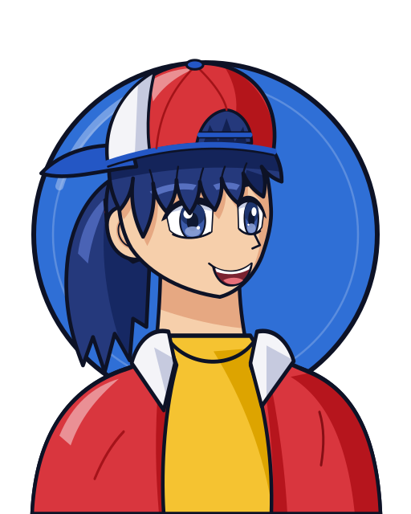
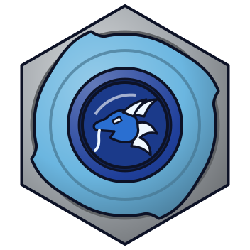
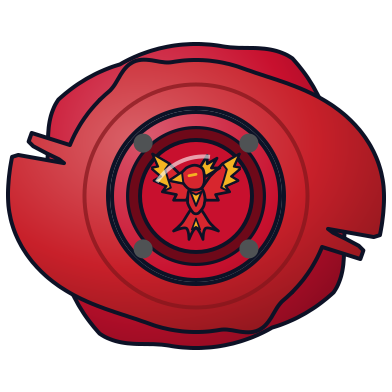

# Tyson Granger (木ノ宮タカオ / Kinomiya Takao)

Retrato original do jogo ([retrato.svg](retrato.svg)). Sem foto de referência no repositório (o CDN da wiki bloqueou o download); o retrato foi feito a partir da descrição da wiki e do visual conhecido do anime.

> **Imagem faltante**: o CDN da wiki (static.wikia.nocookie.net) devolve um desafio anti-bot da Cloudflare para `curl -A "Mozilla/5.0"`, então a foto não foi baixada. Arquivos de origem:
> - S1: https://beyblade.fandom.com/wiki/File:TysonSeason1.jpg (deve ser salva como `foto.jpg`)
> - V-Force: https://beyblade.fandom.com/wiki/File:TysonVForceUpdated.jpg
> - G-Rev: https://beyblade.fandom.com/wiki/File:TysonGRev2.jpeg

| Campo | Valor |
|---|---|
| Nome JP | 木ノ宮タカオ (Kinomiya Takao) |
| Equipe(s) por temporada | S1: Bladebreakers (BBA Team) / V-Force: Bladebreakers (no Mundial, dupla com Max Tate) / G-Rev: BBA Revolution (dupla com Daichi Sumeragi) → G Revolutions (contra a BEGA) |
| Nacionalidade | Japonesa |
| Idade (aprox.) | 11–12 anos (versão japonesa) / 12–13 anos (dublagem em inglês) |
| Fera Bit | Dragoon (青龍 Seiryū, o Dragão Azul do Leste da mitologia chinesa; elemento vento) |
| Estilo de batalha | Attack: beys rápidas com ponta de borracha, rotação **esquerda** e especiais de tornado |
| Dublador(a) JP / EN / PT-BR | Motoko Kumai / Marlowe Gardiner-Heslin / João Cappelli |

## Visual

Padrão do retrato: visual da **temporada 1 (2001)**.

- **S1 (2001)**: cabelo **azul-marinho** com franja espetada saindo por baixo do boné e **rabo de cavalo** preso atrás, que cai até a altura dos ombros. Olhos azuis (a wiki descreve olhos azuis na 1ª temporada), pele clara-pêssego, sorriso confiante. **Boné vermelho, azul e branco usado virado para trás** (aba azul na nuca e a abertura de ajuste na testa, por onde escapa a franja); o boné foi do irmão Hiro. **Jaqueta vermelha aberta com gola branca**, camiseta **amarela** por baixo, luvas sem dedos, bermuda azul e meias brancas longas (fora do busto).
- **V-Force (2002)**: olhos passam a castanhos, mesmo cabelo azul. O boné continua virado para trás, mas a parte branca vira vermelha e o contorno azul vira branco. Mantém a jaqueta aberta com gola (sem os botões amarelos), camiseta amarela de manga mais longa, luvas azuis, calça jeans cinza e tênis vermelho, cinza e azul.
- **G-Revolution (2003)**: volta à jaqueta vermelha com camiseta amarela, luvas azul-escuras, jeans azul-escuro, tênis vermelho e branco e um porta-bey azul e amarelo no braço esquerdo.
- Elementos obrigatórios no retrato: boné virado para trás (vermelho/branco/azul), cabelo azul-marinho com rabo de cavalo, jaqueta vermelha de gola branca, camiseta amarela.
- Nota: a aba do boné foi desenhada azul e a lateral branca; a wiki só lista as três cores, então a distribuição exata é interpretação.

| Uso | Hex |
|---|---|
| Disco de fundo (Dragoon, dragão azul; proposta até existir `feras-bit/dragoon/dados.json`) | `#2f6fd6` (borda `#0d1226`) |
| Cabelo base / sombra / brilho | `#25397c` / `#14245a` / `#5770c0` |
| Olhos (íris) | `#3b5aa8` |
| Pele base / sombra | `#f6cfab` / `#e6a882` |
| Boné vermelho / azul / branco | `#d8343a` / `#2457c5` / `#f4f4f8` |
| Jaqueta / gola (sombra da gola) | `#d9363e` / `#f4f4f8` (`#c6cadf`) |
| Camiseta | `#f5c331` |
| Contorno | `#0d1226` |

## Personalidade e papel na história
- Protagonista da série original. Neto de Ryu Granger, um mestre de kendô dono de um dojo. Irmão mais novo de Hiro Granger ("Jin of the Gale"). O boné que usa foi de Hiro.
- No começo é convencido, impulsivo e destemido, e só fala em ser o "Número 1". Amadurece ao longo da série, mas o ego volta a atrapalhar depois da 1ª temporada, sobretudo no começo de G-Rev, quando culpa o Daichi pelas derrotas.
- Tem muito espírito esportivo. Depois de vencer, costuma encorajar os rivais (Kai, Tala, Zeo, Brooklyn). Kai é o rival eterno. Kenny ("Chefe") é o melhor amigo e quem monta as beys dele.
- Tricampeão mundial: com os Bladebreakers (S1), com Max (V-Force) e com a BBA Revolution (G-Rev).
- O laço com o Dragoon é descrito como único na série. A fera ganha força com a confiança e a garra dele.
- É **canhoto** (tem uma das poucas beys de rotação esquerda), embora o anime às vezes o mostre lançando com a mão direita.
- Não é bom em customização (quem faz isso é o Kenny) e às vezes falta bom senso a ele.

## Estilo de luta (como o jogo deve representá-lo)
- **Lançamento típico**: lançamento forte e agressivo, rotação esquerda (contra-rotação em relação à maioria dos adversários). Usou truques de lançamento:
  - **corrida antes de lançar** (ep. 1, para deixar a Grip Attacker "quatro vezes mais rápida");
  - **lançador virado para cima** (ep. 4, a Dragoon S "some e reaparece");
  - **foco num ponto só**, aprendido no kendô (ep. 3–4).
- **Agressividade**: altíssima. Parte para cima logo de cara ("Tyson immediately lunges at Draciel", G-Rev ep. 25).
- **Preferências táticas**: velocidade + impacto e invocação do Dragoon para um tornado que arremessa o adversário para fora. Quando está em desvantagem, aguenta e vira a luta no fim. Também copia ou reaproveita o golpe do rival (usou o golpe do Kai contra ele, usou o Great Cutter do Daichi para turbinar o próprio golpe).
- **Frases de efeito**: "Let it rip!" (EN), "Go Shoot!" (JP). "Dragoon, attack!", "I would be scared if I wasn't so darn good."

## Beyblades utilizadas no anime (ordem cronológica)
| # | Beyblade | Temporada | Episódio de estreia | Miniatura | Lançador | Pasta |
|---|---|---|---|---|---|---|
| 1 | Dragoon Grip Attacker | S1 | Ep. 01 "The Blade Raider" (destruída pelo Kai no ep. 01–02) |  | [EZ Shooter (Easy Shooter, rotação direita)](../../lancadores/ez-shooter/) | [dragoon-grip-attacker](beyblades/dragoon-grip-attacker/) |
| 2 | Dragoon S (Storm) | S1 | Ep. 02 "Day of the Dragoon" (usada até o ep. 23) |  | [Left EZ Shooter (lançador esquerdo original, "Dragoon")](../../lancadores/left-ez-shooter/) | [dragoon-s](beyblades/dragoon-s/) |
| 3 | Dragoon F (Fantom) | S1 | Ep. 23 "Showdown in Vegas" (até o fim da S1) |  | [Dragoon Shooter DX](../../lancadores/dragoon-shooter-dx/) | [dragoon-f](beyblades/dragoon-f/) |
| 4 | Dranzer F (**emprestada** do Kai) | S1 | Ep. 44 "Losing Kai" (recebe), usada no ep. 45 "Breaking the Ice" contra a Black Dranzer |  | [EZ Shooter (Easy Shooter, rotação direita)](../../lancadores/ez-shooter/) | [dranzer-f](beyblades/dranzer-f/) |
| 5 | Dragoon V (Victory) | V-Force | Ep. 01 "Shot Down in Flames" (V-Force ep. 1 = ep. 52 no total) |  | [Neo Reverse Shooter (Neo Left EZ Shooter)](../../lancadores/neo-reverse-shooter/) | [dragoon-v](beyblades/dragoon-v/) |
| 6 | Master Dragoon (bey genérica de treino, **uso temporário**) | V-Force | Ep. 28: lançada para estourar o pneu do carro dos ladrões (não foi uma batalha) |  | [EZ Shooter (Easy Shooter, rotação direita)](../../lancadores/ez-shooter/) | [master-dragoon](beyblades/master-dragoon/) |
| 7 | Dragoon V2 | V-Force | Ep. 30 "Get a Piece of the Rock" |  | [Neo Reverse Shooter (Neo Left EZ Shooter)](../../lancadores/neo-reverse-shooter/) | [dragoon-v2](beyblades/dragoon-v2/) |
| 8 | Dragoon V2 High Power Custom (customização do Kenny) | V-Force | Ep. 47 "Deceit From Above" (até o ep. 51, final contra o Zeo) |  | [Neo Reverse Shooter (Neo Left EZ Shooter)](../../lancadores/neo-reverse-shooter/) | [dragoon-v2-high-power-custom](beyblades/dragoon-v2-high-power-custom/) |
| 9 | Dragoon G (Galaxy) | G-Rev | Ep. 01 "New Kid in Town" |  | [Customize Grip (Off-White) - versão Tyson](../../lancadores/customize-grip-tyson/) | [dragoon-g](beyblades/dragoon-g/) |
| 10 | Dragoon GT (Galaxy Turbo) | G-Rev | Ep. 26 "Familiar Faces" (destruída no ep. 37) |  | [Customize Grip (Off-White) - versão Tyson](../../lancadores/customize-grip-tyson/) | [dragoon-gt](beyblades/dragoon-gt/) |
| 11 | Dragoon MS (Metal Storm) | G-Rev | Ep. 39 "Rebel Alliance" |  | [Dual Shooter (HMS)](../../lancadores/dual-shooter/) | [dragoon-ms](beyblades/dragoon-ms/) |
| 12 | Dragoon MS Ultimate Version | G-Rev | Ep. 52 "Beybattle for the Ages" (a MS evolui durante a luta com o Brooklyn) |  | [Dual Shooter (HMS)](../../lancadores/dual-shooter/) | [dragoon-ms-ultimate-version](beyblades/dragoon-ms-ultimate-version/) |

**Ficaram sem pasta** (fora do escopo de batalha no anime):
- **Spin Dragoon / Ultimate Dragoon** (01, Takara 1999). Aparece só num flashback da infância em G-Rev ep. 40 "Back to Basics", sem batalha. No mangá é a primeira bey dele.
- **Só no mangá**: Dragoon MF (epílogo), Dragoon Storm Wing Xtreme, Dragoon Fantom/Fighter Gravity Variable, Dragoon Victory Sting Evolution, Dragoon V2 Wheel Xceed' (Burst / *Rising*).
- **Só nos games**: Ultimate Dragoon (game "Next Generation Beigoma Battle") e Kid Dragoon. A Kid Dragoon é a bey do **Carlos** no anime (ep. 1), não do Tyson.
- **Filme "Fierce Battle" (2002, não canônico)**: ele usa a Dragoon V2, que fica vermelha quando o Dragoon é selado e volta. Ganha do Daichi e dos Shadow Bladers. Ver o README da `dragoon-v2`.

## Batalhas marcantes
- **S1 ep. 1–2**: ganha do Billy e do Carlos (Kid Dragoon) com a Grip Attacker. Perde para o Kai (Dranzer S) e tem a bey destruída. No ep. 2, a Dragoon S desperta o Dragoon e empata com o Kai.
- **S1 ep. 3**: perde para o Max (Draciel Metal Ball Defenser). A defesa bloqueia o ataque dele.
- **S1 ep. 7**: ganha do Kai na final do torneio regional.
- **S1 ep. 23**: estreia da Dragoon F e do Phantom Hurricane em Las Vegas.
- **S1 ep. 30 / 39**: perde e depois ganha do Robert Jürgens (Majestics).
- **S1 ep. 44–45**: o Kai entrega a Dranzer F para ele. No lago congelado (Lago Baikal), ele lança Dranzer e Dragoon juntas e, com Max e Ray, vence a Black Dranzer.
- **S1 ep. 50–51**: ganha do Tala (Wolborg 2) na final do Mundial.
- **V-Force ep. 1 / 3**: perde duas vezes para o "Mr. X"/Ozuma (Flash Leopard). Na segunda, o Dragoon não aparece.
- **V-Force ep. 25–27**: ganha do Kane (Cyber Dragoon).
- **V-Force ep. 39**: empata com o Ozuma (Flash Leopard 2). Estreia do Hyper Victory Tornado.
- **V-Force ep. 47–51**: com a V2 High Power Custom, ganha do King (Uriel, apesar do laser da Dra. K), do Gordo (Orthros) e do Zeo (Burning Kerberous) na final.
- **G-Rev ep. 20 / 27**: perde para o F-Dynasty quando o Twin Tornado falha e ganha a revanche com o Dragoon Tank e o Galaxy Turbo Twister.
- **G-Rev ep. 29–30**: ganha do Kai (Dranzer GT) e é tricampeão mundial.
- **G-Rev ep. 37**: ganha do Ray (Driger G). As duas beys ficam irrecuperáveis.
- **G-Rev ep. 49**: ganha do Garland (Apollon) com o Evolution Storm.
- **G-Rev ep. 51–52**: enfrenta o Brooklyn (Zeus) numa dimensão paralela. A Dragoon MS vira Ultimate Version com o poder das feras bit dos amigos. A vitória fica implícita.

## Perfil de IA sugerido para o jogo
- **Agressividade**: 9/10. Ataca desde o lançamento e quase nunca fica parado no centro. O Storm Attack da S1 é a exceção: ele para no lugar enquanto o tornado age.
- **Uso de especial**: usa cedo quando está confiante. Quando está perdendo, tem um bônus de "virada": o especial carrega mais rápido e fica mais forte abaixo de ~30% de rotação, o que reflete o "vigor" dele.
- **Posicionamento**: órbita agressiva pela borda, perto do tornado ridge, com investidas em linha reta contra o adversário. Prefere o choque frontal em contra-rotação.
- **Erro característico**: impulsivo. Tem chance pequena de auto-KO ou de lançamento exagerado, como as rubber tips que escapam pelo tornado ridge.
- **Fraqueza de matchup**: defensores pesados de ponta bola (Draciel) e adversários que leem os movimentos dele (Ozuma, a IA do ep. 4 de V-Force).

## Fontes
- https://beyblade.fandom.com/wiki/Tyson_Granger
- https://beyblade.fandom.com/wiki/Ultimate_Dragoon
- https://beyblade.fandom.com/wiki/Master_Dragoon
- https://beyblade.fandom.com/wiki/Beyblade_-_Episode_01 , _23, _44, _45
- https://beyblade.fandom.com/wiki/Beyblade:_V-Force_-_Episode_28 , _47, _51
- https://beyblade.fandom.com/wiki/Beyblade:_G-Revolution_-_Episode_37 , _40, _51, _52
- https://beyblade.fandom.com/wiki/Beyblade_The_Movie_-_Fierce_Battle
- https://dublagem.fandom.com/wiki/Beyblade (elenco da dublagem PT-BR)
