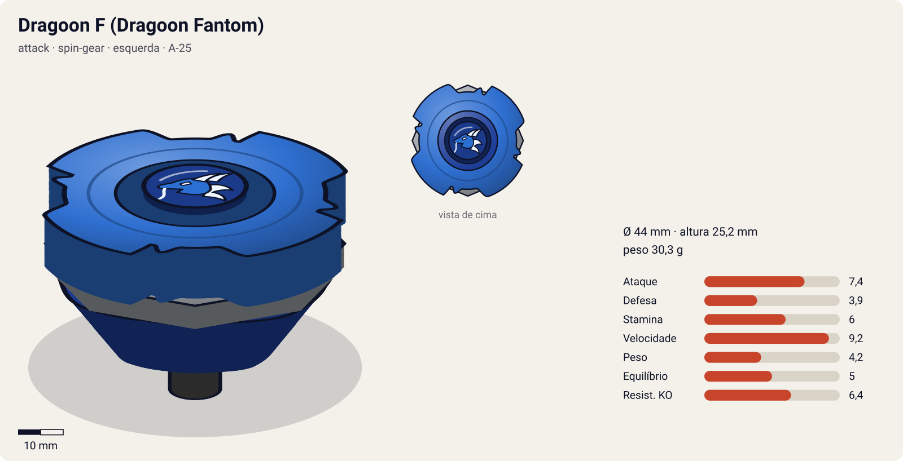
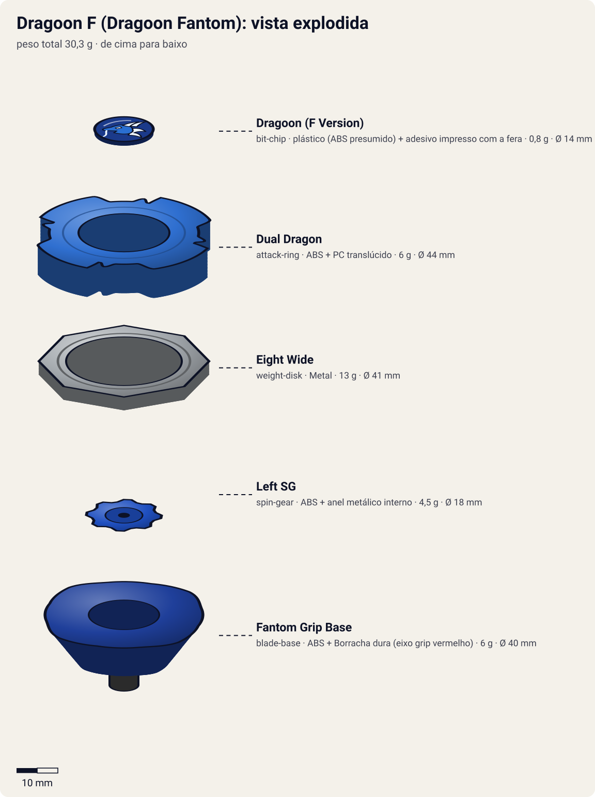

# Dragoon F – Dragoon Fantom (ドラグーン ファントム / Doragūn Fantomu)

<!-- auto:inicio (gerado por npm run build:research; não edite este bloco) -->

| Ficha | |
|---|---|
| Dono | [Tyson Granger (木ノ宮タカオ / Kinomiya Takao)](../../README.md) |
| Tipo · sistema · rotação | attack · spin-gear · esquerda |
| Código do produto | A-25 |
| Montada | Ø 44 mm · altura 25,2 mm · **30,3 g** (soma das peças) |
| Fera bit | [Dragoon](../../../../feras-bit/dragoon/) |
| Lançador | [Dragoon Shooter DX](../../../../lancadores/dragoon-shooter-dx/) |
| Ripcord | [dragon-winder](../../../../lancadores/ripcords/dragon-winder/) |

### Peças

| Camada | Peça | Material | Ø mm | Altura mm | Peso g | Estrelas Takara (A / D / S) | Desenho |
|---|---|---|---|---|---|---|---|
| Bit Chip | [Dragoon (F Version)](../../../../pecas/bit-chip/dragoon-f/) | plástico (ABS presumido) + adesivo impresso com a fera | 14 estimado | 8 estimado | 0,8 comunidade | — | [ver](pecas/bit-chip.svg) |
| Attack Ring | [Dual Dragon](../../../../pecas/attack-ring/dual-dragon/) | ABS + PC translúcido | 44 estimado | 7 estimado | 6 wiki | 3 / 3 / 3 | [ver](pecas/attack-ring.svg) |
| Weight Disk | [Eight Wide](../../../../pecas/weight-disk/eight-wide/) | Metal | 41 estimado | 3,2 estimado | 13 wiki | 0,5 / 1 / 3,5 | [ver](pecas/weight-disk.svg) |
| Spin Gear / Core | [Left SG](../../../../pecas/spin-gear/left-sg/) | ABS + anel metálico interno | 18 estimado | 10 estimado | 4,5 estimado | — | [ver](pecas/spin-gear.svg) |
| Blade Base | [Fantom Grip Base](../../../../pecas/blade-base/fantom-grip-base/) | ABS + Borracha dura (eixo grip vermelho) | 40 estimado | 15 estimado | 6 estimado | 4 / 1 / 0,5 | [ver](pecas/blade-base.svg) |

Fonte de cada medida em subscrito (wiki, comunidade, estimado). Detalhes em cada ficha de peça.

### Atributos

| Atributo | Brinquedo (calculado) | Ajuste anime | Jogo |
|---|---|---|---|
| Ataque | 6,4 | +1 | **7,4** |
| Defesa | 3,9 | — | **3,9** |
| Stamina | 5 | +1 | **6** |
| Velocidade | 9,2 | — | **9,2** |
| Peso | 4,2 | — | **4,2** |
| Equilíbrio | 5 | — | **5** |
| Resistência a KO | 5,4 | +1 | **6,4** |

Calculado por `src/beyblade/stats.js` a partir de: ponta grip (atrito 0,9), contato smash (recoil 0,5), peso do WD na periferia. Modelo em [docs/BEYBLADES.md](../../../../../docs/BEYBLADES.md).

### Fera bit em cima da bey

 

Sons: [invocacao](../../../../feras-bit/dragoon/sons/invocacao.wav) · [rugido](../../../../feras-bit/dragoon/sons/rugido.wav) · [ataque](../../../../feras-bit/dragoon/sons/ataque.wav). Animações: [invocação](../../../../feras-bit/dragoon/invocacao.svg) · [ataque](../../../../feras-bit/dragoon/ataque.svg).
<!-- auto:fim -->

| Campo | Valor |
|---|---|
| Dono | Tyson Granger (montada pelo Kenny) |
| Código do produto | A-25 (Takara). Hasbro: "Dragoon Fighter" |
| Sistema | Spin Gear System |
| Rotação | Esquerda |
| Fera Bit | [Dragoon](../../../../feras-bit/dragoon/) (dragão azul, vento) |
| Série / temporada | Bakuten Shoot (2001), temporada 1 |
| Primeira aparição (anime) | Ep. 23 "Showdown in Vegas" |
| Antecessora → Sucessora | Dragoon S → Dragoon V |

## Formato e geometria
- Vista de cima: 4 cabeças de dragão grandes em simetria de 4 lados, com diâmetro moderado.
- [Dual Dragon](../../../../pecas/attack-ring/dual-dragon/): AR de **duas camadas**. A de cima tem 4 grandes cabeças de dragão com projeções para a esquerda (smash). A de baixo é um anel de 4 lâminas em "Dual Carbonate" (policarbonato) vermelho, que absorve choque. Resultado: smash esquerdo com mais durabilidade e menos recoil que o Reverse Dragon. Na rotação direita sobra só a absorção do anel.
- [Eight Wide](../../../../pecas/weight-disk/eight-wide/) com massa periférica: mobilidade e inércia.
- [Left SG](../../../../pecas/spin-gear/left-sg/): rotação esquerda.
- [Fantom Grip Base](../../../../pecas/blade-base/fantom-grip-base/) com eixo de **borracha vermelha alto** ("Grip Shaft"). Tem mais borracha que a Storm Grip, mas a borracha é dura e gera menos atrito. A base é mais alta, então fica um pouco menos rápida e mais vulnerável por baixo. Quando a borracha gasta, a bey fica hiperagressiva e a stamina despenca.
- Um pouco mais pesada e robusta que a Dragoon S (~30–32 g). Perfil **mais alto**, mais exposto a upper attack.

## Comportamento na arena
- **Movimento**: órbita agressiva, um pouco menos rápida que a da Dragoon S (borracha dura).
- **Ataque**: smash esquerdo com 4 cabeças. Bate com força e aguenta melhor o recoil por causa do anel de policarbonato.
- **Defesa**: média (absorção do anel inferior).
- **Stamina**: baixa.
- **Matchups**: ganha de attackers e balance (Jose, Steven/Tryhorn, Oliver empatou, Enrique na revanche, Robert/Griffolyon na revanche, Tala/Wolborg 2 na final). Perde no primeiro encontro com os Majestics (Robert, ep. 30, e Enrique, ep. 35). Contra a Black Dranzer, só vence quando se junta às outras três feras (ep. 45).

## No anime
- **Ataque especial**: **Phantom Hurricane** (幻影爆風撃 / ファントムハリケーン, Fantomu Harikēn), estreia no ep. 23. No anime é uma versão turbinada do Storm Attack: um tornado maior e mais forte com o Dragoon emergindo. No mangá, cria clones de vento que servem de chamariz. O Storm Attack continua sendo usado.
- **Batalhas marcantes**: torneio americano (ep. 23–27). Majestics na Europa (ep. 30–39: derrota e depois vitória sobre o Robert). Ep. 45, Black Dranzer, quando o Tyson lança a Dragoon F **junto com a Dranzer F** (ver [dranzer-f](../dranzer-f/)). Ep. 50–51, vitória sobre o Tala (Wolborg 2), que dá o título mundial.
- **Substituição**: no início de V-Force vira Dragoon V (Magnacore).

## Mecânica no jogo
- **Padrão de movimento (IA)**: `agressivo` (órbita de borda com investidas). Ao ativar um especial de tornado, para no centro.
- **Gimmick**: rotação esquerda (contra-rotação) e anel absorvente: o recoil que a bey sofre nos choques é 20% menor que o da Dragoon S.
- **Especiais** (efeitos da [fera bit Dragoon](../../../../feras-bit/dragoon/): `invocacao.svg`, grupos `storm`/`funnel` e `wind-front`/`wind-back` do `ataque.svg`; som `ataque.wav`):
  - **Phantom Hurricane**: tornado de raio 2× o da bey por 5 s. Knockback 2× e perda de rotação contínua (−3% por segundo) em quem estiver no raio. A bey fica quase parada (velocidade −70%). Custo 100 de energia, recarga 22 s.
  - **Storm Attack** (herdado): tornado de raio 1,5× por 4 s, knockback 1,5×. Custo 70, recarga 15 s.

## Ajuste do anime

| Atributo | Delta | Justificativa (episódio/batalha) |
|---|---|---|
| Ataque | +1 | Phantom Hurricane vence o Robert/Griffolyon na revanche (ep. 39) e o Tala na final do Mundial (ep. 50–51) |
| Stamina | +1 | Aguenta a final longa contra o Wolborg 2, uma bey de stamina, e o congelamento do Novae Rog (ep. 50–51) |
| Resistência a KO | +1 | Fica no estádio contra os Majestics e na final do Mundial apesar de ser uma bey leve de borracha |

Resultado esperado: a melhor bey da S1 do Tyson; vence o Wolborg 2 e o Griffolyon, mas sozinha não deve vencer a Black Dranzer (no ep. 45 foi preciso juntar as quatro feras).

## Fontes
- https://beyblade.fandom.com/wiki/Dragoon_F
- https://beyblade.fandom.com/wiki/Attack_Ring_-_Dual_Dragon
- https://beyblade.fandom.com/wiki/Blade_Base_-_Fantom_Grip_Base (página vazia; a descrição veio da página da Dragoon F)
- https://beyblade.fandom.com/wiki/Phantom_Hurricane
- https://beyblade.fandom.com/wiki/Beyblade_-_Episode_23
- https://beyblade.fandom.com/wiki/Beyblade_-_Episode_45
