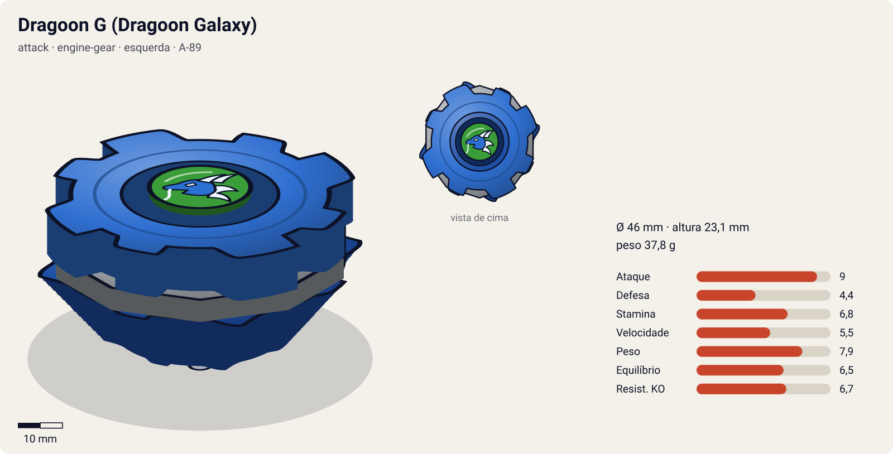
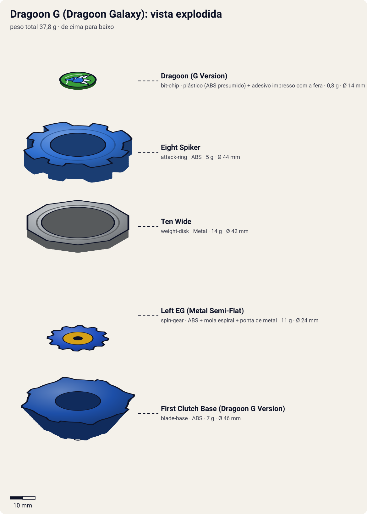

# Dragoon G – Dragoon Galaxy (ドラグーンＧ〈ギャラクシー〉 / Doragūn Gyarakushī)

<!-- auto:inicio (gerado por npm run build:research; não edite este bloco) -->

| Ficha | |
|---|---|
| Dono | [Tyson Granger (木ノ宮タカオ / Kinomiya Takao)](../../README.md) |
| Tipo · sistema · rotação | attack · engine-gear · esquerda |
| Código do produto | A-89 |
| Montada | Ø 46 mm · altura 23,1 mm · **37,8 g** (soma das peças) |
| Fera bit | [Dragoon](../../../../feras-bit/dragoon/) |
| Lançador | [Customize Grip (Off-White) - versão Tyson](../../../../lancadores/customize-grip-tyson/) |
| Ripcord | [dragon-winder](../../../../lancadores/ripcords/dragon-winder/) |

### Peças

| Camada | Peça | Material | Ø mm | Altura mm | Peso g | Estrelas Takara (A / D / S) | Desenho |
|---|---|---|---|---|---|---|---|
| Bit Chip | [Dragoon (G Version)](../../../../pecas/bit-chip/dragoon-g/) | plástico (ABS presumido) + adesivo impresso com a fera | 14 estimado | 8 estimado | 0,8 comunidade | — | [ver](pecas/bit-chip.svg) |
| Attack Ring | [Eight Spiker](../../../../pecas/attack-ring/eight-spiker/) | ABS | 44 estimado | 6 estimado | 5 wiki | 3 / 2 / 2 | [ver](pecas/attack-ring.svg) |
| Weight Disk | [Ten Wide](../../../../pecas/weight-disk/ten-wide/) | Metal | 42 estimado | 3,1 estimado | 14 wiki | 1 / 1,5 / 4 | [ver](pecas/weight-disk.svg) |
| Spin Gear / Core | [Left EG (Metal Semi-Flat)](../../../../pecas/spin-gear/left-eg-metal-semi-flat/) | ABS + mola espiral + ponta de metal | 24 estimado | 18 estimado | 11 wiki | 3 / 0 / 2 | [ver](pecas/spin-gear.svg) |
| Blade Base | [First Clutch Base (Dragoon G Version)](../../../../pecas/blade-base/first-clutch-base-dragoon-g/) | ABS | 46 estimado | 14 estimado | 7 wiki | 3 / 0 / 0 | [ver](pecas/blade-base.svg) |

Fonte de cada medida em subscrito (wiki, comunidade, estimado). Detalhes em cada ficha de peça.

### Atributos

| Atributo | Brinquedo (calculado) | Ajuste anime | Jogo |
|---|---|---|---|
| Ataque | 8 | +1 | **9** |
| Defesa | 4,4 | — | **4,4** |
| Stamina | 6,8 | — | **6,8** |
| Velocidade | 5,5 | — | **5,5** |
| Peso | 7,9 | — | **7,9** |
| Equilíbrio | 6,5 | — | **6,5** |
| Resistência a KO | 6,7 | — | **6,7** |

Calculado por `src/beyblade/stats.js` a partir de: ponta metal-semi-flat (atrito 0,3), contato smash (recoil 0,3), peso do WD na periferia, Engine Gear (instantaneo). Modelo em [docs/BEYBLADES.md](../../../../../docs/BEYBLADES.md).

### Fera bit em cima da bey

 

Sons: [invocacao](../../../../feras-bit/dragoon/sons/invocacao.wav) · [rugido](../../../../feras-bit/dragoon/sons/rugido.wav) · [ataque](../../../../feras-bit/dragoon/sons/ataque.wav). Animações: [invocação](../../../../feras-bit/dragoon/invocacao.svg) · [ataque](../../../../feras-bit/dragoon/ataque.svg).
<!-- auto:fim -->

| Campo | Valor |
|---|---|
| Código do produto | A-89 (Takara, dezembro de 2002, 980 ienes. Hasbro, 2004) |
| Sistema | Engine Gear System (a primeira bey EG lançada) |
| Rotação | Esquerda |
| Fera Bit | [Dragoon](../../../../feras-bit/dragoon/) (dragão azul, vento) |
| Série / temporada | G-Revolution (2003) |
| Primeira aparição (anime) | G-Rev ep. 01 "New Kid in Town" |
| Antecessora → Sucessora | Dragoon V2 (High Power Custom) → Dragoon GT |

## Formato e geometria
- Vista de cima: 8 contatos bem espaçados (simetria de 4 pares), raio grande (Ten Wide).
- [Eight Spiker](../../../../pecas/attack-ring/eight-spiker/): 4 cabeças de dragão seguidas de 4 barbatanas menores (**8 contatos**), cada uma com pequenos espinhos. Smash esquerdo forte, **consistente e com pouco recoil** (dá KO em qualquer fase). Na rotação direita não funciona.
- [Ten Wide](../../../../pecas/weight-disk/ten-wide/): inércia periférica.
- [Left EG (Metal Semi-Flat)](../../../../pecas/spin-gear/left-eg-metal-semi-flat/) (11 g): motor de mola que guarda rotação e a libera de uma vez. A ponta é de metal, flat com bordas levemente arredondadas: movimento agressivo com stamina razoável. A peça é alta e o disparo muitas vezes causa **auto-KO**.
- [First Clutch Base (Dragoon G Version)](../../../../pecas/blade-base/first-clutch-base-dragoon-g/) (= Instant Release): 8 lâminas para ataque; a embreagem **libera o Engine Gear logo no lançamento**.
- Muito peso (~40 g): o EG metálico fica no centro e embaixo, o Ten Wide na borda. Perfil **alto**, com dificuldade de acertar beys baixas.

## Comportamento na arena
- **Movimento**: lançamento normal seguido de **arrancada** do motor logo no começo. Depois, órbita agressiva com a ponta metálica flat.
- **Ataque**: smash esquerdo de 8 pontos com pouco recoil. Mais confiável que a V2, com menos picos de dano.
- **Defesa**: média (peso).
- **Stamina**: média (metal flat + motor).
- **Matchups**: ganha do Ryan, do Daichi (Strata Dragoon V, ep. 1), do Kotaro, do Miguel (Barthez, ep. 17) e do Max (Draciel G, ep. 25). Perde para o Daichi (ep. 7), para o Hiro (ep. 11), para Ray e Lee em dupla (ep. 10) e para o F-Dynasty em dupla (ep. 20).

## No anime
- **Ataques especiais**:
  - **Galaxy Storm** (銀河旋風撃 / ギャラクシーストーム, Gyarakushī Sutōmu), estreia no ep. 1 contra o Daichi (Strata Dragoon V). É um tornado de vento gigante.
  - **Twin Tornado Attack** (com o Daichi e a Strata Dragoon G), estreia no ep. 20 "Burdens of a Champion". O Tyson iguala a rotação dele à do Daichi e surgem dois tornados gigantes que andam juntos. Na 1ª vez contra o F-Dynasty, o Tyson se distrai, perde o tornado dele, o do Daichi some junto e os dois perdem.
- **Batalhas marcantes**: ep. 1 (Daichi), ep. 10 (derrota em dupla para o White Tiger X), ep. 11 (derrota para o Hiro/Jin, que o faz rever a arrogância), ep. 17 (vence o Miguel e a bey trapaceira dele), ep. 25 (vence o Max).
- **Substituição**: o Kenny monta a Dragoon GT (ep. 26) para a revanche contra o F-Dynasty.

## Mecânica no jogo
- **Padrão de movimento (IA)**: `agressivo`. Arrancada do EG em t≈1 s e depois `orbita` rápida.
- **Gimmick — Engine Gear (Instant Release)**: em t≈1 s o motor dispara: +60% de velocidade por 1,5 s (o modelo de atributos já soma +1 de Velocidade e +0,5 de Ataque pelo EG). Se a bey estiver a menos de 15% do raio da borda no disparo, 10% de chance de auto-KO.
- **Especiais** (efeitos da [fera bit Dragoon](../../../../feras-bit/dragoon/): `invocacao.svg`, grupos `storm` e `funnel` do `ataque.svg` em escala grande):
  - **Galaxy Storm**: tornado gigante de raio 2,5× o da bey por 4 s. Puxa quem estiver no raio por 2 s e depois arremessa com knockback 2×. A bey continua andando devagar (velocidade −50%). Custo 100 de energia, recarga 22 s.
  - **Twin Tornado Attack** (só em modo dupla com a Strata Dragoon do Daichi): dois tornados de raio 2× que andam juntos por 4 s. Se um dos dois for interrompido (a bey sofre um choque de dano ≥ 1,5×), os dois caem. Custo 60 de cada bey, recarga 30 s.

## Ajuste do anime

| Atributo | Delta | Justificativa (episódio/batalha) |
|---|---|---|
| Ataque | +1 | O Galaxy Storm vence o Daichi (ep. 1), o Miguel (ep. 17) e o Max/Draciel G (ep. 25) |

Resultado esperado: ajuste pequeno, porque a bey também perde para o Daichi (ep. 7), o Hiro (ep. 11) e nas duplas (ep. 10 e 20). Fica um degrau abaixo da GT.

**Suspeita para o coordenador**: a First Clutch Base (Dragoon G Version) está com estrelas incompletas (3 / ? / ?) e o Left EG (Metal Semi-Flat) com 3 / ? / 2; a Defesa e a Stamina caem no valor neutro e podem estar imprecisas.

## Fontes
- https://beyblade.fandom.com/wiki/Dragoon_G
- https://beyblade.fandom.com/wiki/Attack_Ring_-_Eight_Spiker
- https://beyblade.fandom.com/wiki/Weight_Disk_-_Ten_Wide
- https://beyblade.fandom.com/wiki/Engine_Gear_-_Metal_Semi-Flat
- https://beyblade.fandom.com/wiki/Blade_Base_-_First_Clutch
- https://beyblade.fandom.com/wiki/Galaxy_Storm
- https://beyblade.fandom.com/wiki/Twin_Tornado_Attack
- https://beyblade.fandom.com/wiki/Tyson_Granger (tabela de batalhas G-Rev)

### Inconsistências nas fontes
- O infobox da Dragoon G diz "EngineGear = Left Engine Gear" e "BladeBase = Instant Release (Dragoon G Version)". O corpo da página chama as peças de "Metal Semi-Flat" e "First Clutch". As páginas das peças esclarecem: First Clutch é o nome japonês da Instant Release Base, e o EG é o Left Engine Gear com ponta Metal Semi-Flat (que na verdade é flat).
- A página do Ten Wide diz que o disco "estreou com a Dragoon G em dezembro de 2002", mas a Dragoon V (dezembro de 2001) já trazia um Ten Wide.
