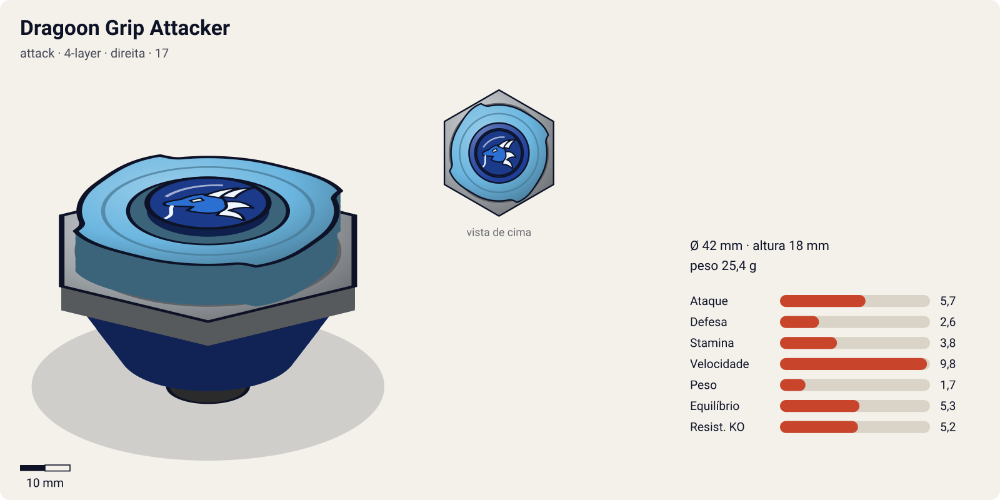
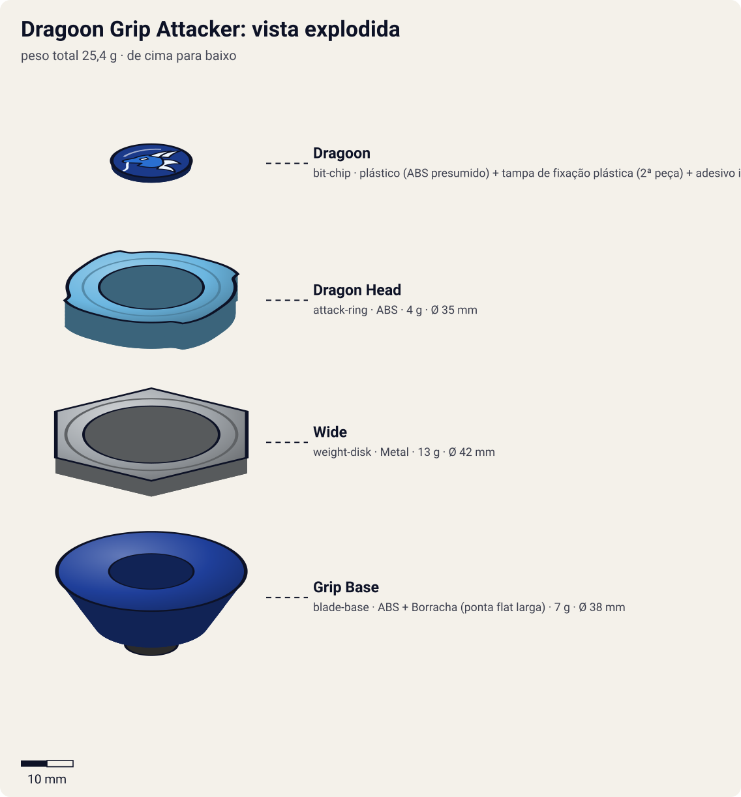

# Dragoon Grip Attacker (ドラグーングリップアタッカー / Doragūn Gurippu Atakkā)

<!-- auto:inicio (gerado por npm run build:research; não edite este bloco) -->

| Ficha | |
|---|---|
| Dono | [Tyson Granger (木ノ宮タカオ / Kinomiya Takao)](../../README.md) |
| Tipo · sistema · rotação | attack · 4-layer · direita |
| Código do produto | 17 |
| Montada | Ø 42 mm · altura 18 mm · **25,4 g** (soma das peças) |
| Lançador | [EZ Shooter (Easy Shooter, rotação direita)](../../../../lancadores/ez-shooter/) |
| Ripcord | [ripcord-alongado-tyson](../../../../lancadores/ripcords/ripcord-alongado-tyson/) |

### Peças

| Camada | Peça | Material | Ø mm | Altura mm | Peso g | Estrelas Takara (A / D / S) | Desenho |
|---|---|---|---|---|---|---|---|
| Bit Chip | [Dragoon](../../../../pecas/bit-chip/dragoon/) | plástico (ABS presumido) + tampa de fixação plástica (2ª peça) + adesivo impresso com a fera | 15 estimado | 5 estimado | 1,4 comunidade | — | [ver](pecas/bit-chip.svg) |
| Attack Ring | [Dragon Head](../../../../pecas/attack-ring/dragon-head/) | ABS | 35 estimado | 5 estimado | 4 wiki | 2 / 1 / 2 | [ver](pecas/attack-ring.svg) |
| Weight Disk | [Wide](../../../../pecas/weight-disk/wide/) | Metal | 42 estimado | 3 estimado | 13 wiki | 1 / 1 / 3 | [ver](pecas/weight-disk.svg) |
| Blade Base | [Grip Base](../../../../pecas/blade-base/grip-base/) | ABS + Borracha (ponta flat larga) | 38 estimado | 10 estimado | 7 wiki | 4 / 1 / 0,5 | [ver](pecas/blade-base.svg) |

Fonte de cada medida em subscrito (wiki, comunidade, estimado). Detalhes em cada ficha de peça.

### Atributos

| Atributo | Brinquedo (calculado) | Ajuste anime | Jogo |
|---|---|---|---|
| Ataque | 5,7 | — | **5,7** |
| Defesa | 2,6 | — | **2,6** |
| Stamina | 3,8 | — | **3,8** |
| Velocidade | 9,8 | — | **9,8** |
| Peso | 1,7 | — | **1,7** |
| Equilíbrio | 5,3 | — | **5,3** |
| Resistência a KO | 5,2 | — | **5,2** |

Calculado por `src/beyblade/stats.js` a partir de: ponta grip (atrito 0,9), contato smash (recoil 0,3), peso do WD na periferia. Modelo em [docs/BEYBLADES.md](../../../../../docs/BEYBLADES.md).
<!-- auto:fim -->

| Campo | Valor |
|---|---|
| Código do produto | 17 (Takara, linha "Next Generation Beigoma Battle"). Hasbro: "Grip Attacker" |
| Sistema | 4 Layer System (pré-Spin Gear: não tem Spin Gear) |
| Rotação | Direita (é a única bey "Dragoon" do Tyson que gira para a direita) |
| Fera Bit | Nenhuma no anime. O Dragoon só entra na bey seguinte (Dragoon S), no ep. 2. O bit chip só mostra a arte do Dragoon |
| Série / temporada | Bakuten Shoot (2001), temporada 1 |
| Primeira aparição (anime) | Ep. 01 "The Blade Raider" |
| Antecessora → Sucessora | (Spin Dragoon, só num flashback de G-Rev ep. 40) → Dragoon S |

## Formato e geometria
- Vista de cima: quase circular e compacta, com 4 pontas mínimas (simetria de 4). Quem fica para fora é o WD, não o AR.
- [Dragon Head](../../../../pecas/attack-ring/dragon-head/) é um dos menores ARs já fabricados: 4 protuberâncias minúsculas, feitas para a rotação direita, e frágeis. O dano vem mais do Weight Disk ("Weight Disk Attack") do que do AR. Na rotação esquerda as protuberâncias ficam de costas e o AR vira um disco liso.
- [Wide](../../../../pecas/weight-disk/wide/) hexagonal, com o peso na periferia: dá inércia e alcance a uma bey muito leve (~25 g).
- [Grip Base](../../../../pecas/blade-base/grip-base/) muito baixa, com ponta de **borracha flat extremamente larga**: uma das bases mais rápidas de todos os tempos, mas gira por pouco tempo e só funciona bem na rotação direita.
- Sem Spin Gear nem Support Part (4 Layer System).

## Comportamento na arena
- **Movimento**: correria agressiva e caótica pela arena (rubber flat). Faz flower pattern rápido quando lançada inclinada.
- **Ataque**: velocidade alta e choques frequentes, mas com pouco "dente". Ganha de beys amadoras por insistência e ritmo.
- **Defesa**: fraca. É leve e não tem nada que absorva impacto.
- **Stamina**: muito baixa na prática. A borracha gasta a rotação depressa.
- **Pontos fortes**: velocidade, perfil baixo. **Fracos**: leve, frágil, pouca stamina e sem fera bit.
- **Matchups**: ganha de beys genéricas e lentas (Star Stinger do Billy, Kid Dragoon do Carlos). Perde feio para beys com fera bit (Dranzer S do Kai, que a destruiu).

## No anime
- **Especiais**: nenhum, porque ainda não tem fera bit. Na batalha com o Carlos, o Tyson pega **impulso correndo antes de lançar** e combina dois ripcords. Na noite anterior, treinou para deixá-la "quatro vezes mais rápida", como o Kenny pediu.
- **Batalhas**: ep. 1, vitória sobre o Billy (Star Stinger) e o Carlos (Kid Dragoon). Ep. 1–2, derrota para o Kai (Dranzer S): a bey é **destruída**.
- **Substituição**: depois de destruída, o Kenny e o Andrew ajudam a montar a Dragoon S, que recebe o Dragoon.

## Mecânica no jogo
- **Padrão de movimento (IA)**: `agressivo`. Órbita rápida e irregular, com investidas diretas no adversário. Velocidade alta no começo que cai rápido (decaimento de rotação acelerado da borracha).
- **Gimmick**: nenhum além da ponta de borracha.
- **Especiais**: sem fera bit, não tem especial de fera (sem invocação nem efeitos do Dragoon).
- **Habilidade de lançamento — "Lançamento com corrida"** (ep. 1): +25% de velocidade inicial nos primeiros 5 s. Custo 0, uso único por partida.

## Ajuste do anime

Sem ajuste (`{}`). É uma bey sem fera bit, usada só no ep. 1–2: venceu beys genéricas e foi destruída pelo primeiro adversário de verdade (Kai). O brinquedo já cobre esse desempenho.

| Atributo | Delta | Justificativa (episódio/batalha) |
|---|---|---|
| — | 0 | Ep. 1: vence Billy e Carlos (genéricos); ep. 1–2: destruída pela Dranzer S |

Resultado esperado: ganha de beys genéricas do começo do modo história e perde de qualquer bey com fera bit.

**Suspeita para o coordenador**: a Stamina do brinquedo (5,7) parece alta para uma bey de 25 g com ponta de borracha larga. Só o Weight Disk Wide tem estrelas Takara (1 / 1 / 3); Dragon Head e Grip Base estão sem estrelas, e a soma escalada para três peças pode estar inflando a Stamina. Vale conferir as estrelas dessas duas peças.

## Fontes
- https://beyblade.fandom.com/wiki/Dragoon_Grip_Attacker
- https://beyblade.fandom.com/wiki/Attack_Ring_-_Dragon_Head
- https://beyblade.fandom.com/wiki/Blade_Base_-_Grip_Base
- https://beyblade.fandom.com/wiki/Beyblade_-_Episode_01
- https://beyblade.fandom.com/wiki/Tyson_Granger
- Arquivos de origem das fotos (não baixadas; CDN da wiki bloqueado): https://beyblade.fandom.com/wiki/File:BCH8251beyattyptops.jpg , https://beyblade.fandom.com/wiki/File:Destroyed_by_Kai.jpg
