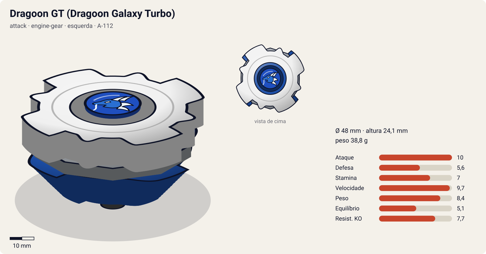
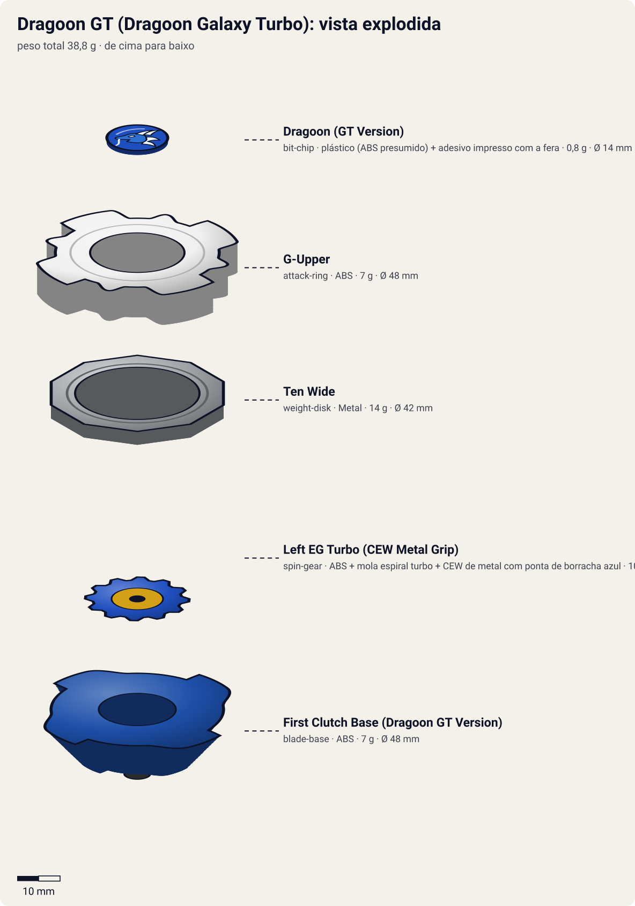

# Dragoon GT – Dragoon Galaxy Turbo (ドラグーンＧＴ〈ギャラクシーターボ〉 / Doragūn Gyarakushī Tābo)

<!-- auto:inicio (gerado por npm run build:research; não edite este bloco) -->

| Ficha | |
|---|---|
| Dono | [Tyson Granger (木ノ宮タカオ / Kinomiya Takao)](../../README.md) |
| Tipo · sistema · rotação | attack · engine-gear · esquerda |
| Código do produto | A-112 |
| Montada | Ø 48 mm · altura 24,1 mm · **38,8 g** (soma das peças) |
| Fera bit | [Dragoon](../../../../feras-bit/dragoon/) |
| Lançador | [Customize Grip (Off-White) - versão Tyson](../../../../lancadores/customize-grip-tyson/) |
| Ripcord | [neo-dragon-winder](../../../../lancadores/ripcords/neo-dragon-winder/) |

### Peças

| Camada | Peça | Material | Ø mm | Altura mm | Peso g | Estrelas Takara (A / D / S) | Desenho |
|---|---|---|---|---|---|---|---|
| Bit Chip | [Dragoon (GT Version)](../../../../pecas/bit-chip/dragoon-gt/) | plástico (ABS presumido) + adesivo impresso com a fera | 14 estimado | 8 estimado | 0,8 comunidade | — | [ver](pecas/bit-chip.svg) |
| Attack Ring | [G-Upper](../../../../pecas/attack-ring/g-upper/) | ABS | 48 estimado | 7 estimado | 7 wiki | 4 / 3 / 2 | [ver](pecas/attack-ring.svg) |
| Weight Disk | [Ten Wide](../../../../pecas/weight-disk/ten-wide/) | Metal | 42 estimado | 3,1 estimado | 14 wiki | 1 / 1,5 / 4 | [ver](pecas/weight-disk.svg) |
| Spin Gear / Core | [Left EG Turbo (CEW Metal Grip)](../../../../pecas/spin-gear/left-eg-turbo/) | ABS + mola espiral turbo + CEW de metal com ponta de borracha azul | 24 estimado | 19 estimado | 10 wiki | 4 / 1 / 1 | [ver](pecas/spin-gear.svg) |
| Blade Base | [First Clutch Base (Dragoon GT Version)](../../../../pecas/blade-base/first-clutch-base-dragoon-gt/) | ABS | 48 estimado | 14 estimado | 7 wiki | 3 / 1 / 1 | [ver](pecas/blade-base.svg) |

Fonte de cada medida em subscrito (wiki, comunidade, estimado). Detalhes em cada ficha de peça.

### Atributos

| Atributo | Brinquedo (calculado) | Ajuste anime | Jogo |
|---|---|---|---|
| Ataque | 10 | +1 | **10** |
| Defesa | 5,6 | — | **5,6** |
| Stamina | 6 | +1 | **7** |
| Velocidade | 9,7 | — | **9,7** |
| Peso | 8,4 | — | **8,4** |
| Equilíbrio | 5,1 | — | **5,1** |
| Resistência a KO | 7,7 | — | **7,7** |

Calculado por `src/beyblade/stats.js` a partir de: ponta grip (atrito 0,9), contato smash (recoil 0,3), peso do WD na periferia, Engine Gear (turbo). Modelo em [docs/BEYBLADES.md](../../../../../docs/BEYBLADES.md).

### Fera bit em cima da bey

 

Sons: [invocacao](../../../../feras-bit/dragoon/sons/invocacao.wav) · [rugido](../../../../feras-bit/dragoon/sons/rugido.wav) · [ataque](../../../../feras-bit/dragoon/sons/ataque.wav). Animações: [invocação](../../../../feras-bit/dragoon/invocacao.svg) · [ataque](../../../../feras-bit/dragoon/ataque.svg).
<!-- auto:fim -->

| Campo | Valor |
|---|---|
| Dono | Tyson Granger (montada pelo Kenny) |
| Código do produto | A-112 (Takara, junho de 2003, 980 ienes. Hasbro, 2004) |
| Sistema | Engine Gear System |
| Rotação | Esquerda |
| Fera Bit | [Dragoon](../../../../feras-bit/dragoon/) (dragão azul, vento) |
| Série / temporada | G-Revolution (2003) |
| Primeira aparição (anime) | G-Rev ep. 26 "Familiar Faces" |
| Antecessora → Sucessora | Dragoon G → Dragoon MS |

## Formato e geometria
- Vista de cima: 4 lâminas grandes + 4 cabeças (8 saliências, simetria de 4), **raio muito grande**.
- [G-Upper](../../../../pecas/attack-ring/g-upper/) (7 g): **4 lâminas curvas** (adesivos "G") com **4 cabeças de dragão** entre elas, de focinho saliente. Um dos ARs mais largos, com o peso logo atrás dos contatos. Smash esquerdo **excelente** e muito alcance; as rampas curtas dão um upper **leve**, e o formato redondo das asas desestabiliza o adversário e permite vencer por **outspin**.
- [Ten Wide](../../../../pecas/weight-disk/ten-wide/): inércia periférica.
- [Left EG Turbo (CEW Metal Grip)](../../../../pecas/spin-gear/left-eg-turbo/): motor turbo, o **primeiro EG com ponta de borracha** (flat azul presa a um peso prateado). Explosão de velocidade e ataque maiores, mas gira por menos tempo.
- [First Clutch Base (Dragoon GT Version)](../../../../pecas/blade-base/first-clutch-base-dragoon-gt/) (Instant Release): 4 lâminas grandes; libera o motor no lançamento, e as lâminas ajudam a acertar beys baixas.
- Peso periférico (G-Upper + Ten Wide) + motor central, ~40 g. Perfil alto (EG), compensado pelas lâminas da base.

## Comportamento na arena
- **Movimento**: arrancada turbo no começo, depois órbita muito rápida (borracha).
- **Ataque**: smash esquerdo forte com grande alcance e um pouco de upper.
- **Defesa**: média.
- **Stamina**: baixa (borracha), mas a desestabilização permite vencer por outspin contra beys instáveis.
- **Matchups**: vence o F-Dynasty em dupla (ep. 27), o Kai (Dranzer GT) na final do Mundial (ep. 29–30), a BEGA Band (ep. 32), o Crusher (ep. 33) e o Ray (Driger G, ep. 37), mas sai **destruída** dessa última.

## No anime
- **Ataques especiais**:
  - **Galaxy Turbo Twister** (銀河爆旋風弾 / ギャラクシーターボツイスター, Gyarakushī Tābo Tsuisutā), estreia no ep. 27 "What a Blast!". Um **tornado de múltiplos vórtices** em forma de dragão, alimentado pelo impulso instantâneo do Engine Gear, que se divide e atinge **vários adversários** ao mesmo tempo, jogando-os para o alto. No ep. 27, o Tyson aproveita o **Great Cutter** do Daichi para turbinar o golpe. Usado também nos ep. 29 e 37.
  - **Dragoon Tank** (com a Strata Dragoon G do Daichi), estreia no ep. 27. As pontas das duas beys se tocam e elas andam só pelo anel de energia. Ganham um impulso e avançam juntas contra o adversário, expulsando-o. Foi inspirado no Gemini Attack do F-Dynasty.
- **Batalhas marcantes**: ep. 27, revanche contra o F-Dynasty (Julia e Raul) no Egito/Saara, vencida com as chamas da arena. Ep. 29–30, Tyson × Kai (Dranzer GT) pelo título mundial: há um sleep-out simultâneo, a luta continua e o Dragoon vence por pouco. É o **tricampeonato**. Ep. 37, Tyson × Ray: vitória apertada, mas as duas beys ficam **irrecuperáveis** e sem peças à venda (boicote da BEGA).
- **Substituição**: o Kenny desenvolve o sistema HMS com ajuda do Miguel e da Emily, e nasce a Dragoon MS (ep. 39).

## Mecânica no jogo
- **Padrão de movimento (IA)**: `agressivo`. Arrancada turbo em t≈1 s e depois `orbita` muito rápida. Prioriza choques laterais que desestabilizam.
- **Gimmick — Engine Gear Turbo (Instant Release)**: em t≈1 s, +80% de velocidade por 1,5 s (o modelo de atributos já soma +1,5 de Velocidade e +1 de Ataque pelo EG turbo). Depois do disparo, a perda de rotação por segundo sobe 10% (borracha). Passiva de outspin: cada choque lateral aumenta a oscilação do adversário (equilíbrio −5% por 3 s, acumula até 3×).
- **Especiais** (efeitos da [fera bit Dragoon](../../../../feras-bit/dragoon/): `invocacao.svg`; o tornado usa os grupos `storm`, `funnel` e `particles` do `ataque.svg`, repetidos em 3 vórtices):
  - **Galaxy Turbo Twister**: 3 vórtices por 4 s numa área de raio 3× o da bey. Acerta **todos** os adversários na área (bom em modo multi ou dupla) com knockback 2× para cima. A bey continua rápida (velocidade −20%). Se for ativado logo depois do disparo do EG, +20% de dano. Custo 100 de energia, recarga 22 s.
  - **Dragoon Tank** (só em dupla com a Strata Dragoon G do Daichi): as duas beys se acoplam por 3 s e fazem uma investida conjunta com a massa somada (knockback 2,5×). Custo 60 de cada bey, recarga 30 s.

## Ajuste do anime

| Atributo | Delta | Justificativa (episódio/batalha) |
|---|---|---|
| Ataque | +1 | O Galaxy Turbo Twister vence o F-Dynasty (ep. 27), o Kai pelo título mundial (ep. 29–30) e o Ray (ep. 37) |
| Stamina | +1 | Contra o Dranzer GT há um sleep-out simultâneo e o Dragoon volta e vence por pouco (ep. 29–30); a bey de borracha aguenta mais do que o brinquedo sugere |

Resultado esperado: o brinquedo já é o attacker mais forte do Tyson antes do HMS (Ataque 8,3, Velocidade 9,7). O ajuste pequeno basta para ela vencer a Dranzer GT e a Driger G em lutas apertadas, como no anime.

## Fontes
- https://beyblade.fandom.com/wiki/Dragoon_GT
- https://beyblade.fandom.com/wiki/Attack_Ring_-_G-Upper
- https://beyblade.fandom.com/wiki/Galaxy_Turbo_Twister
- https://beyblade.fandom.com/wiki/Dragoon_Tank
- https://beyblade.fandom.com/wiki/Beyblade:_G-Revolution_-_Episode_37
- https://beyblade.fandom.com/wiki/Tyson_Granger (Plot: Egypt, Tag Team World Championships)
