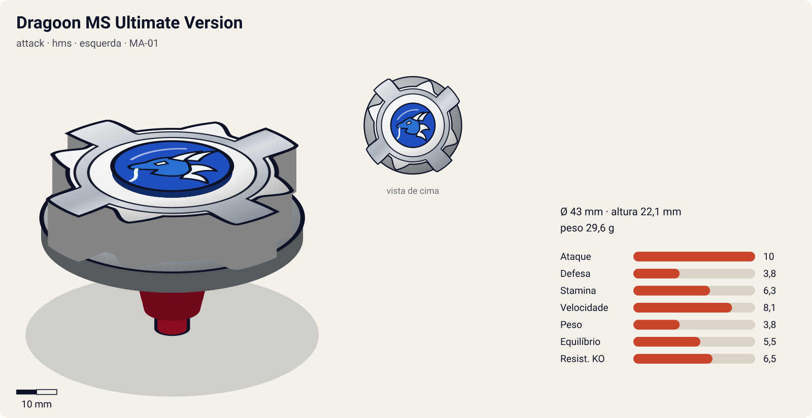
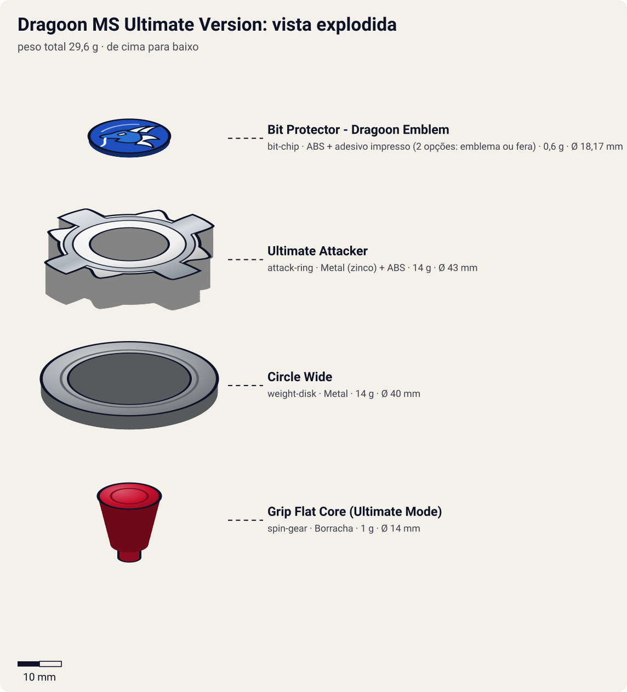

# Dragoon MS Ultimate Version (ドラグーンMS〈メタルストーム〉 アルティメットバージョン / Doragūn Metaru Sutōmu Arutimetto Bājon)

<!-- auto:inicio (gerado por npm run build:research; não edite este bloco) -->

| Ficha | |
|---|---|
| Dono | [Tyson Granger (木ノ宮タカオ / Kinomiya Takao)](../../README.md) |
| Tipo · sistema · rotação | attack · hms · esquerda |
| Código do produto | MA-01 |
| Montada | Ø 43 mm · altura 22,1 mm · **29,6 g** (soma das peças) |
| Fera bit | [Dragoon](../../../../feras-bit/dragoon/) |
| Lançador | [Dual Shooter (HMS)](../../../../lancadores/dual-shooter/) |
| Ripcord | [g-winder](../../../../lancadores/ripcords/g-winder/) |

### Peças

| Camada | Peça | Material | Ø mm | Altura mm | Peso g | Estrelas Takara (A / D / S) | Desenho |
|---|---|---|---|---|---|---|---|
| Bit Chip | [Bit Protector - Dragoon Emblem](../../../../pecas/bit-chip/dragoon-emblem/) | ABS + adesivo impresso (2 opções: emblema ou fera) | 18,2 comunidade | 6,7 comunidade | 0,6 comunidade | — | [ver](pecas/bit-chip.svg) |
| Attack Ring | [Ultimate Attacker](../../../../pecas/attack-ring/ultimate-attacker/) | Metal (zinco) + ABS | 43 estimado | 8 estimado | 14 wiki | 4,5 / 2,5 / 1 | [ver](pecas/attack-ring.svg) |
| Weight Disk | [Circle Wide](../../../../pecas/weight-disk/circle-wide/) | Metal | 40 estimado | 3,1 estimado | 14 wiki | 1 / 1 / 3 | [ver](pecas/weight-disk.svg) |
| Spin Gear / Core | [Grip Flat Core (Ultimate Mode)](../../../../pecas/spin-gear/grip-flat-core-ultimate-mode/) | Borracha | 14 estimado | 11 estimado | 1 wiki | 4 / 1 / 0,5 | [ver](pecas/spin-gear.svg) |

Fonte de cada medida em subscrito (wiki, comunidade, estimado). Detalhes em cada ficha de peça.

### Atributos

| Atributo | Brinquedo (calculado) | Ajuste anime | Jogo |
|---|---|---|---|
| Ataque | 7,3 | +3 | **10** |
| Defesa | 3,8 | — | **3,8** |
| Stamina | 4,3 | +2 | **6,3** |
| Velocidade | 8,1 | — | **8,1** |
| Peso | 3,8 | — | **3,8** |
| Equilíbrio | 5,5 | — | **5,5** |
| Resistência a KO | 5,5 | +1 | **6,5** |

Calculado por `src/beyblade/stats.js` a partir de: ponta grip-flat (atrito 0,7), contato smash (recoil 0,4), peso do WD na periferia. Modelo em [docs/BEYBLADES.md](../../../../../docs/BEYBLADES.md).

### Fera bit em cima da bey

 

Sons: [invocacao](../../../../feras-bit/dragoon/sons/invocacao.wav) · [rugido](../../../../feras-bit/dragoon/sons/rugido.wav) · [ataque](../../../../feras-bit/dragoon/sons/ataque.wav). Animações: [invocação](../../../../feras-bit/dragoon/invocacao.svg) · [ataque](../../../../feras-bit/dragoon/ataque.svg).
<!-- auto:fim -->

| Campo | Valor |
|---|---|
| Código do produto | MA-01 (Takara, novembro de 2003) |
| Sistema | Hard Metal System (HMS) |
| Rotação | Esquerda (frame metálico "Left Spike"). Não confirmado se aceita as duas rotações como a MS |
| Fera Bit | [Dragoon](../../../../feras-bit/dragoon/). No anime aparece **alado e com aura de fogo** na luta com o Brooklyn |
| Série / temporada | G-Revolution (2003) |
| Primeira aparição (anime) | G-Rev ep. 52 "Beybattle for the Ages" (episódio final) |
| Antecessora → Sucessora | Dragoon MS → (Dragoon MF, só no mangá e no brinquedo) |

Outros nomes: "Dragoon Metal Storm Ultimated" (manual japonês) e "Full Metal Jacket Dragoon" (mangá).

## Formato e geometria
- Vista de cima: compacta, 4 cabeças + 4 pontas metálicas (8 saliências, simetria de 4).
- [Bit Protector Dragoon Emblem](../../../../pecas/bit-chip/dragoon-emblem/): adesivo do emblema (fundo **vermelho**) ou do Dragoon (fundo amarelo, arte diferente da MS).
- [Ultimate Attacker](../../../../pecas/attack-ring/ultimate-attacker/) (14 g): a mesma peça de ABS "Cross Wings" do Metal Attacker com uma **nova moldura metálica "Left Spike"**: 4 cabeças de dragão + 4 pontas de ataque com pequenas protuberâncias que concentram a pressão do impacto. Smash confiável, um pouco melhor que o do Metal Attacker; feito para a rotação esquerda (na direita as protuberâncias ficam de costas).
- [Circle Wide](../../../../pecas/weight-disk/circle-wide/) (14 g): Wide circular liso, inércia periférica.
- [Grip Flat Core (Ultimate Mode)](../../../../pecas/spin-gear/grip-flat-core-ultimate-mode/) (1 g): ponta flat de **borracha vermelha macia com 5 mm** (mais larga que a da MS, de ~4 mm). Tração e mobilidade **extremas**, muito disputada no competitivo e muito difícil de controlar.
- Mais metal no contorno que a MS: pressão maior no contato. Perfil muito baixo.

## Comportamento na arena
- **Movimento**: o mais rápido e agressivo da linha Dragoon. A ponta de 5 mm dá ainda mais grip que a da MS, e o controle é difícil.
- **Ataque**: smash metálico concentrado.
- **Defesa / Stamina**: baixas no brinquedo, como na MS.
- **Matchups**: no anime, vence o Brooklyn (Zeus), considerado invencível (vitória implícita). Depois começa a luta final com o Kai, sem resultado mostrado.

## No anime
- **Evolução no ep. 52**: dentro da dimensão criada pelo Brooklyn, o Evolution Storm da Dragoon MS não surte efeito. Com o poder das **feras bit de todos os amigos**, a Dragoon MS **evolui para a Ultimate Version** e o Dragoon aparece alado e envolto em chamas. O resultado não é mostrado, mas a vitória do Tyson fica implícita. No epílogo, o Tyson e o Kai começam a batalha deles, sem resultado (é o fim da série). Nessa última luta, o Dragoon aparece na forma normal.
- **Especiais**: o golpe final contra o Brooklyn não recebe nome nas fontes (**não confirmado**). O **Ultimate Storm** (武神風撃 / アルティメットストーム) é **só do mangá**.

## Mecânica no jogo
- **Padrão de movimento (IA)**: `agressivo` no máximo, com mais ruído de trajetória que a MS (desvio de ±15° por segundo).
- **Gimmick — Ridge Boost** (passiva): +25% de velocidade por 1 s perto do tornado ridge (no máximo uma vez a cada 3 s). Perfil baixo: choques contra beys altas contam como upper (o adversário perde 20% do atrito por 1 s).
- **Especiais** (efeitos da [fera bit Dragoon](../../../../feras-bit/dragoon/): `invocacao.svg` e `ataque.svg`; no especial de virada, o Dragoon alado e em chamas pede uma variante de cor/aura do `ataque.svg`, ainda não desenhada; sons `rugido.wav` e `ataque.wav`):
  - **Evolution Storm** (herdado): como na MS, com dano 2,4×. Custo 100 de energia, recarga 22 s.
  - **"Ultimate Dragoon – Poder dos Amigos"** (nome sugerido, porque o anime não nomeia o golpe): especial de **virada**, disponível uma vez por partida quando a rotação cai abaixo de 30%. Recupera 25% da rotação, fica 1,5 s imune a knockback e faz um dash com o Dragoon alado: dano 3× e knockback 2,5×. Ignora o bônus de defesa de especiais de barreira e de dimensão do adversário (no ep. 52 a evolução rompe a dimensão do Brooklyn). Custo 100 de energia, uso único.

## Ajuste do anime

| Atributo | Delta | Justificativa (episódio/batalha) |
|---|---|---|
| Ataque | +3 | A forma final do Dragoon com o poder das feras dos amigos rompe a defesa do Zeus, que tinha anulado o Evolution Storm (ep. 52) |
| Stamina | +2 | Sobrevive à dimensão do Brooklyn, onde o Zeus tirava a força das feras, e termina a luta girando (vitória implícita, ep. 52) |
| Resistência a KO | +1 | Não é arremessada pelo Zeus na luta final, apesar de ser uma bey de borracha leve |

Resultado esperado: com o ajuste (soma +6, o máximo), a UV fica perto de Ataque 9,6 e Stamina 8,0 e deve vencer o Zeus por ataque (vitória implícita do ep. 52), sem virar uma bey de stamina; a Defesa continua baixa, como numa attacker.

**Suspeitas para o coordenador**: o Ultimate Attacker, o Circle Wide e o Grip Flat Core (Ultimate Mode) estão **sem estrelas Takara** no catálogo, e por isso o brinquedo calculado sai com Ataque **menor** que o da Dragoon MS (6,6 contra 7,8), embora a UV seja a evolução da MS. O `ATRIBUTOS-ORIGEM.md` cita o Ultimate Attacker com 4,5 de ataque. Se as estrelas forem preenchidas, o Ataque com ajuste passa de 10 e o +3 pode ser reduzido.

## Fontes
- https://beyblade.fandom.com/wiki/Dragoon_MS_Ultimate_Version
- https://beyblade.fandom.com/wiki/Dragoon_MS
- https://beyblade.fandom.com/wiki/Ultimate_Storm_(Manga)
- https://beyblade.fandom.com/wiki/Beyblade:_G-Revolution_-_Episode_51
- https://beyblade.fandom.com/wiki/Beyblade:_G-Revolution_-_Episode_52

### Inconsistências nas fontes
- A tabela de batalhas da página do Tyson põe a luta com o Brooklyn nos "ep. 50–51" e a luta com o Kai no "ep. 51". As páginas dos episódios põem a estreia da Ultimate Version e o desfecho no **ep. 52** (G-Rev tem 52 episódios). Adotamos ep. 51–52.
