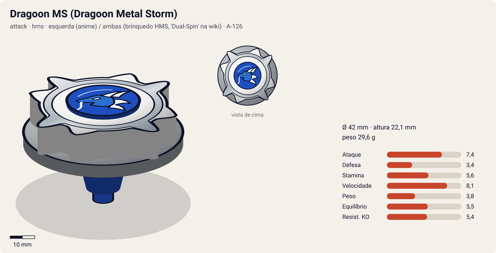
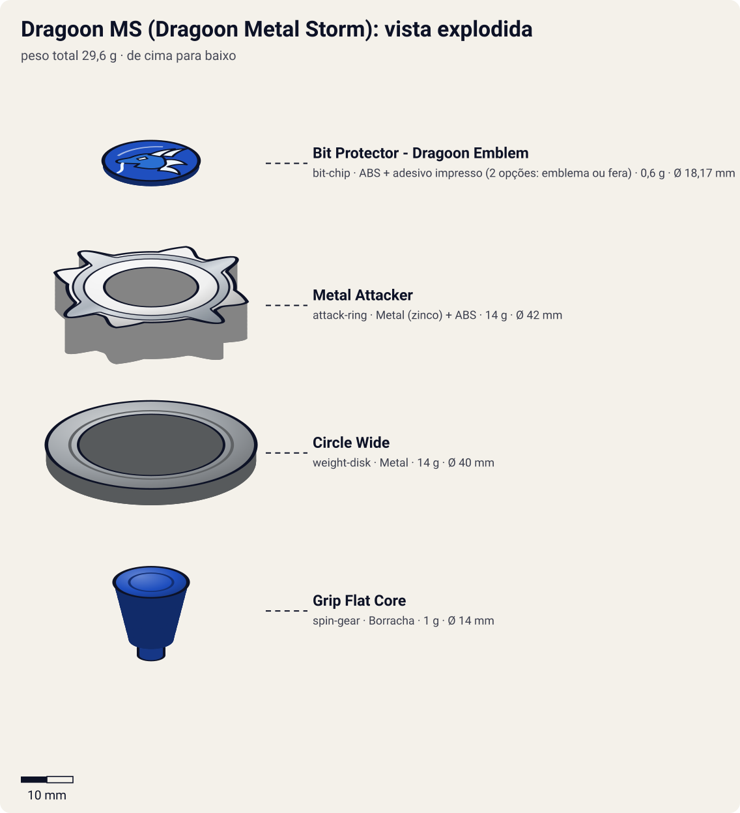

# Dragoon MS – Dragoon Metal Storm (ドラグーンＭＳ〈メタルストーム〉 / Doragūn Metaru Sutōmu)

<!-- auto:inicio (gerado por npm run build:research; não edite este bloco) -->

| Ficha | |
|---|---|
| Dono | [Tyson Granger (木ノ宮タカオ / Kinomiya Takao)](../../README.md) |
| Tipo · sistema · rotação | attack · hms · esquerda (anime) / ambas (brinquedo HMS, 'Dual-Spin' na wiki) |
| Código do produto | A-126 |
| Montada | Ø 42 mm · altura 22,1 mm · **29,6 g** (soma das peças) |
| Fera bit | [Dragoon](../../../../feras-bit/dragoon/) |
| Lançador | [Dual Shooter (HMS)](../../../../lancadores/dual-shooter/) |
| Ripcord | [g-winder](../../../../lancadores/ripcords/g-winder/) |

### Peças

| Camada | Peça | Material | Ø mm | Altura mm | Peso g | Estrelas Takara (A / D / S) | Desenho |
|---|---|---|---|---|---|---|---|
| Bit Chip | [Bit Protector - Dragoon Emblem](../../../../pecas/bit-chip/dragoon-emblem/) | ABS + adesivo impresso (2 opções: emblema ou fera) | 18,2 comunidade | 6,7 comunidade | 0,6 comunidade | — | [ver](pecas/bit-chip.svg) |
| Attack Ring | [Metal Attacker](../../../../pecas/attack-ring/metal-attacker/) | Metal (zinco) + ABS | 42 estimado | 8 estimado | 14 wiki | 4 / 2 / 1 | [ver](pecas/attack-ring.svg) |
| Weight Disk | [Circle Wide](../../../../pecas/weight-disk/circle-wide/) | Metal | 40 estimado | 3,1 estimado | 14 wiki | 1 / 1 / 3 | [ver](pecas/weight-disk.svg) |
| Spin Gear / Core | [Grip Flat Core](../../../../pecas/spin-gear/grip-flat-core/) | Borracha | 14 estimado | 11 estimado | 1 wiki | 3 / 1 / 1 | [ver](pecas/spin-gear.svg) |

Fonte de cada medida em subscrito (wiki, comunidade, estimado). Detalhes em cada ficha de peça.

### Atributos

| Atributo | Brinquedo (calculado) | Ajuste anime | Jogo |
|---|---|---|---|
| Ataque | 6,4 | +1 | **7,4** |
| Defesa | 3,4 | — | **3,4** |
| Stamina | 4,6 | +1 | **5,6** |
| Velocidade | 8,1 | — | **8,1** |
| Peso | 3,8 | — | **3,8** |
| Equilíbrio | 5,5 | — | **5,5** |
| Resistência a KO | 5,4 | — | **5,4** |

Calculado por `src/beyblade/stats.js` a partir de: ponta grip-flat (atrito 0,7), contato smash (recoil 0,5), peso do WD na periferia. Modelo em [docs/BEYBLADES.md](../../../../../docs/BEYBLADES.md).

### Fera bit em cima da bey

 

Sons: [invocacao](../../../../feras-bit/dragoon/sons/invocacao.wav) · [rugido](../../../../feras-bit/dragoon/sons/rugido.wav) · [ataque](../../../../feras-bit/dragoon/sons/ataque.wav). Animações: [invocação](../../../../feras-bit/dragoon/invocacao.svg) · [ataque](../../../../feras-bit/dragoon/ataque.svg).
<!-- auto:fim -->

| Campo | Valor |
|---|---|
| Dono | Tyson Granger (desenvolvida pelo Kenny, com ajuda da Emily e do Miguel) |
| Código do produto | A-126 (Takara, setembro de 2003. Hasbro, 2004) |
| Sistema | Hard Metal System (HMS) |
| Rotação | Esquerda no anime (linha Dragoon). A wiki marca o brinquedo como "Dual-Spin" (o HMS permite lançar para os dois lados) |
| Fera Bit | [Dragoon](../../../../feras-bit/dragoon/) (dragão azul, vento) |
| Série / temporada | G-Revolution (2003) |
| Primeira aparição (anime) | G-Rev ep. 39 "Rebel Alliance" |
| Antecessora → Sucessora | Dragoon GT → Dragoon MS Ultimate Version |

## Formato e geometria
- Vista de cima: compacta (HMS é **menor** que a era plástica), 4 pontas metálicas, simetria de 4.
- [Bit Protector Dragoon Emblem](../../../../pecas/bit-chip/dragoon-emblem/): ABS branco (1º molde, o mais frouxo), com adesivo do emblema ou da fera. No HMS é a trava das peças.
- [Metal Attacker](../../../../pecas/attack-ring/metal-attacker/) (14 g): **4 pontas de metal expostas** com pontas arredondadas (ABS por cima, moldura metálica). Smash bom na época, depois superado. As pontas arredondadas funcionam nos dois sentidos, mas o ângulo de ataque favorece a esquerda.
- [Circle Wide](../../../../pecas/weight-disk/circle-wide/) (14 g): Wide **perfeitamente circular** e liso, com peso na borda.
- [Grip Flat Core](../../../../pecas/spin-gear/grip-flat-core/) (Running Core, 1 g): ponta de **borracha muito macia** de ~4 mm, com uma aba de borracha a ~2 mm da base que pode raspar no tornado ridge. Grip enorme e movimento muito rápido. É o RC **mais baixo** que existe (ótimo para upper e smash) e o mais leve. No HMS o RC substitui a base.
- Metal no AR + Circle Wide: densa e com momento de inércia alto para o tamanho. Perfil **muito baixo**: acerta por baixo da maioria dos adversários.

## Comportamento na arena
- **Movimento**: muito agressivo e rápido. Se for lançada inclinada, a aba de borracha encosta no ridge e acelera ainda mais. É difícil de controlar.
- **Ataque**: smash metálico de 4 pontos com contato baixo.
- **Defesa**: baixa a média.
- **Stamina**: baixa (borracha macia).
- **Matchups**: perde para o Miguel (Dark Gargoyle) no 1º teste (ep. 40, ainda sem saber controlar o HMS). Vence a dupla da BEGA (ep. 41) e o Garland (Apollon, ep. 49). Enfrenta o Brooklyn (Zeus) nos ep. 51–52.

## No anime
- Nasce porque as beys do Tyson e do Ray ficaram destruídas no ep. 37 e a BEGA cortou o acesso a peças. O Kenny desenvolve o sistema HMS com a ajuda do Miguel e da Emily (ep. 38–39). No início o HMS é "complicado demais" e o Dragoon chega a fugir do Tyson no treino (ep. 40, volta ao básico).
- **Ataque especial**: **Evolution Storm**, estreia no ep. 49 "Principles of Victory" contra o Garland. O Tyson e o Dragoon criam um **tornado gigante**. O Dragoon sai pela base do tornado, voa contra o adversário e colide com a fera bit dele. É o último golpe principal do anime original.
- **Batalhas marcantes**: ep. 49, vence o Garland no Justice 5. Ep. 51–52, enfrenta o Brooklyn (Zeus) numa dimensão paralela. O Evolution Storm não faz efeito e a bey evolui para a **Ultimate Version** com o poder das feras de todos os amigos.

## Mecânica no jogo
- **Padrão de movimento (IA)**: `agressivo` com **controle difícil**: velocidade alta e trajetória com ruído (desvio aleatório de ±12° por segundo). Investidas por baixo do adversário.
- **Gimmick — Ridge Boost** (passiva, da aba de borracha do RC): ao passar perto do tornado ridge, +20% de velocidade por 1 s (no máximo uma vez a cada 3 s). Perfil baixo: choques contra beys altas contam como upper (o adversário perde 20% do atrito por 1 s).
- **Especiais** (efeitos da [fera bit Dragoon](../../../../feras-bit/dragoon/): fase 1 com `storm`/`funnel` do `ataque.svg`; fase 2 com `beast`, `speed` e `slashes`; som `rugido.wav` no lançamento do Dragoon):
  - **Evolution Storm**: fase 1 cria um tornado de raio 2,5× por 2 s que puxa os adversários para perto. Fase 2 dispara o Dragoon num dash de longo alcance (1 s, +100% de velocidade) contra o adversário mais próximo: dano 2,2× e knockback 2×. Custo 100 de energia, recarga 24 s.

## Ajuste do anime

| Atributo | Delta | Justificativa (episódio/batalha) |
|---|---|---|
| Ataque | +1 | O Evolution Storm vence o Garland e o Apollon no Justice 5 (ep. 49), um dos bladers mais fortes da BEGA |
| Stamina | +1 | Aguenta a luta longa com o Brooklyn na dimensão paralela até evoluir (ep. 51–52), apesar da borracha macia |

Resultado esperado: vence o Apollon e a maioria da BEGA, mas **não** deve vencer o Zeus sozinha (no anime o Evolution Storm falha contra ele; a vitória só vem com a Ultimate Version).

**Suspeita para o coordenador**: o Circle Wide está sem estrelas Takara no catálogo; a soma escalada pode estar puxando a Stamina para baixo (3,5) e a Defesa (3,7) também.

## Fontes
- https://beyblade.fandom.com/wiki/Dragoon_MS
- https://beyblade.fandom.com/wiki/Evolution_Storm
- https://beyblade.fandom.com/wiki/Beyblade:_G-Revolution_-_Episode_40
- https://beyblade.fandom.com/wiki/Beyblade:_G-Revolution_-_Episode_51
- https://beyblade.fandom.com/wiki/Beyblade:_G-Revolution_-_Episode_52
- https://beyblade.fandom.com/wiki/Tyson_Granger (Plot: G Revolutions, Justice 5)
