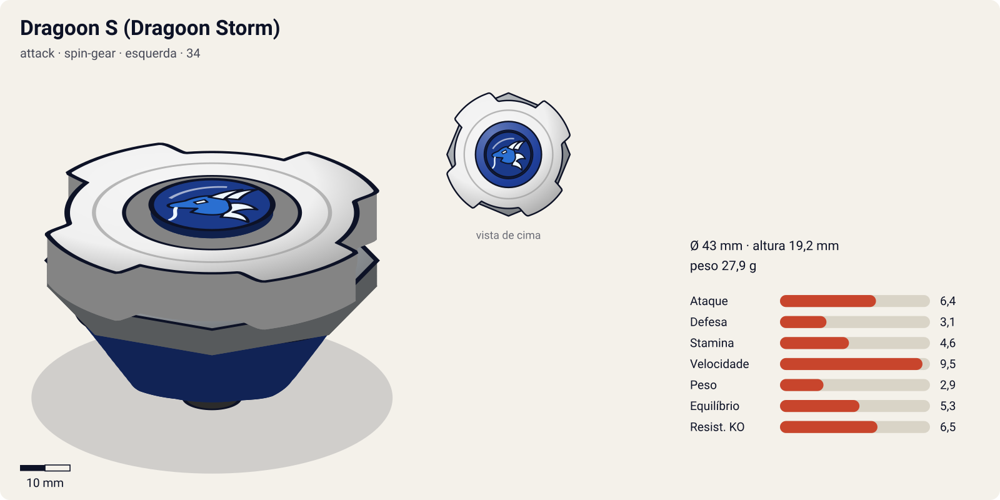
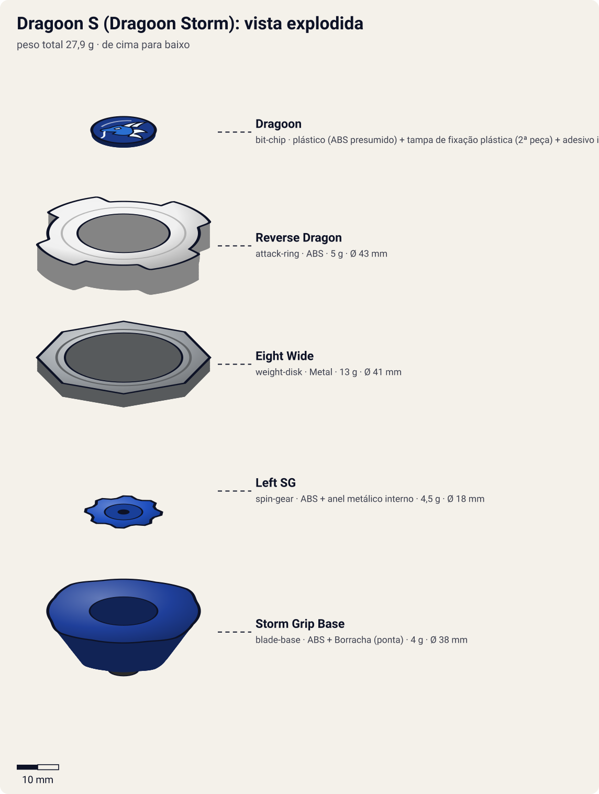

# Dragoon S – Dragoon Storm (ドラグーンS〈ストーム〉 / Doragūn Sutōmu)

<!-- auto:inicio (gerado por npm run build:research; não edite este bloco) -->

| Ficha | |
|---|---|
| Dono | [Tyson Granger (木ノ宮タカオ / Kinomiya Takao)](../../README.md) |
| Tipo · sistema · rotação | attack · spin-gear · esquerda |
| Código do produto | 34 |
| Montada | Ø 43 mm · altura 19,2 mm · **27,9 g** (soma das peças) |
| Fera bit | [Dragoon](../../../../feras-bit/dragoon/) |
| Lançador | [Left EZ Shooter (lançador esquerdo original, "Dragoon")](../../../../lancadores/left-ez-shooter/) |
| Ripcord | [dragon-winder](../../../../lancadores/ripcords/dragon-winder/) |

### Peças

| Camada | Peça | Material | Ø mm | Altura mm | Peso g | Estrelas Takara (A / D / S) | Desenho |
|---|---|---|---|---|---|---|---|
| Bit Chip | [Dragoon](../../../../pecas/bit-chip/dragoon/) | plástico (ABS presumido) + tampa de fixação plástica (2ª peça) + adesivo impresso com a fera | 15 estimado | 5 estimado | 1,4 comunidade | — | [ver](pecas/bit-chip.svg) |
| Attack Ring | [Reverse Dragon](../../../../pecas/attack-ring/reverse-dragon/) | ABS | 43 estimado | 6 estimado | 5 wiki | 2 / 2 / 2 | [ver](pecas/attack-ring.svg) |
| Weight Disk | [Eight Wide](../../../../pecas/weight-disk/eight-wide/) | Metal | 41 estimado | 3,2 estimado | 13 wiki | 0,5 / 1 / 3,5 | [ver](pecas/weight-disk.svg) |
| Spin Gear / Core | [Left SG](../../../../pecas/spin-gear/left-sg/) | ABS + anel metálico interno | 18 estimado | 10 estimado | 4,5 estimado | — | [ver](pecas/spin-gear.svg) |
| Blade Base | [Storm Grip Base](../../../../pecas/blade-base/storm-grip-base/) | ABS + Borracha (ponta) | 38 estimado | 10 estimado | 4 wiki | 3,5 / 1 / 1 | [ver](pecas/blade-base.svg) |

Fonte de cada medida em subscrito (wiki, comunidade, estimado). Detalhes em cada ficha de peça.

### Atributos

| Atributo | Brinquedo (calculado) | Ajuste anime | Jogo |
|---|---|---|---|
| Ataque | 5,4 | +1 | **6,4** |
| Defesa | 3,1 | — | **3,1** |
| Stamina | 4,6 | — | **4,6** |
| Velocidade | 9,5 | — | **9,5** |
| Peso | 2,9 | — | **2,9** |
| Equilíbrio | 5,3 | — | **5,3** |
| Resistência a KO | 5,5 | +1 | **6,5** |

Calculado por `src/beyblade/stats.js` a partir de: ponta grip (atrito 0,9), contato smash (recoil 0,5), peso do WD na periferia. Modelo em [docs/BEYBLADES.md](../../../../../docs/BEYBLADES.md).

### Fera bit em cima da bey

 

Sons: [invocacao](../../../../feras-bit/dragoon/sons/invocacao.wav) · [rugido](../../../../feras-bit/dragoon/sons/rugido.wav) · [ataque](../../../../feras-bit/dragoon/sons/ataque.wav). Animações: [invocação](../../../../feras-bit/dragoon/invocacao.svg) · [ataque](../../../../feras-bit/dragoon/ataque.svg).
<!-- auto:fim -->

| Campo | Valor |
|---|---|
| Código do produto | 34 (Takara, julho de 2000) |
| Sistema | Spin Gear System |
| Rotação | Esquerda (primeira bey de rotação esquerda de todo o brinquedo) |
| Fera Bit | [Dragoon](../../../../feras-bit/dragoon/) (Seiryū, o dragão azul do vento) |
| Série / temporada | Bakuten Shoot (2001), temporada 1 |
| Primeira aparição (anime) | Ep. 02 "Day of the Dragoon" (usada até o ep. 23 "Showdown in Vegas") |
| Antecessora → Sucessora | Dragoon Grip Attacker → Dragoon F |

## Formato e geometria
- Vista de cima: 4 pontas de dragão em simetria de 4 lados, raio médio.
- [Reverse Dragon](../../../../pecas/attack-ring/reverse-dragon/): primeiro AR feito para atacar na rotação **esquerda**. Tem 4 bordas de smash; em contra-rotação contra beys de rotação direita, os choques somam as velocidades e ficam mais violentos. Na rotação direita as bordas ficam de costas e o AR perde quase todo o ataque.
- [Eight Wide](../../../../pecas/weight-disk/eight-wide/) octogonal e largo, com a massa na periferia: mobilidade, inércia e força no smash.
- [Left SG](../../../../pecas/spin-gear/left-sg/) com abas invertidas para lançador esquerdo: define a rotação.
- [Storm Grip Base](../../../../pecas/blade-base/storm-grip-base/) baixa, com ponta de **borracha**: a melhor base de ataque antes do sistema Magne. A borracha gasta com o uso.
- Massa total baixa (~28–30 g) e perfil baixo, bom para acertar por baixo de beys mais altas.

## Comportamento na arena
- **Movimento**: órbita agressiva e rápida (rubber flat), com flower pattern quando lançada inclinada.
- **Ataque**: smash em contra-rotação.
- **Defesa**: baixa a média. É leve e vulnerável a defensores pesados.
- **Stamina**: baixa (borracha).
- **Matchups**: ganha de attackers e balance leves (Kai no ep. 7; empate com o Lee/Galeon no ep. 17). Perde para defensores de ponta bola, como a Draciel Metal Ball Defenser do Max (ep. 3), que bloqueia os ataques.

## No anime
- **Ataques especiais**:
  - **Storm Attack** (ストームアタック, Sutōmu Atakku), estreia no ep. 6. A bey gera uma coluna de ar giratória (tornado) e o Dragoon sai do chip. O tornado faz de barreira e arremessa o adversário para cima. Em troca, a Dragoon S perde mobilidade e às vezes fica parada enquanto o golpe dura.
  - **Ultimate Storm Attack**: listado na wiki sem descrição (detalhes não confirmados).
  - Truque de lançamento (ep. 4, contra o Carlos e os Blade Sharks): lançar com o **lançador virado para cima** faz a Dragoon S "sumir e reaparecer".
- **Batalhas marcantes**: ep. 2, empate com o Kai (Dranzer S), com Dragoon e Dranzer aparecendo. Ep. 3, derrota para o Max. Ep. 4, vitória no battle royale contra o Carlos e os Blade Sharks. Ep. 7, vitória sobre o Kai na final regional. Torneio asiático (Kevin, Ray, Lee). Ep. 21, derrota para o Antonio.
- **Substituição**: para o torneio americano, o Kenny faz o upgrade para a Dragoon F (ep. 23).

## Mecânica no jogo
- **Padrão de movimento (IA)**: `agressivo`: órbita rápida perto da borda, com investidas em contra-rotação. Ao ativar o Storm Attack muda para `centro` (para no lugar).
- **Gimmick**: rotação esquerda. Contra beys de rotação direita, o choque usa a soma das velocidades de contato (mais dano e mais recoil para os dois).
- **Especiais** (efeitos visuais da [fera bit Dragoon](../../../../feras-bit/dragoon/): `invocacao.svg` ao ativar, grupos `storm`/`funnel` do `ataque.svg` para o tornado; som `ataque.wav`):
  - **Storm Attack**: tornado em volta da bey por 4 s, raio 1,5× o da bey. Quem encosta recebe knockback 2× para cima/para fora. A bey fica quase parada (velocidade −80%). Custo 100 de energia, recarga 20 s.
- **Habilidade de lançamento — "Lançamento invertido"** (ep. 4): 2 s em que a IA adversária não consegue mirar a bey. Uso único por partida.

## Ajuste do anime

| Atributo | Delta | Justificativa (episódio/batalha) |
|---|---|---|
| Ataque | +1 | Com o Dragoon desperto, empata com a Dranzer S (ep. 2) e vence o Kai na final regional (ep. 7) |
| Resistência a KO | +1 | O Storm Attack funciona como barreira e segura a bey no estádio contra o battle royale dos Blade Sharks (ep. 4) e o torneio asiático |

Resultado esperado: vence a Dranzer S e attackers leves da S1, mas continua perdendo para a Draciel Metal Ball Defenser (ep. 3), como no anime.

## Fontes
- https://beyblade.fandom.com/wiki/Dragoon_S
- https://beyblade.fandom.com/wiki/Attack_Ring_-_Reverse_Dragon
- https://beyblade.fandom.com/wiki/Weight_Disk_-_Eight_Wide
- https://beyblade.fandom.com/wiki/Spin_Gear_-_Left_SG
- https://beyblade.fandom.com/wiki/Blade_Base_-_Storm_Grip
- https://beyblade.fandom.com/wiki/Storm_Attack
- https://beyblade.fandom.com/wiki/Ultimate_Storm_Attack
- https://beyblade.fandom.com/wiki/Tyson_Granger (seção "Plot" e tabela de batalhas)
