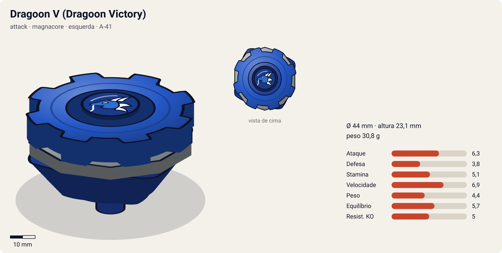
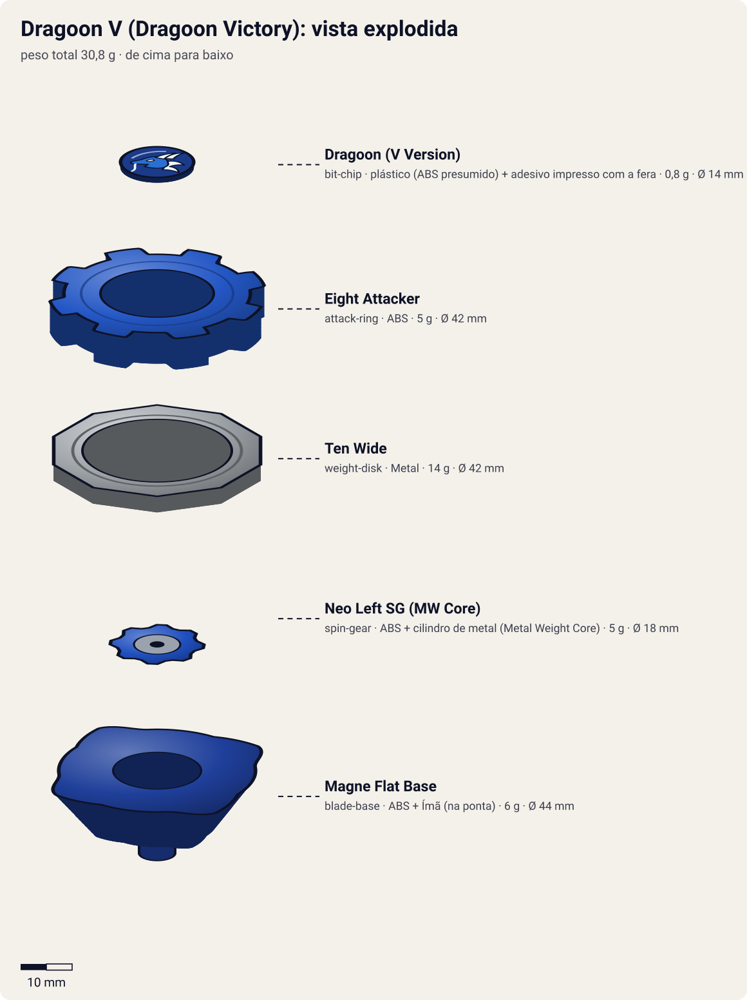

# Dragoon V – Dragoon Victory (ドラグーンＶ〈ビクトリー〉 / Doragūn Bikutorī)

<!-- auto:inicio (gerado por npm run build:research; não edite este bloco) -->

| Ficha | |
|---|---|
| Dono | [Tyson Granger (木ノ宮タカオ / Kinomiya Takao)](../../README.md) |
| Tipo · sistema · rotação | attack · magnacore · esquerda |
| Código do produto | A-41 |
| Montada | Ø 44 mm · altura 23,1 mm · **30,8 g** (soma das peças) |
| Fera bit | [Dragoon](../../../../feras-bit/dragoon/) |
| Lançador | [Neo Reverse Shooter (Neo Left EZ Shooter)](../../../../lancadores/neo-reverse-shooter/) |
| Ripcord | [dragon-winder](../../../../lancadores/ripcords/dragon-winder/) |

### Peças

| Camada | Peça | Material | Ø mm | Altura mm | Peso g | Estrelas Takara (A / D / S) | Desenho |
|---|---|---|---|---|---|---|---|
| Bit Chip | [Dragoon (V Version)](../../../../pecas/bit-chip/dragoon-v/) | plástico (ABS presumido) + adesivo impresso com a fera | 14 estimado | 8 estimado | 0,8 comunidade | — | [ver](pecas/bit-chip.svg) |
| Attack Ring | [Eight Attacker](../../../../pecas/attack-ring/eight-attacker/) | ABS | 42 estimado | 6 estimado | 5 estimado | 2,5 / 2 / 1 | [ver](pecas/attack-ring.svg) |
| Weight Disk | [Ten Wide](../../../../pecas/weight-disk/ten-wide/) | Metal | 42 estimado | 3,1 estimado | 14 wiki | 1 / 1,5 / 4 | [ver](pecas/weight-disk.svg) |
| Spin Gear / Core | [Neo Left SG (MW Core)](../../../../pecas/spin-gear/neo-left-sg-mw-core/) | ABS + cilindro de metal (Metal Weight Core) | 18 estimado | 10 estimado | 5 wiki | — | [ver](pecas/spin-gear.svg) |
| Blade Base | [Magne Flat Base](../../../../pecas/blade-base/magne-flat-base/) | ABS + Ímã (na ponta) | 44 estimado | 14 estimado | 6 estimado | 3 / 1 / 1 | [ver](pecas/blade-base.svg) |

Fonte de cada medida em subscrito (wiki, comunidade, estimado). Detalhes em cada ficha de peça.

### Atributos

| Atributo | Brinquedo (calculado) | Ajuste anime | Jogo |
|---|---|---|---|
| Ataque | 5,3 | +1 | **6,3** |
| Defesa | 3,8 | — | **3,8** |
| Stamina | 5,1 | — | **5,1** |
| Velocidade | 6,9 | — | **6,9** |
| Peso | 4,4 | — | **4,4** |
| Equilíbrio | 5,7 | — | **5,7** |
| Resistência a KO | 5 | — | **5** |

Calculado por `src/beyblade/stats.js` a partir de: ponta flat (atrito 0,5), contato smash (recoil 0,6), peso do WD na periferia. Modelo em [docs/BEYBLADES.md](../../../../../docs/BEYBLADES.md).

### Fera bit em cima da bey

 

Sons: [invocacao](../../../../feras-bit/dragoon/sons/invocacao.wav) · [rugido](../../../../feras-bit/dragoon/sons/rugido.wav) · [ataque](../../../../feras-bit/dragoon/sons/ataque.wav). Animações: [invocação](../../../../feras-bit/dragoon/invocacao.svg) · [ataque](../../../../feras-bit/dragoon/ataque.svg).
<!-- auto:fim -->

| Campo | Valor |
|---|---|
| Código do produto | A-41 (Takara, dezembro de 2001, 980 ienes. Hasbro, 2003) |
| Sistema | Magnacore System |
| Rotação | Esquerda |
| Fera Bit | [Dragoon](../../../../feras-bit/dragoon/) (dragão azul, vento) |
| Série / temporada | V-Force (2002) |
| Primeira aparição (anime) | V-Force ep. 01 "Shot Down in Flames" |
| Antecessora → Sucessora | Dragoon F → Dragoon V2 |

## Formato e geometria
- Vista de cima: 8 pontas pequenas em anel (simetria de 8), raio grande por causa do Ten Wide.
- [Eight Attacker](../../../../pecas/attack-ring/eight-attacker/): 8 protuberâncias para smash na rotação esquerda. Tem muito vão entre as pontas, então o recoil anula boa parte do dano. Na rotação direita as pontas ficam de costas e o contato vira raspão.
- [Ten Wide](../../../../pecas/weight-disk/ten-wide/) decagonal, o mais largo da série Wide: inércia e alcance.
- [Neo Left SG (MW Core)](../../../../pecas/spin-gear/neo-left-sg-mw-core/): rotação esquerda e um cilindro de metal (Metal Weight Core) que põe peso no centro.
- [Magne Flat Base](../../../../pecas/blade-base/magne-flat-base/): 4 asas no corpo para smash e eixo flat de **plástico duro com ímã embutido** (Magnacore). O plástico dura mais que a borracha, mas é menos rápido e menos controlável. O ímã interage com estádios e WDs magnéticos.
- Massa periférica + metal central: inércia boa (~33 g). Altura média.

## Comportamento na arena
- **Movimento**: flower pattern largo e rápido (flat de plástico). Menos explosivo que a borracha, mas consistente por mais tempo.
- **Ataque**: muitos contatos pequenos. Recoil considerável.
- **Defesa**: baixa a média.
- **Stamina**: média-baixa. O flat de plástico gasta menos que a borracha.
- **Matchups**: perde para o Ozuma (Flash Leopard) duas vezes (ep. 1 e 3, na 2ª com o Dragoon "falhando") e para a IA que lê os movimentos (ep. 4). Ganha do Snakey (Sabel Cobra), do Daryl (ep. 11), do Ozuma (ep. 14) e do Kane (Cyber Dragoon, ep. 25–27).

## No anime
- **Ataque especial**: **Victory Tornado** (勝利竜巻 / ビクトリートルネード, Bikutorī Torunēdo), estreia no V-Force ep. 11 contra o Daryl (Darylanzer). No anime, a bey avança envolta num vórtice giratório. No mangá, é um tornado de múltiplos vórtices que repele vários adversários.
- **Batalhas marcantes**: ep. 1, derrota para o "Mr. X" (Ozuma). Ep. 4, consegue recuperar o Dragoon contra a IA do navio. Ep. 17, empate com o Kane. Ep. 25–27, vitória sobre o Kane e a Cyber Dragoon (cópia ciborgue do Dragoon).
- **Substituição**: fica danificada no prédio da Psykick. Em Nova York, a Judy Tate (mãe do Max) cria a Dragoon V2 (ep. 30).

## Mecânica no jogo
- **Padrão de movimento (IA)**: `flower` largo e rápido, com investidas quando o adversário estiver perto.
- **Gimmick — Magnacore** (passiva): perto de outra bey Magnacore, atração (+30% de frequência de choques) ou repulsão (−30%), conforme o polo escolhido antes da partida.
- **Especiais** (efeitos da [fera bit Dragoon](../../../../feras-bit/dragoon/): `invocacao.svg`; no golpe, grupos `funnel`, `speed` e `slashes` do `ataque.svg`):
  - **Victory Tornado**: a bey vira um projétil envolto em vórtice e faz uma investida guiada ao adversário (dash de 1,5 s, +60% de velocidade). Golpe com dano 1,8× e knockback 1,5×. Diferente dos tornados da S1, ela **se move** durante o golpe. Custo 100 de energia, recarga 20 s.

## Ajuste do anime

| Atributo | Delta | Justificativa (episódio/batalha) |
|---|---|---|
| Ataque | +1 | O Victory Tornado vence o Daryl (ep. 11), o Ozuma (ep. 14) e o Kane/Cyber Dragoon (ep. 25–27) |

Resultado esperado: ajuste pequeno, porque a bey também perde duas vezes para o Flash Leopard (ep. 1 e 3) e para a IA do ep. 4. Ganha de rivais médios da V-Force e fica atrás da V2.

## Fontes
- https://beyblade.fandom.com/wiki/Dragoon_V
- https://beyblade.fandom.com/wiki/Attack_Ring_-_Eight_Attacker
- https://beyblade.fandom.com/wiki/Blade_Base_-_Magne_Flat_Base
- https://beyblade.fandom.com/wiki/Weight_Disk_-_Ten_Wide
- https://beyblade.fandom.com/wiki/Victory_Tornado
- https://beyblade.fandom.com/wiki/Beyblade_VForce_-_Episode_03 , https://beyblade.fandom.com/wiki/Beyblade_VForce_-_Episode_04
