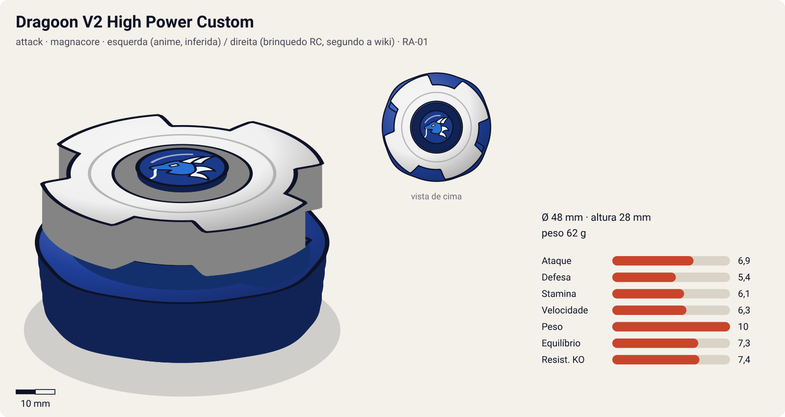
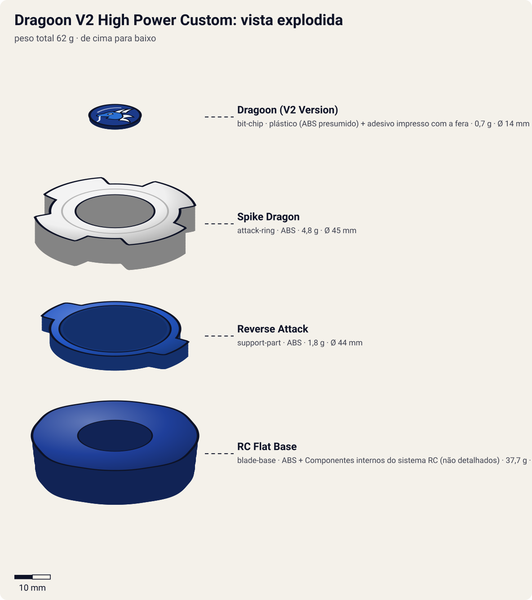

# Dragoon V2 High Power Custom (ドラグーンV2 ハイパワーカスタム / Doragūn Bikutorī Tsū Hai Pawā Kasutamu)

<!-- auto:inicio (gerado por npm run build:research; não edite este bloco) -->

| Ficha | |
|---|---|
| Dono | [Tyson Granger (木ノ宮タカオ / Kinomiya Takao)](../../README.md) |
| Tipo · sistema · rotação | attack · magnacore · esquerda (anime, inferida) / direita (brinquedo RC, segundo a wiki) |
| Código do produto | RA-01 |
| Montada | Ø 48 mm · altura 28 mm · **62 g** (soma das peças) |
| Fera bit | [Dragoon](../../../../feras-bit/dragoon/) |
| Lançador | [Neo Reverse Shooter (Neo Left EZ Shooter)](../../../../lancadores/neo-reverse-shooter/) |
| Ripcord | [neo-dragon-winder](../../../../lancadores/ripcords/neo-dragon-winder/) |

### Peças

| Camada | Peça | Material | Ø mm | Altura mm | Peso g | Estrelas Takara (A / D / S) | Desenho |
|---|---|---|---|---|---|---|---|
| Bit Chip | [Dragoon (V2 Version)](../../../../pecas/bit-chip/dragoon-v2/) | plástico (ABS presumido) + adesivo impresso com a fera | 14 estimado | 8 estimado | 0,7 comunidade | — | [ver](pecas/bit-chip.svg) |
| Attack Ring | [Spike Dragon](../../../../pecas/attack-ring/spike-dragon/) | ABS | 45 estimado | 8 estimado | 4,8 wiki | 3 / 1,5 / 1 | [ver](pecas/attack-ring.svg) |
| Support Part | [Reverse Attack](../../../../pecas/support-part/reverse-attack/) | ABS | 44 estimado | 4 estimado | 1,8 wiki | 2 / 0 / 0 | [ver](pecas/support-part.svg) |
| Blade Base | [RC Flat Base](../../../../pecas/blade-base/rc-flat-base/) | ABS + Componentes internos do sistema RC (não detalhados) | 48 estimado | 20 estimado | 37,7 wiki | — | [ver](pecas/blade-base.svg) |

Fonte de cada medida em subscrito (wiki, comunidade, estimado). Detalhes em cada ficha de peça.

### Atributos

| Atributo | Brinquedo (calculado) | Ajuste anime | Jogo |
|---|---|---|---|
| Ataque | 5,9 | +1 | **6,9** |
| Defesa | 5,4 | — | **5,4** |
| Stamina | 5,1 | +1 | **6,1** |
| Velocidade | 4,3 | +2 | **6,3** |
| Peso | 10 | — | **10** |
| Equilíbrio | 7,3 | — | **7,3** |
| Resistência a KO | 6,4 | +1 | **7,4** |

Calculado por `src/beyblade/stats.js` a partir de: ponta semi-flat (atrito 0,3), contato spike (recoil 0,8). Modelo em [docs/BEYBLADES.md](../../../../../docs/BEYBLADES.md).

### Fera bit em cima da bey

 

Sons: [invocacao](../../../../feras-bit/dragoon/sons/invocacao.wav) · [rugido](../../../../feras-bit/dragoon/sons/rugido.wav) · [ataque](../../../../feras-bit/dragoon/sons/ataque.wav). Animações: [invocação](../../../../feras-bit/dragoon/invocacao.svg) · [ataque](../../../../feras-bit/dragoon/ataque.svg).
<!-- auto:fim -->

| Campo | Valor |
|---|---|
| Dono | Tyson Granger (customização feita pelo Kenny) |
| Código do produto | RA-01 (Takara, linha **RC Beyblade**, 2004. A Hasbro lançou por engano como "Dragoon V") |
| Sistema | Magnacore System (série V2). O brinquedo é a versão radiocontrolada |
| Rotação | Anime: esquerda, como toda a linha Dragoon pós-S1 (inferência). Brinquedo RC: **direita**, segundo o infobox. Ver inconsistências |
| Fera Bit | [Dragoon](../../../../feras-bit/dragoon/) (dragão azul, vento) |
| Série / temporada | V-Force (2002) |
| Primeira aparição (anime) | V-Force ep. 47 "Deceit From Above" |
| Antecessora → Sucessora | Dragoon V2 → Dragoon G |

Outros nomes: "Dragoon Ultimate Customize" (anime JP, dito pelo Kenny) e "Dragoon Tune Up" (dublagem EN).

## Formato e geometria
- Vista de cima: a mesma silhueta de 4 cabeças da V2. A RC Flat Base é mais larga, então o raio total aumenta.
- [Spike Dragon](../../../../pecas/attack-ring/spike-dragon/): igual ao da V2, 4 cabeças com faces planas e ranhuras. Smash esquerdo devastador, com recoil severo; inútil na rotação direita (o que pesa contra o brinquedo RC de rotação direita).
- [Reverse Attack](../../../../pecas/support-part/reverse-attack/): igual ao da V2, contatos extras baixos.
- Weight Disk e Spin Gear: **não informados** para a versão RC. No anime presume-se o Magne WD herdado da V2.
- [RC Flat Base](../../../../pecas/blade-base/rc-flat-base/) (37,7 g): base **larga e pesada** de rotação direita, com ponta **semi-flat** (amarela no anime e na Takara, branca na Hasbro), feita para ser radiocontrolada com o lançador próprio. O peso muito maior muda tudo: mais inércia e menos aceleração.
- Muito mais pesada que a V2, com o peso concentrado embaixo. Perfil alto e largo.

## Comportamento na arena
- **Anime**: na prática é uma V2 "afinada" pelo Kenny para o Mundial. Ataca com mais potência e resiste melhor (aguenta os raios da Dra. K no ep. 47 e vence a Burning Kerberous do Zeo).
- **Brinquedo**: semi-flat, pesada, com direção controlável por RC (gimmick de brinquedo, sem equivalente no anime).
- **Ataque**: máximo (Spike Dragon com mais massa).
- **Defesa/Stamina**: um pouco melhores que as da V2 por causa da massa (estimativa).
- **Matchups**: vence King (Uriel), Max (Draciel V2, ep. 49), Gordo (Orthros, ep. 50) e Zeo (Burning Kerberous, ep. 51). Contra o Kai no ep. 49, sem resultado.

## No anime
- **Ep. 47**: o Kenny ajusta a V2 no "custom definitivo" (não é uma bey nova, e sim a melhor versão dela). Contra o King, a Dra. K tenta desativar o Dragoon com um feixe de partículas do teto, sem sucesso.
- **Ep. 49–51**: Mundial. Vitórias sobre o Max, o Gordo e, na final, o Zeo e a Burning Kerberous, que dão o bicampeonato.
- **Especiais**: o anime não lista um golpe próprio para a versão HPC. Presume-se o **Hyper Victory Tornado** herdado (**não confirmado** pelas fontes como nome usado nesses episódios).

## Mecânica no jogo
- **Padrão de movimento (IA)**: `orbita` agressiva, mais "pesada" e menos errática que a V2 (sem a chance de auto-KO da V2).
- **Gimmick — "Tune Up"** (passiva, nome da dublagem EN): o recoil que a bey sofre cai 30% em relação à V2. O controle remoto do brinquedo não entra no jogo.
- **Especiais** (efeitos da [fera bit Dragoon](../../../../feras-bit/dragoon/), iguais aos da V2):
  - **Hyper Victory Tornado (Custom)**: dash vermelho de 2,5 s (+70% de velocidade), dano 2,3× e knockback 2×, imune a recoil. Custo 100 de energia, recarga 22 s.

## Ajuste do anime

| Atributo | Delta | Justificativa (episódio/batalha) |
|---|---|---|
| Ataque | +1 | "Custom definitivo" do Kenny: vence Uriel (ep. 47), Draciel V2 (ep. 49), Orthros (ep. 50) e Burning Kerberous na final (ep. 51) |
| Velocidade | +2 | No anime ela anda como a V2, em órbita agressiva; a lentidão do brinquedo vem da RC Flat Base de 37,7 g, que não aparece no anime |
| Stamina | +1 | Vence a final longa contra o Zeo, que tem a bey mais forte da temporada |
| Resistência a KO | +1 | Aguenta o feixe de partículas da Dra. K contra o King (ep. 47) sem sair do estádio |

Resultado esperado: a bey mais forte da V-Force do Tyson, capaz de vencer a Burning Kerberous do Zeo na final.

**Suspeita para o coordenador**: as peças desta ficha são as do brinquedo RC (RA-01), não as do anime. A RC Flat Base (37,7 g, provavelmente com motor/eletrônica dentro) leva o Peso a 10 e a Velocidade a 4,3, e o brinquedo gira para a **direita**, o que deixa o Spike Dragon sem função. O +2 de Velocidade descreve o anime, mas o certo seria decidir se a ficha deve modelar a bey do anime (V2 com Magne WD e Customize Grip) em vez do RC.

## Fontes
- https://beyblade.fandom.com/wiki/Dragoon_V2_High_Power_Custom
- https://beyblade.fandom.com/wiki/Dragoon_V2
- https://beyblade.fandom.com/wiki/Beyblade:_V-Force_-_Episode_47
- https://beyblade.fandom.com/wiki/Beyblade:_V-Force_-_Episode_51
- https://beyblade.fandom.com/wiki/Tyson_Granger (tabela de batalhas)

### Inconsistências nas fontes
- A página da Dragoon V2 diz que a **V2** foi usada até a final contra o Zeo. A página da HPC e a do ep. 47 dizem que ela foi ajustada para **HPC** no ep. 47. As páginas dos ep. 51 listam apenas "Dragoon V2". Aqui adotamos HPC do ep. 47 ao 51.
- O infobox do brinquedo diz "Right-Spin", mas a página do Tyson afirma que todas as Dragoons dele (menos a Grip Attacker) são de rotação esquerda. A rotação direita vale para o brinquedo RC. No anime, provavelmente esquerda.
- A Spike Dragon é descrita como lançada em "dezembro de 2001" na página da peça, mas a Dragoon V2 saiu em julho de 2002 (dezembro de 2001 é a data da Dragoon V).
