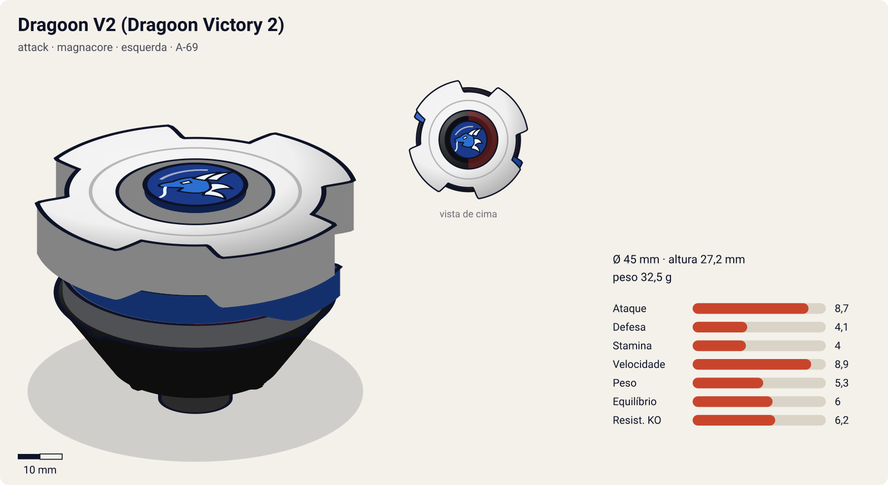
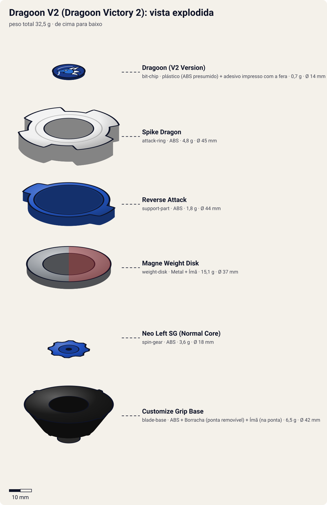

# Dragoon V2 – Dragoon Victory 2 (ドラグーンV2〈ビクトリー・ツー〉 / Doragūn Bikutorī Tsū)

<!-- auto:inicio (gerado por npm run build:research; não edite este bloco) -->

| Ficha | |
|---|---|
| Dono | [Tyson Granger (木ノ宮タカオ / Kinomiya Takao)](../../README.md) |
| Tipo · sistema · rotação | attack · magnacore · esquerda |
| Código do produto | A-69 |
| Montada | Ø 45 mm · altura 27,2 mm · **32,5 g** (soma das peças) |
| Fera bit | [Dragoon](../../../../feras-bit/dragoon/) |
| Lançador | [Neo Reverse Shooter (Neo Left EZ Shooter)](../../../../lancadores/neo-reverse-shooter/) |
| Ripcord | [dragon-winder](../../../../lancadores/ripcords/dragon-winder/) |

### Peças

| Camada | Peça | Material | Ø mm | Altura mm | Peso g | Estrelas Takara (A / D / S) | Desenho |
|---|---|---|---|---|---|---|---|
| Bit Chip | [Dragoon (V2 Version)](../../../../pecas/bit-chip/dragoon-v2/) | plástico (ABS presumido) + adesivo impresso com a fera | 14 estimado | 8 estimado | 0,7 comunidade | — | [ver](pecas/bit-chip.svg) |
| Attack Ring | [Spike Dragon](../../../../pecas/attack-ring/spike-dragon/) | ABS | 45 estimado | 8 estimado | 4,8 wiki | 3 / 1,5 / 1 | [ver](pecas/attack-ring.svg) |
| Support Part | [Reverse Attack](../../../../pecas/support-part/reverse-attack/) | ABS | 44 estimado | 4 estimado | 1,8 wiki | 2 / 0 / 0 | [ver](pecas/support-part.svg) |
| Weight Disk | [Magne Weight Disk](../../../../pecas/weight-disk/magne-weight-disk/) | Metal + Ímã | 37 estimado | 3,2 estimado | 15,1 wiki | 3 / 3 / 3 | [ver](pecas/weight-disk.svg) |
| Spin Gear / Core | [Neo Left SG (Normal Core)](../../../../pecas/spin-gear/neo-left-sg-normal-core/) | ABS | 18 estimado | 10 estimado | 3,6 wiki | — | [ver](pecas/spin-gear.svg) |
| Blade Base | [Customize Grip Base](../../../../pecas/blade-base/customize-grip-base/) | ABS + Borracha (ponta removível) + Ímã (na ponta) | 42 estimado | 16 estimado | 6,5 wiki | 4 / 1 / 1 | [ver](pecas/blade-base.svg) |

Fonte de cada medida em subscrito (wiki, comunidade, estimado). Detalhes em cada ficha de peça.

### Atributos

| Atributo | Brinquedo (calculado) | Ajuste anime | Jogo |
|---|---|---|---|
| Ataque | 7,7 | +1 | **8,7** |
| Defesa | 4,1 | — | **4,1** |
| Stamina | 4 | — | **4** |
| Velocidade | 8,9 | — | **8,9** |
| Peso | 5,3 | — | **5,3** |
| Equilíbrio | 6 | — | **6** |
| Resistência a KO | 5,2 | +1 | **6,2** |

Calculado por `src/beyblade/stats.js` a partir de: ponta grip (atrito 0,9), contato spike (recoil 0,8), peso do WD na equilibrado. Modelo em [docs/BEYBLADES.md](../../../../../docs/BEYBLADES.md).

### Fera bit em cima da bey

 

Sons: [invocacao](../../../../feras-bit/dragoon/sons/invocacao.wav) · [rugido](../../../../feras-bit/dragoon/sons/rugido.wav) · [ataque](../../../../feras-bit/dragoon/sons/ataque.wav). Animações: [invocação](../../../../feras-bit/dragoon/invocacao.svg) · [ataque](../../../../feras-bit/dragoon/ataque.svg).
<!-- auto:fim -->

| Campo | Valor |
|---|---|
| Dono | Tyson Granger (criada pela Judy Tate, segundo o infobox) |
| Código do produto | A-69 (Takara, julho de 2002). Nome de desenvolvimento: "Dragoon X" |
| Sistema | Magnacore System (série V2, com Support Parts) |
| Rotação | Esquerda |
| Fera Bit | [Dragoon](../../../../feras-bit/dragoon/) (dragão azul, vento) |
| Série / temporada | V-Force (2002) |
| Primeira aparição (anime) | V-Force ep. 30 "Get a Piece of the Rock" |
| Antecessora → Sucessora | Dragoon V → Dragoon V2 High Power Custom (ajuste do Kenny no ep. 47) → Dragoon G |

## Formato e geometria
- Vista de cima: 4 grandes cabeças de dragão em simetria de 4, raio grande, com contatos em faces planas.
- [Spike Dragon](../../../../pecas/attack-ring/spike-dragon/): AR grosso com 4 cabeças de dragão e cristas que terminam em **faces planas, grossas e verticais**, cada uma com 4 ranhuras paralelas ("Spike Attack"). Smash esquerdo **devastador** (bom para OHKO), mas as faces largas geram **recoil severo**. Na rotação direita é inútil.
- [Reverse Attack](../../../../pecas/support-part/reverse-attack/) (Support Part, 0,9 g cada): peças laterais encaixadas na base que dão mais pontos de contato baixos.
- [Magne Weight Disk](../../../../pecas/weight-disk/magne-weight-disk/): disco com face N e face S (inverte o polo ao virar). Polos iguais se repelem (batalha de stamina) e polos opostos se atraem (choques violentos e constantes).
- [Neo Left SG (Normal Core)](../../../../pecas/spin-gear/neo-left-sg-normal-core/): núcleo de **tubo plástico oco** no lugar de metal ou ímã. Pouco peso sobre a ponta, então o peso fica todo na periferia: bom para smash.
- [Customize Grip Base](../../../../pecas/blade-base/customize-grip-base/): base relativamente **alta** com ponta **removível de borracha flat** azul de bordas arredondadas e ímã. Muito rápida e agressiva; a altura atrapalha contra beys baixas, e as bordas arredondadas escorregam pelo tornado ridge e causam **auto-KO**. Aceita núcleos, SPs e pontas.
- Perfil **alto**: vulnerável a upper attack e com dificuldade de acertar beys baixas.

## Comportamento na arena
- **Movimento**: órbita agressiva e muito rápida pela borda (borracha flat). Tende a escapar pelo ridge se for lançada mal ou depois de choques fortes.
- **Ataque**: o smash esquerdo mais forte da era plástica do Tyson. "Tudo ou nada".
- **Defesa**: baixa. O recoil a joga longe.
- **Stamina**: baixa.
- **Matchups**: ganha de attackers e balance (Kenny, Saint Shields, Zeo, Raymond, King). Empata com o Max (Draciel V2, ep. 34), o Ozuma (Flash Leopard 2, ep. 39) e o Kai (Dranzer V2, ep. 40).

## No anime
- **Ataques especiais**:
  - **Hyper Victory Tornado** (超勝利竜巻 / ハイパービクトリートルネード, Haipā Bikutorī Torunēdo), estreia no ep. 39 contra o Ozuma (Flash Leopard 2). A bey **brilha em vermelho** e avança dentro de um redemoinho feroz.
  - **Vanishing Attack** e **Wave Attack**: só o Tyson usa, estreia no ep. 30. As fontes não trazem descrição (**não confirmado**). Os nomes sugerem, respectivamente, desaparecer e reaparecer e um ataque em ondas.
- **Batalhas marcantes**: ep. 30, contra o Kenny e os Saint Shields (com o Zeo). Ep. 32, contra o Zeo (Zeronix). Ep. 39, empate na batalha final com o Ozuma. Ep. 40, empate com o Kai. Ep. 43, contra o Raymond. Ep. 47, contra o King (Uriel), resistindo aos raios de próton do laser da Dra. K.
- **Filme "Fierce Battle"** (não canônico): a Dragoon V2 fica **vermelha** depois que o Dragoon é selado e volta.
- **Evolução**: no ep. 47 o Kenny ajusta a bey para a [Dragoon V2 High Power Custom](../dragoon-v2-high-power-custom/). Depois vem a Dragoon G.

## Mecânica no jogo
- **Padrão de movimento (IA)**: `orbita` agressiva pela borda + `agressivo` (investidas). 8% de chance de auto-KO depois de um choque frontal forte perto da borda (bordas arredondadas da ponta).
- **Gimmick — polaridade Magne** (passiva): atração (+30% de frequência de choques) ou repulsão (−30%) contra outra bey magnética, escolhida antes da partida. Ponta intercambiável fora da partida (Customize Grip).
- **Especiais** (efeitos da [fera bit Dragoon](../../../../feras-bit/dragoon/): `invocacao.svg` com tom vermelho; no dash, grupos `funnel`, `speed` e `slashes` do `ataque.svg`):
  - **Hyper Victory Tornado**: dash vermelho de 2 s (+70% de velocidade) dentro do redemoinho. Golpe com dano 2× e knockback 2×; imune a recoil durante o dash. Custo 100 de energia, recarga 22 s.
  - **Vanishing Attack** (efeito estimado): 1,5 s inalvejável e o próximo choque causa +40% de dano. Custo 60, recarga 15 s.
  - **Wave Attack** (efeito estimado): 3 investidas curtas em ziguezague, cada uma com dano 1,2×. Custo 60, recarga 15 s.

## Ajuste do anime

| Atributo | Delta | Justificativa (episódio/batalha) |
|---|---|---|
| Ataque | +1 | O Hyper Victory Tornado empata com Draciel V2 (ep. 34), Flash Leopard 2 (ep. 39) e Dranzer V2 (ep. 40), e vence o Zeronix (ep. 32) |
| Resistência a KO | +1 | No anime o recoil do Spike Dragon quase nunca a tira do estádio; aguenta o laser da Dra. K contra o King (ep. 47) |

Resultado esperado: o brinquedo já é o attacker mais forte da era plástica; o ajuste é pequeno e deixa a bey no nível dos empates com Max, Ozuma e Kai, sem passar deles com folga.

**Suspeitas para o coordenador**: o catálogo dá ao Magne Weight Disk estrelas 3 / 3 / 3, alto para um WD (os Wide/Heavy ficam em 1–2 de ataque); a Spike Dragon está com 3 / 2 / 1 (valor da wiki), mas a Takara dá 3 / **1,5** / 1 (`ATRIBUTOS-ORIGEM.md`); e o Neo Left SG (Normal Core) tem estrelas 3 / 1 / 2, que não deveriam existir num Spin Gear comum. A Customize Grip Base está sem estrelas.

## Fontes
- https://beyblade.fandom.com/wiki/Dragoon_V2
- https://beyblade.fandom.com/wiki/Attack_Ring_-_Spike_Dragon
- https://beyblade.fandom.com/wiki/Hyper_Victory_Tornado
- https://beyblade.fandom.com/wiki/Vanishing_Attack
- https://beyblade.fandom.com/wiki/Wave_Attack
- https://beyblade.fandom.com/wiki/Beyblade:_V-Force_-_Episode_35
- https://beyblade.fandom.com/wiki/Beyblade:_V-Force_-_Episode_47
- https://beyblade.fandom.com/wiki/Tyson_Granger (tabela de batalhas)
