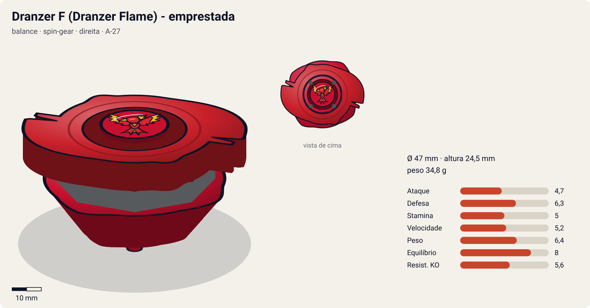
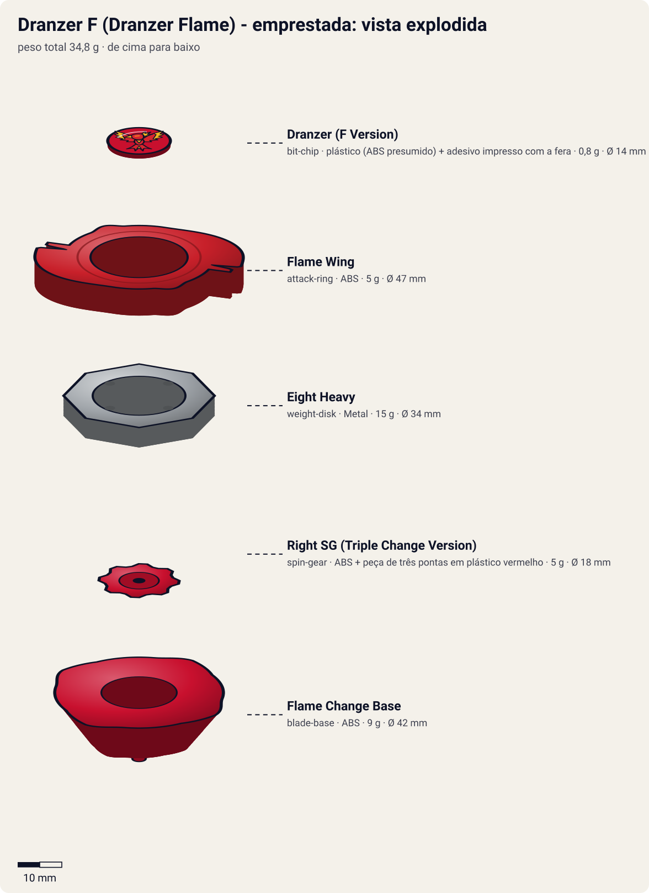

# Dranzer F – Dranzer Flame (emprestada do Kai)

<!-- auto:inicio (gerado por npm run build:research; não edite este bloco) -->

| Ficha | |
|---|---|
| Dono | [Tyson Granger (木ノ宮タカオ / Kinomiya Takao)](../../README.md) |
| Tipo · sistema · rotação | balance · spin-gear · direita |
| Código do produto | A-27 |
| Montada | Ø 47 mm · altura 24,5 mm · **34,8 g** (soma das peças) |
| Fera bit | [Dranzer](../../../../feras-bit/dranzer/) |
| Lançador | [EZ Shooter (Easy Shooter, rotação direita)](../../../../lancadores/ez-shooter/) |
| Ripcord | [winder-padrao](../../../../lancadores/ripcords/winder-padrao/) |

### Peças

| Camada | Peça | Material | Ø mm | Altura mm | Peso g | Estrelas Takara (A / D / S) | Desenho |
|---|---|---|---|---|---|---|---|
| Bit Chip | [Dranzer (F Version)](../../../../pecas/bit-chip/dranzer-f/) | plástico (ABS presumido) + adesivo impresso com a fera | 14 estimado | 8 estimado | 0,8 comunidade | — | [ver](pecas/bit-chip.svg) |
| Attack Ring | [Flame Wing](../../../../pecas/attack-ring/flame-wing/) | ABS | 47 estimado | 6 estimado | 5 wiki | 1,5 / 3 / 1,5 | [ver](pecas/attack-ring.svg) |
| Weight Disk | [Eight Heavy](../../../../pecas/weight-disk/eight-heavy/) | Metal | 34 estimado | 4,5 estimado | 15 wiki | 0,5 / 3 / 1,5 | [ver](pecas/weight-disk.svg) |
| Spin Gear / Core | [Right SG (Triple Change Version)](../../../../pecas/spin-gear/right-sg-triple-change-version/) | ABS + peça de três pontas em plástico vermelho | 18 estimado | 12 estimado | 5 wiki | — | [ver](pecas/spin-gear.svg) |
| Blade Base | [Flame Change Base](../../../../pecas/blade-base/flame-change-base/) | ABS | 42 estimado | 14 estimado | 9 wiki | 3 / 2 / 3 | [ver](pecas/blade-base.svg) |

Fonte de cada medida em subscrito (wiki, comunidade, estimado). Detalhes em cada ficha de peça.

### Atributos

| Atributo | Brinquedo (calculado) | Ajuste anime | Jogo |
|---|---|---|---|
| Ataque | 4,7 | — | **4,7** |
| Defesa | 6,3 | — | **6,3** |
| Stamina | 5 | — | **5** |
| Velocidade | 5,2 | — | **5,2** |
| Peso | 6,4 | — | **6,4** |
| Equilíbrio | 8 | — | **8** |
| Resistência a KO | 5,6 | — | **5,6** |

Calculado por `src/beyblade/stats.js` a partir de: ponta semi-flat (atrito 0,3), contato smash (recoil 0,6), peso do WD na centro. Modelo em [docs/BEYBLADES.md](../../../../../docs/BEYBLADES.md).

### Fera bit em cima da bey

 

Sons: [invocacao](../../../../feras-bit/dranzer/sons/invocacao.wav) · [rugido](../../../../feras-bit/dranzer/sons/rugido.wav) · [ataque](../../../../feras-bit/dranzer/sons/ataque.wav). Animações: [invocação](../../../../feras-bit/dranzer/invocacao.svg) · [ataque](../../../../feras-bit/dranzer/ataque.svg).
<!-- auto:fim -->

> **Bey emprestada.** A dona é a Dranzer F do **Kai Hiwatari** (ficha principal em [kai-hiwatari/dranzer-f](../../../kai-hiwatari/beyblades/dranzer-f/)). O Tyson a usou em 2 episódios da temporada 1. Aqui o foco é o uso pelo Tyson, sem deixar de cobrir a bey inteira para o jogo.

| Campo | Valor |
|---|---|
| Dono | Kai Hiwatari (o Tyson usou emprestada nos ep. 44–45 da S1) |
| Código do produto | A-27 (Takara/Hasbro) |
| Tipo | Balance |
| Sistema | Spin Gear System |
| Rotação | Direita |
| Fera Bit | [Dranzer](../../../../feras-bit/dranzer/) (fênix vermelha / Suzaku, fogo) |
| Série / temporada | Bakuten Shoot (2001), temporada 1 |
| Primeira aparição (anime) | Ep. 33 "Last Tangle in Paris" (com o Kai). Com o Tyson: ep. 44 "Losing Kai" / ep. 45 "Breaking the Ice" |

## Formato e geometria
- Vista de cima: lâminas em forma de asa de fênix com rampas, simetria de 4 lados (estimativa a partir das fotos da wiki), raio médio.
- [Flame Wing](../../../../pecas/attack-ring/flame-wing/): AR "multiuso", com pontas inclinadas para cima (rampa de ~10°) e dois entalhes rombudos na ponta de cada lâmina. Na rotação direita faz smash (entalhes) e upper fraco (rampas); os entalhes quebram com facilidade.
- [Eight Heavy](../../../../pecas/weight-disk/eight-heavy/) com a massa perto do centro: peso, RPM alto e boa defesa.
- [Right SG (Triple Change Version)](../../../../pecas/spin-gear/right-sg-triple-change-version/): uma peça vermelha de 3 pontas que, puxada para baixo, alterna entre ponta **flat, sharp e semi-flat**. O SG é alto e, em muitas unidades, a peça fica frouxa e trava entre duas pontas.
- [Flame Change Base](../../../../pecas/blade-base/flame-change-base/): base própria do Triple Change, funciona junto com o SG.
- Massa central (~33–35 g) e perfil **alto**, vulnerável a upper attack de beys baixas.

## Comportamento na arena
- **Movimento**: depende do modo da ponta. Sharp: fica no centro. Semi-flat: flower pattern moderado. Flat: órbita agressiva.
- **Ataque**: smash direito médio e upper fraco.
- **Defesa**: média-boa (Eight Heavy).
- **Stamina**: média. Boa em sharp, mas com o risco de a ponta travar entre modos.
- **Matchups**: equilibrada. No anime, a força veio da fera e da raiva da Dranzer por ter sido abandonada pelo Kai.

## No anime
- **Ep. 44 "Losing Kai"**: o Kai, já com a Black Dranzer, devolve a velha Dranzer F para o Tyson na abadia da BIOVOLT e o manda embora.
- **Ep. 45 "Breaking the Ice"**: no lago congelado, o Kai (Black Dranzer) derrota Tyson (Dragoon F), Ray e Kenny e quase rouba o Dragoon. O Max chega com a nova Draciel F. O Tyson **lança a Dranzer F junto com a Dragoon F** e consegue invocar a Dranzer: a raiva dele contra o Kai se soma à raiva da própria Dranzer por ter sido abandonada. As quatro feras (Dragoon, Dranzer, Driger e Draciel) vencem a Black Dranzer. O gelo quebra, o Kai é salvo e o Tyson devolve a Dranzer F a ele.
- **Especiais**: com o Kai, os especiais listados são "Flame Saber" e "Flame Thrower". O nome do golpe usado pelo Tyson com a Dranzer no ep. 45 **não foi confirmado**: as fontes só dizem que ele "invoca a Dranzer".
- Isso mostra que o Tyson consegue usar outras beys e até invocar outras feras.

## Mecânica no jogo
- **Padrão de movimento (IA)**: alternável: `centro` (sharp), `flower` (semi-flat) ou `orbita` (flat). Com o Tyson, a IA prefere o modo flat/agressivo.
- **Gimmick — troca de ponta (Triple Change)**: uma troca de modo por partida, escolhida pelo jogador. Muda o atrito da ponta (sharp 0,3 / semi-flat 0,5 / flat 0,6) e o padrão de movimento. 10% de chance de a troca "travar" e deixar a ponta no modo anterior (defeito do SG real).
- **Especiais** (efeitos da [fera bit Dranzer](../../../../feras-bit/dranzer/): `invocacao.svg` e `ataque.svg`):
  - **Flame Saber** (golpe do Kai): investida flamejante de 1 s com dano 1,8× e knockback 1,5×. Custo 100 de energia, recarga 20 s.
  - **"Fúria da Dranzer"** (exclusivo do Tyson, nome sugerido porque o anime não nomeia): só no evento de história do ep. 45, em modo "duas beys" ao lado da Dragoon F: +30% de ataque das duas beys por 6 s. Custo 100, uso único.

## Ajuste do anime

Sem ajuste (`{}`). Com o Tyson, a bey foi usada uma única vez e a vitória sobre a Black Dranzer veio da união das quatro feras, não da Dranzer F sozinha. O desempenho dela nas mãos do Kai fica para a ficha do Kai.

| Atributo | Delta | Justificativa (episódio/batalha) |
|---|---|---|
| — | 0 | Ep. 45: vence a Black Dranzer só junto com Dragoon F, Driger e Draciel |

Resultado esperado: com o Tyson, a mesma bey do brinquedo; no evento do ep. 45, a vitória vem do modo "duas beys", não dos atributos.

## Fontes
- https://beyblade.fandom.com/wiki/Dranzer_F
- https://beyblade.fandom.com/wiki/Attack_Ring_-_Flame_Wing
- https://beyblade.fandom.com/wiki/Beyblade_-_Episode_44
- https://beyblade.fandom.com/wiki/Beyblade_-_Episode_45
- https://beyblade.fandom.com/wiki/Tyson_Granger (seção "Skills": uso da Dranzer)
