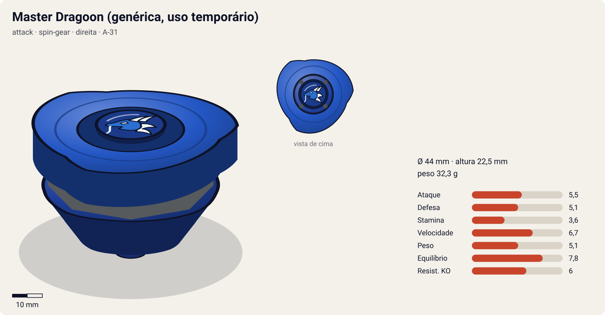
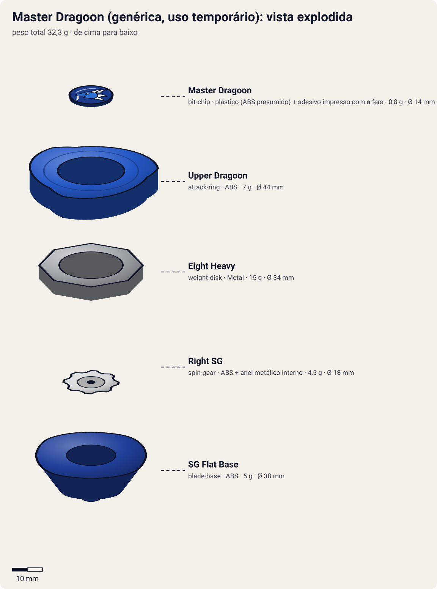

# Master Dragoon (bey genérica de treino, uso temporário)

<!-- auto:inicio (gerado por npm run build:research; não edite este bloco) -->

| Ficha | |
|---|---|
| Dono | [Tyson Granger (木ノ宮タカオ / Kinomiya Takao)](../../README.md) |
| Tipo · sistema · rotação | attack · spin-gear · direita |
| Código do produto | A-31 |
| Montada | Ø 44 mm · altura 22,5 mm · **32,3 g** (soma das peças) |
| Lançador | [EZ Shooter (Easy Shooter, rotação direita)](../../../../lancadores/ez-shooter/) |
| Ripcord | [winder-padrao](../../../../lancadores/ripcords/winder-padrao/) |

### Peças

| Camada | Peça | Material | Ø mm | Altura mm | Peso g | Estrelas Takara (A / D / S) | Desenho |
|---|---|---|---|---|---|---|---|
| Bit Chip | [Master Dragoon](../../../../pecas/bit-chip/master-dragoon/) | plástico (ABS presumido) + adesivo impresso com a fera | 14 estimado | 8 estimado | 0,8 comunidade | — | [ver](pecas/bit-chip.svg) |
| Attack Ring | [Upper Dragoon](../../../../pecas/attack-ring/upper-dragoon/) | ABS | 44 estimado | 7 estimado | 7 wiki | 3 / 1 / 1,5 | [ver](pecas/attack-ring.svg) |
| Weight Disk | [Eight Heavy](../../../../pecas/weight-disk/eight-heavy/) | Metal | 34 estimado | 4,5 estimado | 15 wiki | 0,5 / 3 / 1,5 | [ver](pecas/weight-disk.svg) |
| Spin Gear / Core | [Right SG](../../../../pecas/spin-gear/right-sg/) | ABS + anel metálico interno | 18 estimado | 10 estimado | 4,5 estimado | — | [ver](pecas/spin-gear.svg) |
| Blade Base | [SG Flat Base](../../../../pecas/blade-base/sg-flat-base/) | ABS | 38 estimado | 11 estimado | 5 wiki | 3 / 2 / 1 | [ver](pecas/blade-base.svg) |

Fonte de cada medida em subscrito (wiki, comunidade, estimado). Detalhes em cada ficha de peça.

### Atributos

| Atributo | Brinquedo (calculado) | Ajuste anime | Jogo |
|---|---|---|---|
| Ataque | 5,5 | — | **5,5** |
| Defesa | 5,1 | — | **5,1** |
| Stamina | 3,6 | — | **3,6** |
| Velocidade | 6,7 | — | **6,7** |
| Peso | 5,1 | — | **5,1** |
| Equilíbrio | 7,8 | — | **7,8** |
| Resistência a KO | 6 | — | **6** |

Calculado por `src/beyblade/stats.js` a partir de: ponta flat (atrito 0,5), contato upper (recoil 0,3), peso do WD na centro. Modelo em [docs/BEYBLADES.md](../../../../../docs/BEYBLADES.md).
<!-- auto:fim -->

> **Uso temporário, fora de batalha.** A wiki lista a Master Dragoon como "Generic model; borrowed" no infobox do Tyson. No anime, ela aparece como bey genérica usada por bladers amadores sem fera bit. O único uso confirmado pelo Tyson é no **V-Force ep. 28**: com as beys dele em conserto, ele lança a "practice blade" que recebeu na BBA de Nova York para **estourar o pneu do carro dos ladrões** que roubaram a pedra das feras bit. **Não houve batalha** contra outra bey. Se o jogo exigir uso em batalha, pode ser tratada só como bey genérica e destravável.

| Campo | Valor |
|---|---|
| Dono | Kenny (segundo a caixa, faz parte da "coleção do Kenny"). Tyson: uso temporário |
| Código do produto | A-31 (Takara, julho de 2001) |
| Tipo | Attack (upper attack) |
| Sistema | Spin Gear System |
| Rotação | Direita |
| Fera Bit | Nenhuma (bit chip "Master Dragoon" decorativo) |
| Série / temporada | Lançada na era da S1. Aparece como genérica em V-Force (ep. 1, 5, 6, 7, 28, 35) |
| Primeira aparição (anime) | V-Force ep. 01 (como genérica). Com o Tyson: V-Force ep. 28 "Hot Rock" (título EN da galeria da wiki) |

## Formato e geometria
- Vista de cima: quase circular, com 4 rampas longas (simetria de 4, estimativa pelas fotos).
- [Upper Dragoon](../../../../pecas/attack-ring/upper-dragoon/): rampas longas inclinadas para cima (~15° na rotação direita), quase perfeitamente redondo e um dos ARs mais pesados. **Upper attack**: levanta o adversário do chão, tira a defesa dele e facilita o KO; considerado o melhor AR de upper da rotação direita. Na rotação esquerda as rampas descem em vez de subir e o AR vira só um disco redondo.
- [Eight Heavy](../../../../pecas/weight-disk/eight-heavy/) com massa central: peso e estabilidade.
- [Right SG](../../../../pecas/spin-gear/right-sg/) padrão.
- [SG Flat Base](../../../../pecas/blade-base/sg-flat-base/): ponta flat de plástico e perfil baixo, boa para upper, considerada ultrapassada.
- Massa central (~32 g), estável. Perfil baixo, ideal para entrar por baixo dos adversários.

## Comportamento na arena
- **Movimento**: flower pattern médio (flat de plástico).
- **Ataque**: upper. Levanta e desestabiliza o adversário.
- **Defesa**: média (redonda e pesada no centro).
- **Stamina**: média-baixa.
- **Matchups**: boa contra beys altas e attackers. Fraca contra beys muito baixas, que escapam da rampa.

## No anime
- Bey de massa usada por figurantes sem fera bit (V-Force ep. 1, 5, 6, 7, 28, 35).
- V-Force ep. 28: o Tyson lança a "practice blade" de bicicleta e acerta o pneu do carro de fuga. O carro para e os ladrões fogem a pé.
- Sem especiais.

## Mecânica no jogo
- **Padrão de movimento (IA)**: `flower` médio. Tenta passar por baixo do adversário.
- **Gimmick**: nenhum. Passiva **"Upper"** (do AR): cada choque frontal tem 25% de chance de levantar o adversário, que perde 30% do atrito da ponta por 1 s (mais fácil de empurrar para fora).
- **Especiais**: nenhum especial de fera. No modo história, "lançamento de precisão" num alvo fixo (ep. 28).

## Ajuste do anime

Sem ajuste (`{}`). Bey genérica, sem fera bit e sem nenhuma batalha com o Tyson.

| Atributo | Delta | Justificativa (episódio/batalha) |
|---|---|---|
| — | 0 | V-Force ep. 28: só um lançamento contra o pneu de um carro, sem batalha |

Resultado esperado: igual ao brinquedo; uma bey genérica de upper para destravar.

## Fontes
- https://beyblade.fandom.com/wiki/Master_Dragoon
- https://beyblade.fandom.com/wiki/Blade_Base_-_SG_Flat_Base
- https://beyblade.fandom.com/wiki/Beyblade:_V-Force_-_Episode_28
- https://beyblade.fandom.com/wiki/Beyblade_VForce_-_Episode_01 (lista de beys)
- https://beyblade.fandom.com/wiki/Tyson_Granger (infobox: "Master Dragoon (Generic model; borrowed)")
